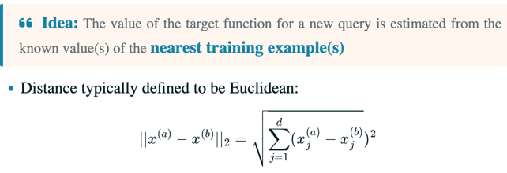
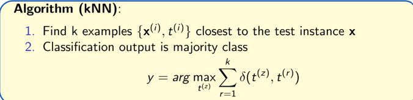
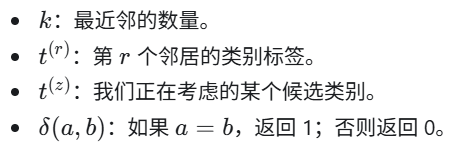
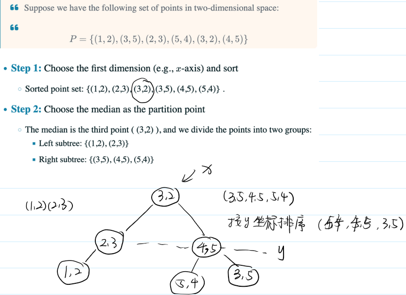
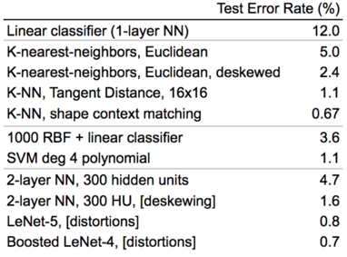

## What about non-parametric models?

Nonlinear Decision Boundaries(MLP is a parametric model, but KNN is a non-parametric model; linear regression has linear dicision boundaries, but KNN has nonlinear decision boundaries)

### we use the thought of nearest neighours，KNN stands for K-Nearest Neighbors.
 The key idea is to predict the output of a new input based on the outputs of its K nearest neighbors in the training data.

### Instance-based Learning（基于实例的学习）

KNN 是基于实例的学习方法：**保留训练样本，预测时利用与新输入相似的样本来推断输出。** 核心依据是：输入相近，输出通常也相近。

#### 1. 非参数模型（Non-parametric Models）

- **参数模型**：预先规定模型形式，用训练数据学习固定数量的参数。例如，结构固定的 MLP 通过训练确定权重和偏置。
- **非参数模型**：模型复杂度不受预先固定数量的参数限制，可以随训练样本数增长。KNN 保留训练样本，并在预测时使用它们。

注意：“非参数”不代表没有需要设置的量。KNN 的 **K 是参与预测的邻居数量**，属于超参数，即用于规定算法行为的设置。

#### 2. 可以处理分类与回归

基于实例的方法可以近似离散值或实数值的目标函数。这里的**目标函数**是希望学到的“输入到输出的映射”，不是训练时最小化的损失函数。

| 任务 | 输出 | KNN 的常见做法 |
| --- | --- | --- |
| 分类 | 离散类别 | 最近 K 个训练样本进行多数投票 |
| 回归 | 实数值 | 对最近 K 个训练样本的输出取平均 |

#### 3. 学习主要是存储，预测依赖相似性

- **学习阶段**：主要保存训练输入及其对应输出，通常不预先拟合一个全局预测函数，因此称为**惰性学习（Lazy Learning）**。实际实现中也可能进行数据预处理或建立搜索索引。
- **预测阶段**：根据距离寻找相似的训练样本，再综合它们的输出。距离越小，通常认为越相似。

#### 4. 两个常见的底层假设

**① 输出随输入平滑变化（Output varies smoothly with input）。**

KNN 用邻居的输出估计新样本的输出，因此需要输入的接近能够反映输出的接近。对于回归，这意味着输入小幅变化时输出通常也只小幅变化；对于分类，可以理解为局部区域内的样本往往属于同一类，但类别边界附近可能不成立。

**② 数据集中在高维输入空间中的低维子空间或结构附近。**

输入维度是描述一个样本所用的特征数量。特征很多，并不意味着这些特征能够彼此独立地任意变化。例如，图像有大量像素，但同一物体的图像变化可能主要受姿态、光照等少量因素控制。

因此，数据的有效变化自由度可能远小于输入维度。图片用“子空间”描述这一点；更一般地，这种低维结构也可以是弯曲的，不一定是线性代数中的线性子空间。这个假设也不自动保证 KNN 有效，距离仍需反映与任务相关的相似性。

> 对前文的补充：参数模型也可以产生非线性决策边界，例如 MLP。线性分类器的决策边界是线性的；线性回归本身预测连续值，通常不直接讨论分类决策边界。KNN 分类可以形成非线性决策边界。

> Vononoi diagram,拿来展示其decision boundaries.可以看到boundary是piecewise linear, 但总体是nonlinear.

相当于计数投票然后选票数最多的

### How do we choose $k$?

- Larger $k$ may lead to better performance
- But if we set $k$ too large we may end up looking at samples that are not neighbors (are far away from the query)
- We can use cross-validation to find $k$
- Rule of thumb is $k < \sqrt{n}$, where $n$ is the number of training examples

### issues

- if some coordinates have higher range, they may dominate the distance calculation, so we may want to weight the distance metric accordingly
    - then we may  normalize the data before applying KNN
    - but some features may be just more important than others, so we may want to weight the features accordingly
- expensive at test time. To find the nearest neighbors, we need to compute the distance from all N points. 
    - solution1: subset of demensions, use some of the features,not all of them
    - solution2: use some data structure to speed up the search, e.g. KD-tree.
        - 中位数划分是为了建立高效的搜索结构，而不是为了直接找到最近邻
        - 
    - from scipy.spatial import KDTree

### applications
- 识别手写字

- where on earth is this photo taken?