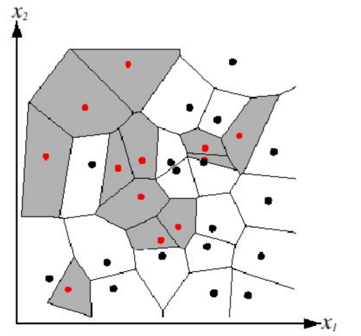

# KNN: K-Nearest Neighbors

[Original notes](KNN.md)

## What about non-parametric models?

KNN predicts an output from the outputs of nearby training examples. It can form nonlinear decision boundaries by combining local decisions across the input space.

An MLP is a parametric model and can also have nonlinear decision boundaries. A linear classifier has a linear decision boundary. Linear regression predicts a continuous quantity; a classification boundary requires an additional decision rule.

## Instance-based learning

**Keep the training examples, then use examples similar to a new input to predict its output.** The central assumption is that similar inputs tend to have similar outputs.

### 1. Parametric and non-parametric models

- A **parametric model** fixes a model family and learns a fixed number of parameters. An MLP with a fixed architecture learns its weights and biases.
- A **non-parametric model** can grow in complexity as more training data become available. KNN retains the training examples and uses them at prediction time.

Here $K$ is the number of neighbors used for prediction. It is a **hyperparameter**: a setting that controls the algorithm. A non-parametric model can still have such settings.

### 2. Classification and regression

Instance-based methods approximate a target mapping from inputs to outputs. Here **target mapping** means the function we want to learn; **loss function** means the criterion used to measure prediction error.

| Task | Output | Typical KNN prediction |
| --- | --- | --- |
| Classification | A discrete class | Majority vote among the nearest $K$ examples |
| Regression | A real value | Average the outputs of the nearest $K$ examples |

### 3. Storage during learning, similarity during prediction

The learning stage mainly stores inputs and their associated outputs. This is called **lazy learning**, since a global prediction function is usually not fitted in advance. Preprocessing and construction of a search index may still be performed.

At prediction time, distances identify similar training examples, whose outputs are then combined. Smaller distances represent greater similarity under the chosen metric.

### 4. Two underlying assumptions

**Outputs vary smoothly with inputs.** For regression, a small input change should usually cause a small output change. For classification, nearby examples should often share a class, with transitions near class boundaries.

**High-dimensional data lie near a lower-dimensional structure.** Input dimension is the number of features describing an example. Those features need not vary independently. An image contains many pixels, while its main variations may be controlled by only a few factors, such as pose and illumination.

The effective number of degrees of freedom can therefore be much smaller than the input dimension. Such a structure may be curved; a linear subspace is one particular case. The distance metric must still capture similarities relevant to the task.

## Distance, decision regions, and voting

Let $x,x^{(r)}\in\mathbb R^D$ be a query and training example, with feature index $i$. The Euclidean distance used in the original slide is

$$
d(x,x^{(r)})=\sqrt{\sum_{i=1}^{D}(x_i-x_i^{(r)})^2}.
$$

For one-nearest-neighbor classification, every training point owns the region of inputs closer to it than to any other training point. These are **Voronoi cells**. The boundary between two points is a perpendicular bisector; the collection of boundaries is piecewise linear and can create an overall nonlinear classifier.



The voting diagram and its Chinese notation legend can be expressed directly. Define:

- $K$: the number of nearest neighbors; the source also writes this as lowercase $k$.
- $t^{(r)}$: the class label of neighbor $r$.
- $c$: a candidate class label, written as $t^{(z)}$ in the original legend.
- $\delta(a,b)$: an indicator that is $1$ when $a=b$ and $0$ otherwise.

The score of a candidate class is the number of neighbors with that label:

$$
\hat t(x)=\arg\max_c\sum_{r=1}^{K}\delta(c,t^{(r)}).
$$

Thus prediction amounts to counting votes and selecting the class with the most votes. A tie requires a tie-breaking rule.

For regression, if $y^{(r)}$ is the output of neighbor $r$, the unweighted prediction is

$$
\hat y(x)=\frac1K\sum_{r=1}^{K}y^{(r)}.
$$

## How do we choose $K$?

- Larger neighborhoods can reduce sensitivity to individual examples.
- An excessively large $K$ includes points far from the query and can blur local structure.
- Use cross-validation to compare candidate values.
- The source records $K<\sqrt n$, where $n$ is the training-set size, as a rule of thumb for choosing a search range.

## Practical issues

### Feature scaling and relevance

A coordinate with a large numerical range can dominate a distance calculation. Normalize or standardize features when their scales would otherwise distort similarity. Feature weights can also express differences in task relevance.

### Prediction cost

A direct search compares the query with all $N$ training examples. Two approaches in the notes are to select a subset of useful features and to build a search structure such as a **KD-tree**.

A KD-tree recursively partitions points along coordinate axes. Median splitting helps balance the search tree; nearest-neighbor search then uses the resulting regions to prune candidates.

The example and handwritten annotations in the original figure describe these steps:

1. Start with $P=\{(1,2),(3,5),(2,3),(5,4),(3,2),(4,5)\}$.
2. Sort along $x$: $(1,2),(2,3),(3,2),(3,5),(4,5),(5,4)$.
3. Use the illustrated median $(3,2)$ as the root. Its left group is $\{(1,2),(2,3)\}$; its right group is $\{(3,5),(4,5),(5,4)\}$.
4. Switch to the $y$ coordinate. In the right group, sorting by $y$ gives $(5,4),(4,5),(3,5)$; the illustrated next split uses $(4,5)$.
5. Continue recursively, alternating coordinates. The drawn left branch places $(2,3)$ above $(1,2)$; the right branch places $(5,4)$ and $(3,5)$ below $(4,5)$.

An implementation mentioned in the notes is:

```python
from scipy.spatial import KDTree
```

## Applications

### Handwritten-digit recognition

The original comparison slide reports the following test error rates. These values are transcribed from that slide, whose dataset and experimental protocol are not specified in the notes.

| Method in the source slide | Test error (%) |
| --- | ---: |
| Linear classifier, one-layer neural network | 12.0 |
| K-nearest neighbors, Euclidean distance | 5.0 |
| K-nearest neighbors, Euclidean distance with deskewing | 2.4 |
| KNN, tangent distance, $16\times16$ | 1.1 |
| KNN, shape-context matching | 0.67 |
| 1,000 radial basis functions plus a linear classifier | 3.6 |
| SVM with a degree-4 polynomial kernel | 1.1 |
| Two-layer neural network, 300 hidden units | 4.7 |
| Two-layer neural network, 300 hidden units with deskewing | 1.6 |
| LeNet-5 with distortions | 0.8 |
| Boosted LeNet-4 with distortions | 0.7 |

### Image geolocation

Another example is asking where a photograph was taken: retrieve visually similar, geographically labeled examples and use their locations to support a prediction.
