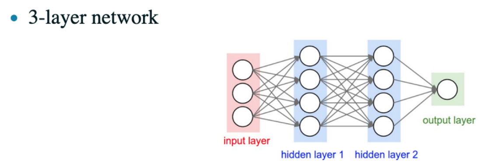
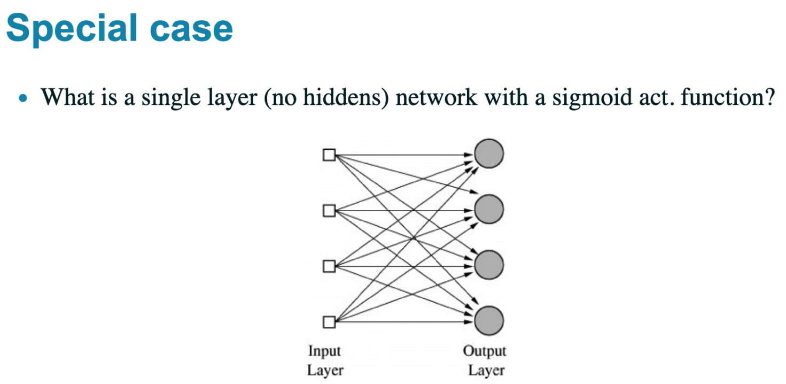
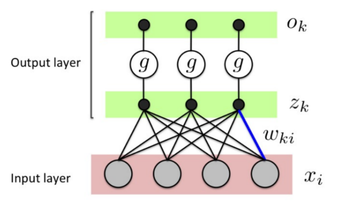
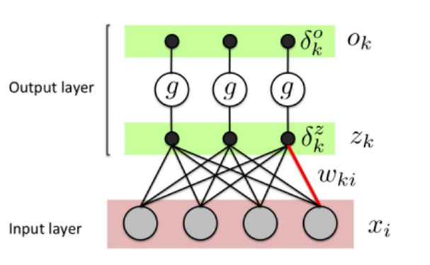
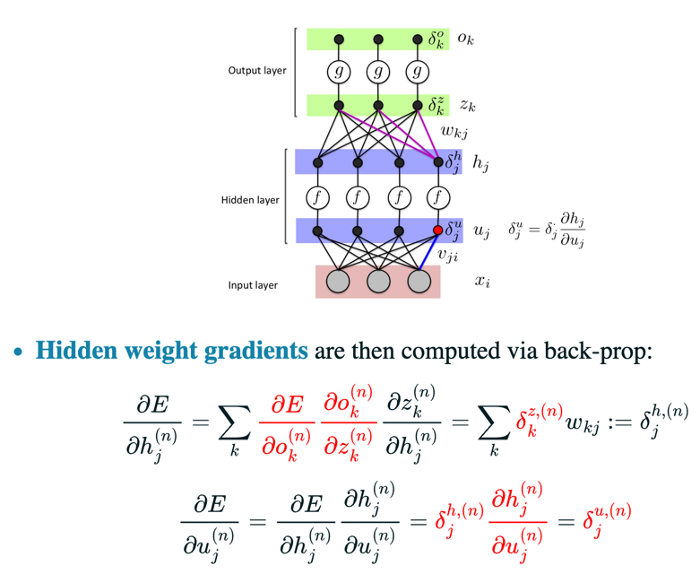
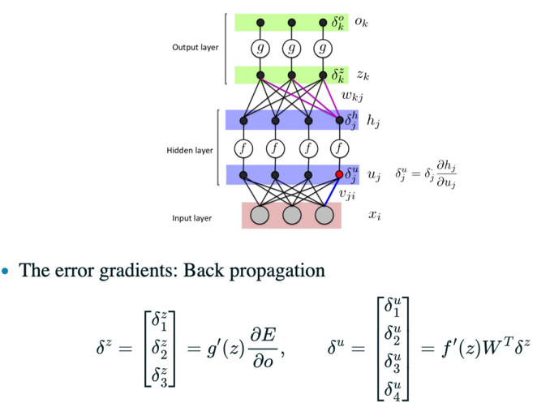
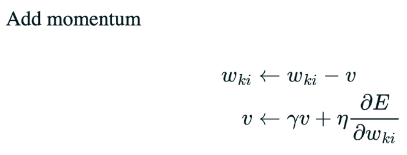

<p align="center">
  
</p>

<details>
<summary>Network output</summary>

The output of the network can be written as:

$$
\begin{aligned}
h_j(x) &= f\left(v_{j0}+\sum_{i=1}^D x_i v_{ji}\right) \\
o_k(x) &= g\left(w_{k0}+\sum_{j=1}^J h_j(x) w_{kj}\right)
\end{aligned}
$$

where:

- $D$ is the number of input features; $i=1,\ldots,D$ indexes them.
- $J$ is the number of hidden units; $j=1,\ldots,J$ indexes them.
- $K$ is the number of output units; $k=1,\ldots,K$ indexes them.

</details>

<details>
<summary>Example: forward propagation</summary>

A three-layer network can be implemented efficiently using matrix operations.



$$
\begin{aligned}
h^1 &= f\left(W_1 x+b_1\right) \\
h^2 &= f\left(W_2 h^1+b_2\right) \\
o &= g\left(W_3 h^2+b_3\right)
\end{aligned}
$$

For the example above, $W_1$ is a $4 \times 3$ matrix and $W_2$ is a $4 \times 4$ matrix.

所以这里的 $W$ 是一层中的所有权重。

Questions:

- What about the biases and $W_3$?
- What does the $(i,j)$-th entry of $W_1$ refer to? For example, what does $W_1(2,3)$ mean?

```python
# Forward pass of a three-layer neural network
f = lambda x: 1.0 / (1.0 + np.exp(-x))  # Activation function (sigmoid)
x = np.random.randn(3, 1)  # Random input vector (3 x 1)
h1 = f(np.dot(W1, x) + b1)  # First hidden layer activations (4 x 1)
h2 = f(np.dot(W2, h1) + b2)  # Second hidden layer activations (4 x 1)
out = np.dot(W3, h2) + b3  # Output neuron (1 x 1)
```

</details>

<details>
<summary>Backward propagation，求的是损失对于每层的W和b的梯度</summary>


$$
\begin{aligned}
&\text { - Network: }\\
&z_k=w_{k 0}+\sum_{i=1}^D w_{k i} x_i, \quad o_k=\frac{1}{1+\exp \left(-z_k\right)}
\end{aligned}
$$
Training neural nets:

Loop until convergence:

- For each example $n$:
  1. Given input $\mathbf{x}^{(n)}$, propagate activity forward $\left(\mathbf{x}^{(n)} \rightarrow \mathbf{h}^{(n)} \rightarrow o^{(n)}\right)$ (forward pass).
  2. Propagate gradients backward (backward pass).
  3. Update each weight (via gradient descent).
- Given any loss function $E()$, activation functions $g()$ and $f()$, just need to derive gradients

- We don't have targets for a hidden unit, but we can compute how fast the error changes as we change its activity，即只有输出层有标签对应有target，但是中间层是不知道他们合理的输出是什么样。

    1. Instead of using desired activities to train the hidden units, use error derivatives w.r.t.（with respect to，对..求导） hidden activities
    2. Each hidden activity can affect many output units and can therefore have many separate effects on the error. These effects must be combined，求和
    3. We can compute error derivatives for all the hidden units efficiently Once we have the error derivatives for the hidden activities, it's easy to get the error derivatives for the weights going into a hidden unit
- This is just the chain rule!
- **One-layer** network example (without a hidden layer):

  

  The symbols in the diagram correspond to:

  - $o_k$: output of output unit $k$.
  - $g$: activation function applied at the output layer.
  - $z_k$: net input to output unit $k$, before applying $g$.
  - $w_{ki}$: weight on the connection from input unit $i$ to output unit $k$.
  - $x_i$: value (activity) of input unit $i$.

  For each output unit $k$:

  $$
  z_k = w_{k0} + \sum_{i=1}^{D} w_{ki}x_i,
  \qquad
  o_k = g(z_k)
  $$


  Let $E$ be the loss for this example. Define the loss gradient with respect to the output of unit $k$ as

  $$
  \delta_k^o \equiv \frac{\partial E}{\partial o_k}.
  $$

  The output is computed from the net input (weighted sum) $z_k$ by $o_k=g(z_k)$. Define the loss gradient with respect to this net input as

  $$
  \delta_k^z \equiv \frac{\partial E}{\partial z_k}
  = \frac{\partial E}{\partial o_k}\frac{\partial o_k}{\partial z_k}
  = \delta_k^o g'(z_k).
  $$

  The value of $\delta_k^o$ depends on the chosen loss function.

  To find how changing a weight affects the loss, treat $w_{ki}$ as the variable and hold the input and target fixed. The dependency is:

  $$
  w_{ki} \longrightarrow z_k \longrightarrow o_k \longrightarrow E
  $$

  Applying the chain rule along this path gives:

  $$
  \frac{\partial E}{\partial w_{ki}}
  =
  \underbrace{\frac{\partial E}{\partial o_k}}_{\delta_k^o}
  \frac{\partial o_k}{\partial z_k}
  \frac{\partial z_k}{\partial w_{ki}}
  =
  \underbrace{\frac{\partial E}{\partial z_k}}_{\delta_k^z}
  \frac{\partial z_k}{\partial w_{ki}}
  = \delta_k^z x_i
  $$

  Each factor describes one step in the dependency:

  - Since $z_k=w_{k0}+\sum_i w_{ki}x_i$, $\frac{\partial z_k}{\partial w_{ki}}=x_i$.
  - Thus, the weight gradient is the net-input error gradient $\delta_k^z$ multiplied by the input value $x_i$.


### Worked example: MSE with logistic activation

For one training example $n$, use the squared-error loss

$$
E^{(n)}
= \underbrace{\sum_k \frac{1}{2}\left(o_k^{(n)}-t_k^{(n)}\right)^2}
_{\text{sum the errors over all output units}},
\qquad
g(z)=\frac{1}{1+\exp(-z)}.
$$

$$
\begin{aligned}
\text{FP-1:}\quad
z_k^{(n)}
&= w_{k0}+\sum_{i=1}^{D}w_{ki}x_i^{(n)},\\
\text{FP-2:}\quad
o_k^{(n)}
&=g\!\left(z_k^{(n)}\right),\\[4pt]
\text{BP-1:}\quad
\underbrace{\delta_k^o = \frac{\partial E^{(n)}}{\partial o_k^{(n)}}}_{\text{对于每个神经元k求导}}
&=o_k^{(n)}-t_k^{(n)},\\
\text{BP-2:}\quad
\delta_k^z
&=\frac{\partial E^{(n)}}{\partial z_k^{(n)}}
=\delta_k^o g'\!\left(z_k^{(n)}\right)\\
&=\delta_k^o \underbrace{g\!\left(z_k^{(n)}\right)
  \left(1-g\!\left(z_k^{(n)}\right)\right)}_{g(z)为sigmoid所以求导为此}
=\delta_k^o o_k^{(n)}\left(1-o_k^{(n)}\right),\\
\text{BP-3:}\quad
\frac{\partial E^{(n)}}{\partial w_{ki}}
&=\delta_k^z x_i^{(n)}.
\end{aligned}
$$

上面这个正向1，2；反向1，2，3非常重要，后面矩阵不会就回头看。

### Matrix form

设一层有 $D$ 个输入、$K$ 个输出，$W=[w_{ki}]$：

**Forward propagation**

$$
\mathbf{z}=W\mathbf{x}+\mathbf{b},
\qquad
\mathbf{o}=g(\mathbf{z})
$$

$W\mathbf{x}$ 已经包含对输入单元的加权求和：
$z_k=\sum_i w_{ki}x_i+b_k$。

**Backward propagation**（sigmoid + squared error）

$$
\boldsymbol{\delta}^{o}=\mathbf{o}-\mathbf{t},
\qquad
\boldsymbol{\delta}^{z}
=\boldsymbol{\delta}^{o}\odot\mathbf{o}\odot(\mathbf{1}-\mathbf{o})
$$

$\odot$ 表示 elementwise multiplication。

**Weight and bias gradients**这里对W和对b求导，前面的都一样，就是后面对Z求导一个得到x，一个得到1，

$$
\frac{\partial E}{\partial W}
=\boldsymbol{\delta}^{z}\mathbf{x}^{T}
=\left[\delta_k^z x_i\right]_{k,i},
\qquad
\frac{\partial E}{\partial\mathbf{b}}
=\boldsymbol{\delta}^{z}
$$

多层网络只需对每一层重复计算（$\mathbf{a}^{(0)}=\mathbf{x}$） g指的是激活函数：

$$
\mathbf{z}^{(\ell)}
=W^{(\ell)}\mathbf{a}^{(\ell-1)}+\mathbf{b}^{(\ell)},
\qquad
\mathbf{a}^{(\ell)}=g^{(\ell)}\!\left(\mathbf{z}^{(\ell)}\right)
$$

反向传播时，当前层的误差要汇总下一层所有神经元的影响：

$$
\boldsymbol{\delta}^{z,(\ell)}
=\underbrace{\left(W^{(\ell+1)}\right)^T
 \boldsymbol{\delta}^{z,(\ell+1)}}_{\text{下一层各神经元影响之和}}
 \odot g'\!\left(\mathbf{z}^{(\ell)}\right)
$$

> 这是一种迭代，这是2-layer network


从前文可以看出，E对于hj的偏导数是输出端开始到下一层所有神经元对hj的偏导数之和，W^T就是把下一层所有神经元对hj的偏导数求和。

因此不必逐个神经元手算；矩阵乘法一次完成整层的求和与计算。


</details>

### Gradient update（梯度更新）

反向传播得到梯度后，沿梯度的反方向调整参数，以减小损失。

先区分符号：

- $w_{ki}$ 是从输入单元 $i$ 到输出单元 $k$ 的一个权重；$W=[w_{ki}]$ 是整层的权重矩阵。
- $\eta>0$ 是学习率，控制每次更新的步长；$\leftarrow$ 表示用右侧计算结果替换左侧参数。
- $N$ 是训练样本总数；上标 $(n)$ 表示第 $n$ 个样本，不是乘方。
- $E^{(n)}=E(\mathbf{o}^{(n)},\mathbf{t}^{(n)})$ 是单个样本的损失；本节按图中约定，$E=\sum_{n=1}^{N}E^{(n)}$ 是全部样本的损失之和。
- $\partial E/\partial w_{ki}$ 是一个标量；$\partial E/\partial W=[\partial E/\partial w_{ki}]_{k,i}$ 是与 $W$ 同形状的梯度矩阵，表示对每个权重分别求偏导。

**Scalar form：更新一个权重**

1. **Batch gradient descent（批量梯度下降）**：遍历全部训练样本、累加梯度后，更新一次。

   $$
   w_{ki}\leftarrow w_{ki}-\eta\frac{\partial E}{\partial w_{ki}}
   =w_{ki}-\eta\sum_{n=1}^{N}\frac{\partial E^{(n)}}{\partial w_{ki}}
   $$

   求和中的所有梯度都在同一组当前参数处计算，遍历过程中不更新参数。

2. **Stochastic gradient descent（随机梯度下降，SGD）**：每次取一个训练样本，计算梯度后立即更新。

   $$
   w_{ki}\leftarrow w_{ki}-\eta\frac{\partial E^{(n)}}{\partial w_{ki}}
   $$

   通常随机抽取样本，或每轮打乱样本顺序。不同样本的梯度方向可能不同，因此更新会有波动。

3. **Mini-batch gradient descent（小批量梯度下降）**：每次取一小批样本，汇总梯度后更新。设这批样本的索引集合为 $\mathcal{B}$，样本数为 $B=|\mathcal{B}|$，采用平均损失时：

   $$
   w_{ki}\leftarrow w_{ki}
   -\eta\frac{1}{B}\sum_{n\in\mathcal{B}}
   \frac{\partial E^{(n)}}{\partial w_{ki}}
   $$

**Matrix form：一次更新整层权重（batch update）**

$$
W\leftarrow W-\eta\frac{\partial E}{\partial W}
=W-\eta\sum_{n=1}^{N}\frac{\partial E^{(n)}}{\partial W}
$$

代入前面推导的单样本梯度，可得：

$$
W\leftarrow W-\eta\sum_{n=1}^{N}
\boldsymbol{\delta}^{z,(n)}\left(\mathbf{x}^{(n)}\right)^T,
\qquad
\mathbf{b}\leftarrow\mathbf{b}-\eta\sum_{n=1}^{N}\boldsymbol{\delta}^{z,(n)}
$$




### Add momentum（加入动量）

普通梯度下降只看当前梯度；动量法还保留过去的更新趋势。

- $w_{ki}$：权重；$v$：该权重对应的历史累积量，初始为 $0$。
- $\eta$：学习率；$\gamma\in[0,1)$：历史保留比例。
- $\partial E/\partial w_{ki}$：当前损失对权重的梯度。

先更新 $v$，再更新权重：

$$
v\leftarrow\underbrace{\gamma v}_{\text{保留历史}}
+\underbrace{\eta\frac{\partial E}{\partial w_{ki}}}_{\text{加入当前梯度}},
\qquad
w_{ki}\leftarrow w_{ki}-v.
$$

梯度持续同向时，历史累积使更新加速；梯度来回变号时，会部分抵消，减轻振荡。$\gamma=0$ 就退化为普通梯度下降。

> 图中把权重更新放在上面；标准实现应先更新动量，再用新的动量更新权重。
> momentum加速一致方向的移动、缓解震荡；有时帮助离开局部最优。
