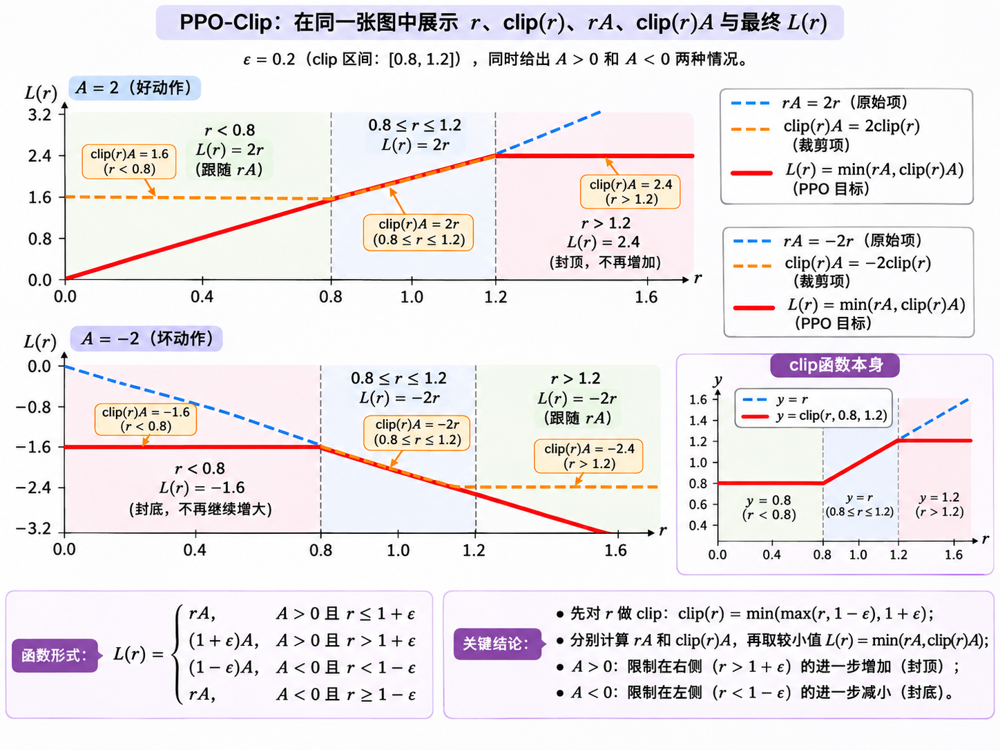

# 近端策略优化Proximal Policy Optimization

> 对应 [Spinning Up PPO 官方页面](https://spinningup.openai.com/en/latest/algorithms/ppo.html)

keyword：PPO, clip, GAE

## 1. 背景（Background）

motivated by the same question of [trust region policy optimization](TRPO_handnote.md), how can we take the biggest possible improvement step on a policy using the data we currently have, without stepping so far that we accidentally cause performance collapse? 在安全的前提下进行最大的改进

TRPO tries to solve this problem with a complex second-order method, PPO is a family of first-order methods.

PPO methods are significantly simpler to implement, and empirically seem to perform at least as well as TRPO.

two road of PPO: PPO penality and PPO clip

PPO-Penalty approximately solves a KL-constrained update like TRPO, but penalizes the KL-divergence in the objective function instead of making it a hard constraint, and automatically adjusts the penalty coefficient over the course of training so that it’s scaled appropriately.(objective function? hard constraint?)

**PPO-Clip** does NOT have a KL-divergence term in the objective and doesn’t have a constraint at all. Instead relies on specialized clipping in the objective function to remove incentives for the new policy to get far from the old policy.相当于截断激励(clipping? incentives?)

the PPO-Clip is more popular

### 1.1 Quick Facts

- PPO is an on-policy algorithm.
- PPO can be used for environments with either discrete or continuous action spaces.
- The Spinning Up implementation of PPO supports parallelization with MPI.

### 1.2 Key Equations

#### clip ：让一次改进的收益适时饱和

policy improvement 的基本方向是增加好动作的概率、降低差动作的概率 。PPO-Clip 在这个方向上进一步考虑：**用同一批数据反复更新时，一个样本提供的改进信号，应该持续鼓励策略改变到什么程度？** clip 的作用就是给这种鼓励设置阈值：达到一定幅度后，该样本的目标值进入平台。

设旧策略为 $\pi_{\theta_k}$，待更新策略为 $\pi_\theta$。固定一个样本 $(s,a)$，定义 probability ratio（概率比）和旧策略下的 advantage：

$$
r(\theta)=\frac{\pi_\theta(a\mid s)}{\pi_{\theta_k}(a\mid s)}.
$$

$$
A=A^{\pi_{\theta_k}}(s,a)=Q^{\pi_{\theta_k}}(s,a)-V^{\pi_{\theta_k}}(s).
$$

$r$ 衡量这个动作的概率相对旧策略变化了多少：$r=1$ 表示相同，$r>1$ 表示提高，$r<1$ 表示降低；连续动作对应概率密度之比。一次更新期间，旧策略和旧 advantage 固定，$\theta$ 的变化通过分子影响 $r$。

在 TRPO 的 surrogate objective 中，单个样本的贡献为

$$
L^{\mathrm{unclip}}=r(\theta)A.
$$
同一批数据被反复使用时，策略可能过度追随这批样本中的优势估计，逐渐偏离旧策略。

PPO-Clip 因而给每个样本的改进收益设置一个饱和点。取 $0<\epsilon<1$，用 $1+\epsilon$ 和 $1-\epsilon$ 分别作为提高、降低概率时的阈值。

#### 用 clip 和 min 合并，得到统一目标

clip 函数把输入截到区间内：

$$
\operatorname{clip}(r,1-\epsilon,1+\epsilon)
=\begin{cases}
1-\epsilon, & r<1-\epsilon,\\
r, & 1-\epsilon\leq r\leq1+\epsilon,\\
1+\epsilon, & r>1+\epsilon.
\end{cases}
$$

将原始目标 $rA$ 与裁剪后的目标放在一起，取较小值，就能同时实现前面两种单侧饱和的效果：

$$
\boxed{
L(s,a,\theta_k,\theta)
=\min\left(
r(\theta)A,\;
\operatorname{clip}\bigl(r(\theta),1-\epsilon,1+\epsilon\bigr)A
\right).
}
$$
当 $A>0$ 时，先算内层的clip(这里体现在取最小值)，$r>1+\epsilon$ 的部分被裁剪，避免过度提高好动作的概率；当 $A<0$ 时，先算内层clip，这里体现在取最大值）$r<1-\epsilon$ 的部分被裁剪，避免过度降低差动作的概率。

所以clip是分段函数，是内层，min是外层。



#### 对整批样本优化，得到策略更新

对旧策略采到的状态、动作取期望，得到 PPO-Clip 的策略目标与更新形式：

$$
\mathcal L^{\mathrm{clip}}(\theta_k,\theta)
=\mathbb E_{s,a\sim\pi_{\theta_k}}
\left[L(s,a,\theta_k,\theta)\right].
$$

$$
\theta_{k+1}=\arg\max_\theta\mathcal L^{\mathrm{clip}}(\theta_k,\theta).
$$

实际采集一批旧策略数据 $\mathcal D_k=\{(s_t,a_t,\hat A_t)\}_{t=1}^N$，以样本平均近似期望，以 $\hat A_t$ 估计 advantage：

$$
\widehat{\mathcal L}^{\mathrm{clip}}(\theta)
=\frac1N\sum_{t=1}^N
\min\left(
r_t(\theta)\hat A_t,\;
\operatorname{clip}\bigl(r_t(\theta),1-\epsilon,1+\epsilon\bigr)\hat A_t
\right).
$$

$$
r_t(\theta)=\frac{\pi_\theta(a_t\mid s_t)}{\pi_{\theta_k}(a_t\mid s_t)}.
$$

advantage function $\hat A_t$ 的计算用到 generalized advantage estimation (GAE) 方法：

$$
\underbrace{\delta_t}_{\text{TD error}}
=r_t+\underbrace{\gamma V(s_{t+1})-V(s_t)}_{\text{两个 }V\text{ 均为训练的 value 网络 / critic 输出}}.
$$

$$
\hat A_t^{\mathrm{GAE}(\gamma,\lambda)}
=\sum_{l=0}^{T-t-1}(\gamma\lambda)^l\delta_{t+l}.
$$

旧概念：$r_t$ is 即时奖励；$V(s_t)$ is critic 对状态价值的估计；$\gamma$ is 折扣因子；$T$ is 轨迹片段的结束时刻；$\delta_t$ is 一步 TD error。

GAE 新概念：$\lambda\in[0,1]$ means 调节未来 TD error 权重衰减的参数，用于权衡偏差与方差；$\hat A_t^{\mathrm{GAE}}$ means 将当前及后续的 TD error 按 $(\gamma\lambda)^l$ 加权求和，得到 advantage 估计。

γ 决定我们如何看待未来，λ 决定我们如何利用未来的 TD 误差信息来估计 Advantage。

边界处理：真正终止时令 $V(s_T)=0$，仅截断采样时保留 $V(s_T)$ 以 bootstrap。

公式与实现说明参见 [Spinning Up — PPO Key Equations](https://spinningup.openai.com/en/latest/algorithms/ppo.html#key-equations)；多轮 minibatch 优化参见 [PPO 原论文](https://arxiv.org/abs/1707.06347)。

### 1.3 Exploration-Exploitation Tradeoff

PPO trains a stochastic policy in an on-policy way.从随机策略开始，策略逐渐收敛到一个确定性策略，这使得可能陷入局部最优。

### 1.4 Pseudocode

**Algorithm 1 PPO-Clip**

1. **Input:** initial policy parameters $\theta_0$, initial value function parameters $\phi_0$
2. **for** $k=0,1,2,\ldots$ **do**
3. Collect set of trajectories $\mathcal D_k=\{\tau_i\}$ by running policy $\pi_k=\pi(\theta_k)$ in the environment.
4. Compute rewards-to-go $\hat R_t$.
5. Compute advantage estimates, $\hat A_t$ (using any method of advantage estimation) based on the current value function $V_{\phi_k}$.
6. Update the policy by maximizing the PPO-Clip objective更新actor网络$\theta$：:

    $$
    \theta_{k+1}=\arg\max_\theta
    \frac{1}{|\mathcal D_k|T}
    \sum_{\tau\in\mathcal D_k}\sum_{t=0}^{T}
    \min\left(
    \frac{\pi_\theta(a_t\mid s_t)}{\pi_{\theta_k}(a_t\mid s_t)}
    A^{\pi_{\theta_k}}(s_t,a_t),\;
    g\left(\epsilon,A^{\pi_{\theta_k}}(s_t,a_t)\right)
    \right),
    $$

    typically via stochastic gradient ascent with Adam.

    > **梯度更新：** 从 $\theta_k$ 出发做多次梯度上升：$\theta\leftarrow\theta+\alpha\nabla_\theta L^{\mathrm{clip}}$。代码通常令 `actor_loss = -L_clip`，用 `backward()` 自动求梯度，再由 Adam 做梯度下降，效果等价。
    >
    > **clip 的巧妙之处：** 固定旧策略和 advantage，记概率比为 $r$。当 $A>0$ 且 $r>1+\epsilon$，或 $A<0$ 且 $r<1-\epsilon$ 时，clip 与外层 min 使该样本为常数平直线，对 $\theta$ 的梯度为 0（对r求导为0）。这相当于一个按条件生效的 **gradient mask**，屏蔽该样本继续沿有利方向过度更新的激励；

7. Fit value function by regression on mean-squared error更新critic网络$\phi$：

    $$
    \phi_{k+1}=\arg\min_\phi
    \frac{1}{|\mathcal D_k|T}
    \sum_{\tau\in\mathcal D_k}\sum_{t=0}^{T}
    \left(V_\phi(s_t)-\hat R_t\right)^2,
    $$

    typically via some gradient descent algorithm，$\hat R_t$是累计奖励，如果采集的步长有限用bootstrapping自举，后面的用网络预测值代替.

8. **end for**

## 2. full code implementation

```
# docs and experiment results can be found at https://docs.cleanrl.dev/rl-algorithms/ppo/#ppopy
import os
import random
import time
from dataclasses import dataclass

import gymnasium as gym
import numpy as np
import torch
import torch.nn as nn
import torch.optim as optim
import tyro
from torch.distributions.categorical import Categorical
from torch.utils.tensorboard import SummaryWriter


@dataclass
class Args:
    exp_name: str = os.path.basename(__file__)[: -len(".py")]
    """the name of this experiment"""
    seed: int = 1
    """seed of the experiment"""
    torch_deterministic: bool = True
    """if toggled, `torch.backends.cudnn.deterministic=False`"""
    cuda: bool = True
    """if toggled, cuda will be enabled by default"""
    track: bool = False
    """if toggled, this experiment will be tracked with Weights and Biases"""
    wandb_project_name: str = "cleanRL"
    """the wandb's project name"""
    wandb_entity: str = None
    """the entity (team) of wandb's project"""
    capture_video: bool = False
    """whether to capture videos of the agent performances (check out `videos` folder)"""

    # Algorithm specific arguments
    env_id: str = "CartPole-v1"
    """the id of the environment"""
    total_timesteps: int = 500000
    """total timesteps of the experiments"""
    learning_rate: float = 2.5e-4
    """the learning rate of the optimizer"""
    num_envs: int = 4
    """the number of parallel game environments"""
    num_steps: int = 128
    """the number of steps to run in each environment per policy rollout"""
    anneal_lr: bool = True
    """Toggle learning rate annealing for policy and value networks"""
    gamma: float = 0.99
    """the discount factor gamma"""
    gae_lambda: float = 0.95
    """the lambda for the general advantage estimation"""
    num_minibatches: int = 4
    """the number of mini-batches"""
    update_epochs: int = 4
    """the K epochs to update the policy"""
    norm_adv: bool = True
    """Toggles advantages normalization"""
    clip_coef: float = 0.2
    """the surrogate clipping coefficient"""
    clip_vloss: bool = True
    """Toggles whether or not to use a clipped loss for the value function, as per the paper."""
    ent_coef: float = 0.01
    """coefficient of the entropy"""
    vf_coef: float = 0.5
    """coefficient of the value function"""
    max_grad_norm: float = 0.5
    """the maximum norm for the gradient clipping"""
    target_kl: float = None
    """the target KL divergence threshold"""

    # to be filled in runtime
    batch_size: int = 0
    """the batch size (computed in runtime)"""
    minibatch_size: int = 0
    """the mini-batch size (computed in runtime)"""
    num_iterations: int = 0
    """the number of iterations (computed in runtime)"""


def make_env(env_id, idx, capture_video, run_name):
    def thunk():
        if capture_video and idx == 0:
            env = gym.make(env_id, render_mode="rgb_array")
            env = gym.wrappers.RecordVideo(env, f"videos/{run_name}")
        else:
            env = gym.make(env_id)
        env = gym.wrappers.RecordEpisodeStatistics(env)
        return env

    return thunk


def layer_init(layer, std=np.sqrt(2), bias_const=0.0):
    torch.nn.init.orthogonal_(layer.weight, std)
    torch.nn.init.constant_(layer.bias, bias_const)
    return layer


class Agent(nn.Module):
    def __init__(self, envs):
        super().__init__()
        self.critic = nn.Sequential( #Sequential是一个容器，里面的模块会按照传入的顺序依次被添加到计算图中
            layer_init(nn.Linear(np.array(envs.single_observation_space.shape).prod(), 64)),
            nn.Tanh(),
            layer_init(nn.Linear(64, 64)),
            nn.Tanh(),
            layer_init(nn.Linear(64, 1), std=1.0),
        ) #critic是一个64-64-1的全连接神经网络，输入是环境的状态，输出是一个标量值函数估计。
          #Tanh是激活函数，表达式是 (e^x - e^-x)/(e^x + e^-x)，输出范围是(-1,1)。
        self.actor = nn.Sequential(
            layer_init(nn.Linear(np.array(envs.single_observation_space.shape).prod(), 64)),
            nn.Tanh(),
            layer_init(nn.Linear(64, 64)),
            nn.Tanh(),
            layer_init(nn.Linear(64, envs.single_action_space.n), std=0.01),
        ) #actor是一个64-64-动作数的全连接神经网络，输入是环境的状态，输出是每个动作的概率分布。
        #std是初始化权重的增益

    def get_value(self, x):
        return self.critic(x)
    #get value输出的是状态价值state value

    def get_action_and_value(self, x, action=None):
        logits = self.actor(x) #logits是输出的每个动作的logit值
        probs = Categorical(logits=logits) #这里构建了一个categorical实例
        if action is None:
            action = probs.sample()
        return action, probs.log_prob(action), probs.entropy(), self.critic(x)
    #probs.sample返回一个根据概率分布采样的动作
    #probs.log_prob(action)返回所选动作的对数概率
    #probs.entropy()返回动作分布的熵
    #self.critic(x)返回状态价值

if __name__ == "__main__":
    args = tyro.cli(Args)
    args.batch_size = int(args.num_envs * args.num_steps)
    args.minibatch_size = int(args.batch_size // args.num_minibatches)
    args.num_iterations = args.total_timesteps // args.batch_size
    run_name = f"{args.env_id}__{args.exp_name}__{args.seed}__{int(time.time())}"
    if args.track:
        import wandb
        #wandb是Weights & Biases的缩写，用于跟踪实验和可视化结果
        wandb.init(
            project=args.wandb_project_name,
            entity=args.wandb_entity,
            sync_tensorboard=True,
            config=vars(args),
            name=run_name,
            monitor_gym=True,
            save_code=True,
        )
    writer = SummaryWriter(f"runs/{run_name}")
    writer.add_text(
        "hyperparameters",
        "|param|value|\n|-|-|\n%s" % ("\n".join([f"|{key}|{value}|" for key, value in vars(args).items()])),
    )

    # TRY NOT TO MODIFY: seeding
    random.seed(args.seed)
    np.random.seed(args.seed)
    torch.manual_seed(args.seed)
    torch.backends.cudnn.deterministic = args.torch_deterministic
    #随机seed

    device = torch.device("cuda" if torch.cuda.is_available() and args.cuda else "cpu")

    # env setup
    envs = gym.vector.SyncVectorEnv(
        [make_env(args.env_id, i, args.capture_video, run_name) for i in range(args.num_envs)],
    )
    assert isinstance(envs.single_action_space, gym.spaces.Discrete), "only discrete action space is supported"

    agent = Agent(envs).to(device)
    #回忆之前的Agent类定义，这里初始化Agent对象
    optimizer = optim.Adam(agent.parameters(), lr=args.learning_rate, eps=1e-5)
    #adam：梯度下降优化器

    # ALGO Logic: Storage setup
    obs = torch.zeros((args.num_steps, args.num_envs) + envs.single_observation_space.shape).to(device)
    actions = torch.zeros((args.num_steps, args.num_envs) + envs.single_action_space.shape).to(device)
    logprobs = torch.zeros((args.num_steps, args.num_envs)).to(device)
    rewards = torch.zeros((args.num_steps, args.num_envs)).to(device)
    dones = torch.zeros((args.num_steps, args.num_envs)).to(device)
    values = torch.zeros((args.num_steps, args.num_envs)).to(device)

    # TRY NOT TO MODIFY: start the game
    global_step = 0
    start_time = time.time()
    next_obs, _ = envs.reset(seed=args.seed) #obs：环境的初始观测值
    next_obs = torch.Tensor(next_obs).to(device) #Tensor：将numpy数组转换为torch张量，支持数学运算和自动求导
    next_done = torch.zeros(args.num_envs).to(device)

    for iteration in range(1, args.num_iterations + 1):
        # Annealing the rate if instructed to do so.退火
        if args.anneal_lr:
            frac = 1.0 - (iteration - 1.0) / args.num_iterations
            lrnow = frac * args.learning_rate
            optimizer.param_groups[0]["lr"] = lrnow

        #rollout阶段，收集数据
        #每次外层迭代，同时运行4个环境，每个环境执行num_steps步
        for step in range(0, args.num_steps):
            global_step += args.num_envs #一次4个环境
            obs[step] = next_obs #记录当前步的观测值
            dones[step] = next_done #记录当前步的终止状态 eg.tensor([0.,1.,0.,0.])

            # ALGO LOGIC: action logic
            with torch.no_grad(): #暂时关闭梯度计算，因为在交互
                action, logprob, _, value = agent.get_action_and_value(next_obs) #actor & critic的输出
                #eg:
                values[step] = value.flatten()
            actions[step] = action
            logprobs[step] = logprob

            # TRY NOT TO MODIFY: execute the game and log data.
            next_obs, reward, terminations, truncations, infos = envs.step(action.cpu().numpy()) #将tensor张量移动到CPU上，并转换为numpy数组，传入step函数
            #action做出动作，返回新的观测值、奖励、终止状态等
            next_done = np.logical_or(terminations, truncations)
            # terminations: 终止状态，truncations: 时间截断状态 都是布尔true/false
            rewards[step] = torch.tensor(reward).to(device).view(-1) #view(-1)将reward张量展平为一维张量
            next_obs, next_done = torch.Tensor(next_obs).to(device), torch.Tensor(next_done).to(device)

            if "final_info" in infos:
                for info in infos["final_info"]:
                    if info and "episode" in info:
                        print(f"global_step={global_step}, episodic_return={info['episode']['r']}")
                        writer.add_scalar("charts/episodic_return", info["episode"]["r"], global_step)
                        writer.add_scalar("charts/episodic_length", info["episode"]["l"], global_step)

        # bootstrap value if not done
        #gae: Generalized Advantage Estimation
        with torch.no_grad():
            next_value = agent.get_value(next_obs).reshape(1, -1) 
            #假设交互了127步，next_obs是四个环境各自第128步的state value，reshape(1,-1)将其变为1行128列的张量
            #为后面计算TD error和优势函数做准备
            advantages = torch.zeros_like(rewards).to(device) #准备
            lastgaelam = 0 #上一个已经计算出来的 GAE Advantage，也就是当前时间步后一个时间步的优势估计。
            for t in reversed(range(args.num_steps)): #GAE从后往前迭代
                if t == args.num_steps - 1:
                    nextnonterminal = 1.0 - next_done #if done, nextnonterminal=0, else 1,(1-0=1)
                    nextvalues = next_value #最后一个必须用critic预测的下一个state value，因为只有这么多步
                else:
                    nextnonterminal = 1.0 - dones[t + 1]
                    nextvalues = values[t + 1]
                delta = rewards[t] + args.gamma * nextvalues * nextnonterminal - values[t] #TD error
                #这里乘了nextnonterminal是为了处理done的情况，如果done=1，说明episode结束了，
                # nextvalues可能不为0但是不应该被考虑进来，nextnonterminal相当于屏蔽器
                advantages[t] = lastgaelam = delta + args.gamma * args.gae_lambda * nextnonterminal * lastgaelam
                #还是从后往前推，然后再赋值到advantages[t],相当于一个存放的容器
            returns = advantages + values

        # flatten the batch ，把之前格式为(num_steps, num_envs, obs_shape)的张量展平为(num_steps*num_envs, obs_shape)
        # 前面采集数据时，按照「时间步 × 环境」组织数据；现在要把它们整理成「样本数量 × 特征维度」
        b_obs = obs.reshape((-1,) + envs.single_observation_space.shape)
        b_logprobs = logprobs.reshape(-1)
        b_actions = actions.reshape((-1,) + envs.single_action_space.shape)
        b_advantages = advantages.reshape(-1)
        b_returns = returns.reshape(-1)
        b_values = values.reshape(-1)

        # Optimizing the policy and value network
        b_inds = np.arange(args.batch_size) #indices,eg: [0,1,2,...,511],索引编号
        clipfracs = []
        for epoch in range(args.update_epochs): #update_epochs=4，表示每个rollout数据要重复利用4次，打乱4次
            np.random.shuffle(b_inds) #eg: [  0   1   2 ... 509 510 511] -> [  3  10  11 ... 503 505 506]
            for start in range(0, args.batch_size, args.minibatch_size): #4个mini batches，每个mini batch大小为batch_size/num_minibatches
                end = start + args.minibatch_size
                mb_inds = b_inds[start:end] #取出一个mini batch大小的索引编号

                _, newlogprob, entropy, newvalue = agent.get_action_and_value(b_obs[mb_inds], b_actions.long()[mb_inds])
                #newlogprob就是log pi(a|s)
                logratio = newlogprob - b_logprobs[mb_inds] #log 所以是相减
                ratio = logratio.exp() #再exp恢复为重要性采样中的r

                with torch.no_grad():
                    # calculate approx_kl http://joschu.net/blog/kl-approx.html
                    old_approx_kl = (-logratio).mean() #直接取平均，相当于求期望
                    approx_kl = ((ratio - 1) - logratio).mean() #也是一种近似KL散度的计算方法
                    # \begin{aligned}
                    # approx\_kl
                    # &amp;=\mathbb E_{old}[ratio-1-\log ratio]\\
                    # &amp;=0-\mathbb E_{old}[\log ratio]\\
                    # &amp;=D_{KL}(\pi_{old}\|\pi_{new})
                    # \end{aligned}
                    clipfracs += [((ratio - 1.0).abs() > args.clip_coef).float().mean().item()]
                    #(ratio - 1.0).abs() > args.clip_coef)就是和epsilon比较
                mb_advantages = b_advantages[mb_inds]
                if args.norm_adv:
                    mb_advantages = (mb_advantages - mb_advantages.mean()) / (mb_advantages.std() + 1e-8)
                    #z-score标准化

                # Policy loss #       
                pg_loss1 = -mb_advantages * ratio #rA
                pg_loss2 = -mb_advantages * torch.clamp(ratio, 1 - args.clip_coef, 1 + args.clip_coef) #clip rA
                pg_loss = torch.max(pg_loss1, pg_loss2).mean() #max(-rA, -clip rA)=-min(rA, clip rA) 取平均就是期望

                # Value loss
                newvalue = newvalue.view(-1)
                if args.clip_vloss:
                    v_loss_unclipped = (newvalue - b_returns[mb_inds]) ** 2 #均方误差
                    v_clipped = b_values[mb_inds] + torch.clamp( #b_values是rollout时critic预测的state value，b_returns是GAE计算的优势函数加上state value，R
                        newvalue - b_values[mb_inds],
                        -args.clip_coef,
                        args.clip_coef,
                    ) # V_clipped = V_old + clip(V_new - V_old, -epsilon, epsilon)
                    v_loss_clipped = (v_clipped - b_returns[mb_inds]) ** 2 #继续均方误差
                    v_loss_max = torch.max(v_loss_unclipped, v_loss_clipped) #取最大的
                    v_loss = 0.5 * v_loss_max.mean() #0.5是方便求导时的系数
                else:
                    v_loss = 0.5 * ((newvalue - b_returns[mb_inds]) ** 2).mean()

                entropy_loss = entropy.mean()
                #！！
                #合并为总loss，L=L_policy - c1 * L_value + c2 * H
                #entropy loss意思是鼓励策略多样性，防止过早收敛到局部最优解。通过最大化熵，策略会倾向于探索更多的动作，从而提高学习的稳定性和泛化能力。
                #c1和c2是超参数，分别控制价值函数损失和熵的权重
                #H是熵，衡量策略的不确定性，熵越大，策略越随机，探索性越强。通过引入熵正则化项，可以在训练过程中保持一定的探索性，避免策略过早收敛到次优解。
                #？
                loss = pg_loss - args.ent_coef * entropy_loss + v_loss * args.vf_coef
                
                optimizer.zero_grad()
                loss.backward()
                nn.utils.clip_grad_norm_(agent.parameters(), args.max_grad_norm)
                optimizer.step()

            if args.target_kl is not None and approx_kl > args.target_kl:
                break

        y_pred, y_true = b_values.cpu().numpy(), b_returns.cpu().numpy()
        var_y = np.var(y_true)
        explained_var = np.nan if var_y == 0 else 1 - np.var(y_true - y_pred) / var_y

        # TRY NOT TO MODIFY: record rewards for plotting purposes
        writer.add_scalar("charts/learning_rate", optimizer.param_groups[0]["lr"], global_step)
        writer.add_scalar("losses/value_loss", v_loss.item(), global_step)
        writer.add_scalar("losses/policy_loss", pg_loss.item(), global_step)
        writer.add_scalar("losses/entropy", entropy_loss.item(), global_step)
        writer.add_scalar("losses/old_approx_kl", old_approx_kl.item(), global_step)
        writer.add_scalar("losses/approx_kl", approx_kl.item(), global_step)
        writer.add_scalar("losses/clipfrac", np.mean(clipfracs), global_step)
        writer.add_scalar("losses/explained_variance", explained_var, global_step)
        print("SPS:", int(global_step / (time.time() - start_time)))
        writer.add_scalar("charts/SPS", int(global_step / (time.time() - start_time)), global_step)

    envs.close()
    writer.close()
```


