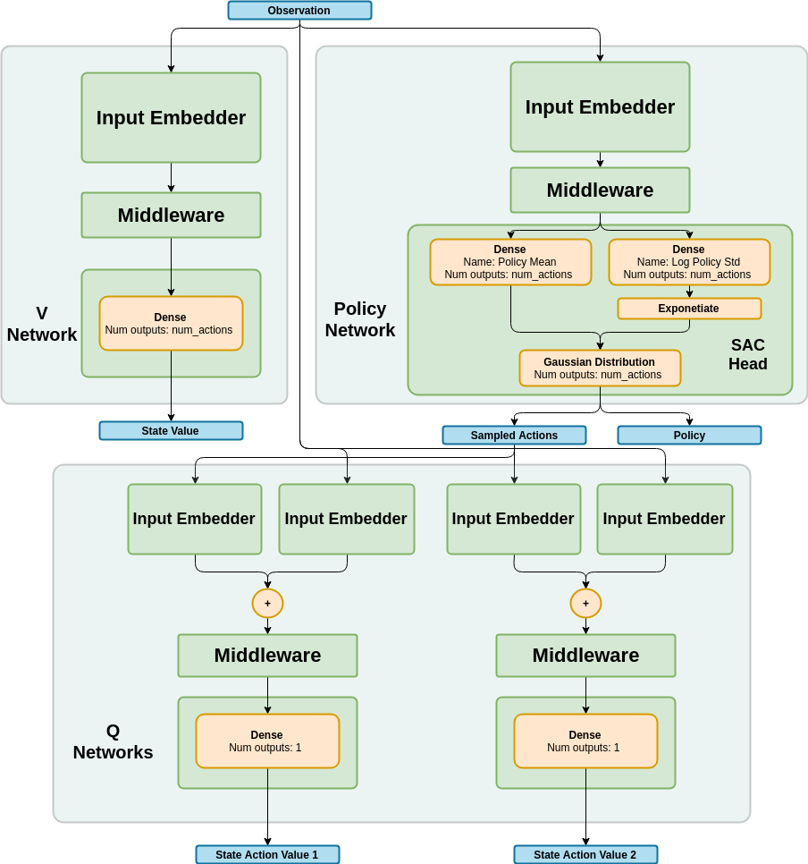
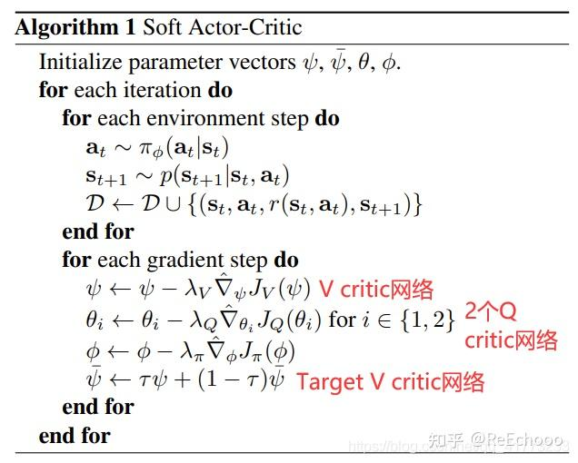
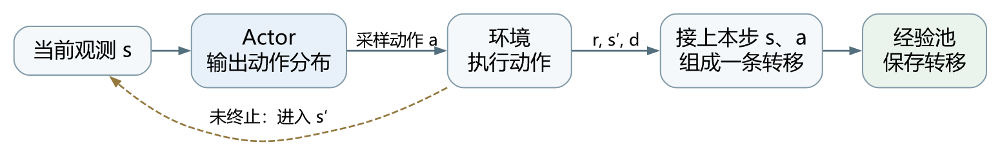
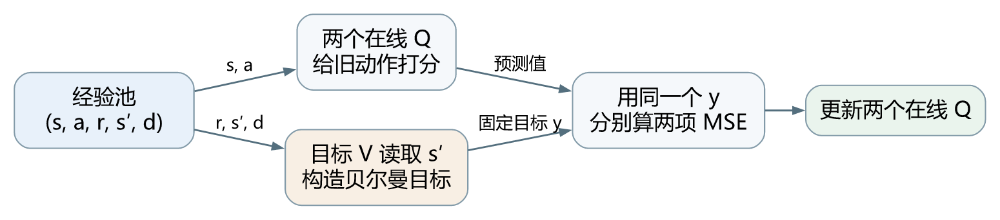
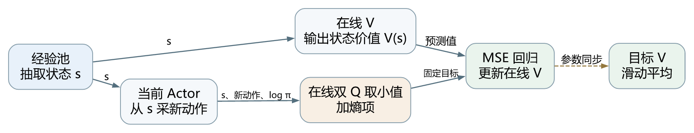
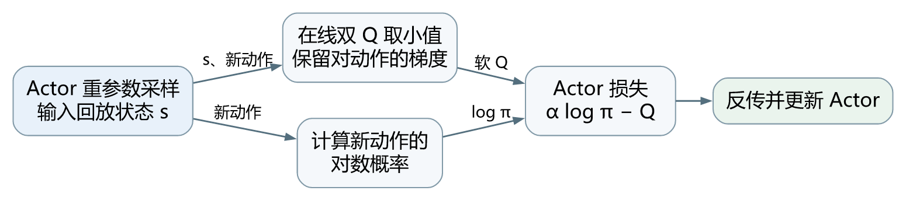
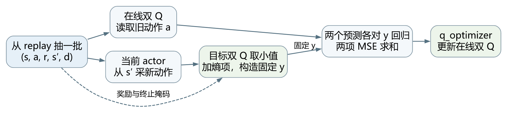
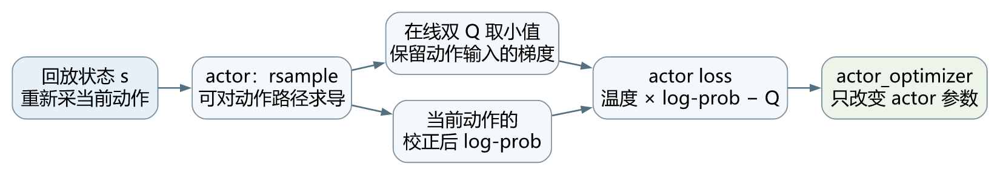

# Soft actor critic (SAC)

[spinningup sac](https://spinningup.openai.com/en/latest/algorithms/sac.html)

## Background

SAC 用随机策略做强化学习，在追求累计回报的同时奖励策略的熵。它可以反复从经验池取过去的交互，用来评价和改进当前策略，因此属于 off-policy。手记以 CleanRL 的连续动作实现为准。

## 一轮训练

这四张图按早期 SAC 的结构讲，含在线 V 和目标 V。$s$ 是当前状态，$a$ 是实际执行的动作，$r$ 是奖励，$s'$ 是下一状态，$d$ 是终止标记。

### 1. Experience 的产生过程

Actor 读入 $s$，采样得到 $a$。环境执行 $a$，返回 $r,s',d$。把这一条转移 $(s,a,r,s',d)$ 存进经验池，未终止时从 $s'$ 继续交互。

### 2. 两个 Q 网络的更新过程

两个在线 Q 都读回放里的 $(s,a)$。目标 V 读下一状态 $s'$，得到 $\bar V(s')$。令 $\gamma$ 为折扣因子，固定目标为 $y=r+\gamma(1-d)\bar V(s')$。**两个 Q 各自拟合同一个 $y$，两个都更新。**

### 3. V critic 网络的更新过程

在线 V 只读 $s$。同一个 $s$ 也给当前 actor，从中采一个新动作 $\tilde a$。用在线双 Q 的较小值减去 $\alpha\log\pi(\tilde a\mid s)$ 得到软价值目标，其中 $\alpha$ 是熵的权重。固定该目标做回归，只更新在线 V。目标 V 通过滑动平均跟随在线 V。

### 4. Actor 网络的更新过程

Actor 从回放取 $s$，用重参数化采出新动作 $\tilde a$。在线双 Q 取小值给动作打分，加上对数概率项得到损失 $\alpha\log\pi(\tilde a\mid s)-\min_i Q_i(s,\tilde a)$。Q 对动作的梯度传回 actor，这一步只更新 actor。

后面的公式和 Questions 对应 CleanRL。它在更新双 Q 时，直接用**目标双 Q 加熵项**估计下一状态的软价值，接替图中目标 V 的位置。[ICML 2018 SAC 原论文](https://proceedings.mlr.press/v80/haarnoja18b.html) · [CleanRL 源码](https://github.com/vwxyzjn/cleanrl/blob/master/cleanrl/sac_continuous_action.py#L233)

## Key Equations

沿上面的流程往下看：**Soft Bellman** 解释 critic 的目标从哪来；**EBP 和 KL** 解释为什么 actor 的损失同时有 Q 和熵；**双 Q 取小值**帮助缓解高估，**重参数化**让新动作的评分能反传到 actor。后两点可对照最后的 Questions 和对应流程图。

### Entropy-Regularized Reinforcement Learning

consider entropy as a quantity that measures the randomness, the more random the policy is, the higher the entropy. For discrete actions, a deterministic policy has zero entropy.（在深度学习decision tree中也有出现此概念）
For a discrete random variable $X$ with distribution $P$ and probability mass function $p(x)$, its entropy is:

$$
H(X) = \mathbb{E}_{x \sim P}\left[-\log p(x)\right] = -\sum_x p(x)\log p(x).
$$

连续动作时，$\pi(a\mid s)$ 表示概率密度。给定 $s$ 的微分熵仍可用「负对数密度的平均值」来算：

$$
H(\pi(\cdot\mid s))
=-\int_{\mathcal A}\pi(a\mid s)\log\pi(a\mid s)\,\mathrm da.
$$

连续密度可以大于 1，所以微分熵也可以为负。代码里的 `log_pi` 是一次动作采样的对数密度，`(-log_pi).mean()` 可以用来估计一批状态上的平均熵。

优化目标变成
$$
J(\pi) = \mathbb{E}_{\tau \sim \pi}\left[
\sum_{t=0}^{\infty} \gamma^t \left(
R(s_t, a_t, s_{t+1}) + \alpha H\left(\pi(\cdot \mid s_t)\right)
\right)
\right].
$$

其中 $J(\pi)$ 是策略 $\pi$ 的目标函数值，最优策略为 $\pi^*=\arg\max_\pi J(\pi)$。

温度 $\alpha>0$ 调节熵在目标中的权重。动作价值相近时，较大的 $\alpha$ 让策略更愿意把概率分给多个动作。

### 从标准 Q/V function 到 Soft Q/V function

符号：$s,a$ 为当前状态、动作，$s',a'$ 为下一时刻状态、动作；$p$ 为状态转移分布，$\pi$ 为策略；$r$ 为期望即时奖励，$\gamma\in[0,1)$ 为折扣因子，$\alpha>0$ 为熵权重；上标 $\pi$ 表示按该策略评估，下标 $\mathrm{soft}$ 表示加入熵奖励。

#### 标准的 Q function 和 V function

$Q^\pi(s,a)$：从状态 $s$ 开始，先执行指定动作 $a$，之后按照策略 $\pi$ 行动，得到的期望折扣累计奖励。

$$
Q^\pi(s,a)
=r(s,a)+\gamma\mathbb{E}_{s'\sim p(\cdot\mid s,a)}
\left[\mathbb{E}_{a'\sim\pi(\cdot\mid s')}
\left[Q^\pi(s',a')\right]\right].
$$

$V^\pi(s)$：从状态 $s$ 开始，按照策略 $\pi$ 行动的期望折扣累计奖励，其 Bellman 递推式如下，其中 $R_{t+1}$ 是执行 $a_t$ 后获得的即时奖励，期望包含策略选动作与环境转移的随机性。

$$
\begin{aligned}
V^\pi(s)
&=\mathbb{E}_{\pi}\left[
R_{t+1}+\gamma V^\pi(s_{t+1})\mid s_t=s
\right]\\
&=\mathbb{E}_{a\sim\pi(\cdot\mid s)}\left[Q^\pi(s,a)\right].
\end{aligned}
$$

代入可得标准 Bellman 方程：

$$
Q^\pi(s,a)
=r(s,a)+\gamma\mathbb{E}_{s'\sim p(\cdot\mid s,a)}
\left[V^\pi(s')\right].
$$

#### 引入熵：Soft Q function 和 Soft V function

Soft Q function：在标准 Q 的递推中，从下一时刻起加入熵奖励 $-\alpha\log\pi(a'\mid s')$。

$$
\begin{aligned}
Q^\pi_{\mathrm{soft}}(s,a)
&=r(s,a)+\gamma\mathbb{E}_{s'\sim p(\cdot\mid s,a)}
\Bigl[\mathbb{E}_{a'\sim\pi(\cdot\mid s')}\bigl[
Q^\pi_{\mathrm{soft}}(s',a')\\
&\hspace{10em}-\alpha\log\pi(a'\mid s')
\bigr]\Bigr].
\end{aligned}
$$

Soft V function：在当前状态下，对 Soft Q 与当前熵奖励之和取动作平均。

$$
V^\pi_{\mathrm{soft}}(s)
=\mathbb{E}_{a\sim\pi(\cdot\mid s)}
\left[Q^\pi_{\mathrm{soft}}(s,a)-\alpha\log\pi(a\mid s)\right].
$$

#### Soft Bellman 方程与策略评估

将 Soft V 的定义代入 Soft Q，可得：

$$
Q^\pi_{\mathrm{soft}}(s,a)
=r(s,a)+\gamma\mathbb{E}_{s'\sim p(\cdot\mid s,a)}
\left[V^\pi_{\mathrm{soft}}(s')\right].
$$

固定策略时，用这个方程反复评价 Q。在奖励与策略熵有界、精确计算期望的情况下，迭代收敛到该策略的 $Q^\pi_{\mathrm{soft}}$。CleanRL 用当前策略采一个下一动作，以双 Q 和熵项估计上式中的 $V^\pi_{\mathrm{soft}}$，直接构造在线 Q 的训练目标。

### Soft policy improvement：从 Soft Q 到 actor 损失

策略评估固定策略求 Q。到了策略改进，我们固定状态 $s$ 和刚得到的软价值评分 $Q(s,a)$，再问：**如果高分动作都值得尝试，该给每个动作分配多少概率？**

#### EBP：把动作评分变成概率密度

设 $a$ 是要打分的动作，$\alpha>0$ 是温度。EBP（energy-based policy，基于能量的策略）给每个动作一个能量 $E(s,a)$，再用 $e^{-E(s,a)}$ 当权重。希望 Q 越高的动作权重越大，因此取：

$$
-E(s,a)=Q(s,a)/\alpha.
$$

用 $b$ 遍历动作空间 $\mathcal A$，把权重积分得到归一化常数 $Z_Q(s)$，也叫配分函数。除以它，得到理想策略的概率密度 $p_Q$：

$$
p_Q(a\mid s)=\frac{\exp(Q(s,a)/\alpha)}{\int_{\mathcal A}\exp(Q(s,b)/\alpha)\,\mathrm db},\qquad
Z_Q(s)=\int_{\mathcal A}\exp(Q(s,b)/\alpha)\,\mathrm db.
$$

离散动作时改用求和,即softmax归一化。例如两个动作的 Q 为 2 和 1，$\alpha=1$，归一化后的概率约为 73% 和 27%。温度越低，权重越集中在高 Q 动作附近。

#### KL：为什么 actor 要最小化 $\alpha\log\pi-Q$？

用 $\pi(a\mid s)$ 表示正在训练的策略。$D_{\mathrm{KL}}(\pi\|p_Q)$ 是从 $\pi$ 采动作时，两者给同一个动作的对数密度差的平均值：

$$
D_{\mathrm{KL}}(\pi\|p_Q)
=\mathbb E_{a\sim\pi}\!\left[\log\pi(a\mid s)-\log p_Q(a\mid s)\right].
$$

代入 $\log p_Q(a\mid s)=Q(s,a)/\alpha-\log Z_Q(s)$，把动作价值和熵放在左边：

$$
\mathbb E_{a\sim\pi}\!\left[Q(s,a)-\alpha\log\pi(a\mid s)\right]
=\alpha\log Z_Q(s)-\alpha D_{\mathrm{KL}}(\pi\|p_Q).
$$

固定 Q 时，右边第一项是常数。最小化 KL 就会提高左边的软价值。代码用当前 actor 采样来估计期望，去掉固定项后，实际最小化的是 $\alpha\log\pi-Q$。CleanRL 用压缩高斯策略近似 $p_Q$，用在线双 Q 中较小的那个给动作打分。

#### 把策略评估和策略改进连起来

记 $\pi_{\mathrm{old}}$ 为当前策略，$\tilde\pi$ 为候选策略，$\Pi$ 为允许的策略族。**评估**固定 $\pi_{\mathrm{old}}$，用前面的 Soft Bellman 方程求出 $Q^{\pi_{\mathrm{old}}}_{\mathrm{soft}}$。**改进**固定这个 Q，构造目标分布 $p_{Q^{\pi_{\mathrm{old}}}_{\mathrm{soft}}}$，再从策略族里找最接近它的策略：

$$
\pi_{\mathrm{new}}(\cdot\mid s)
=\arg\min_{\tilde\pi\in\Pi}
D_{\mathrm{KL}}\!\left(
  \tilde\pi(\cdot\mid s)
  \,\middle\|\, p_{Q^{\pi_{\mathrm{old}}}_{\mathrm{soft}}}(\cdot\mid s)
\right).
$$

上式是在单个状态 $s$ 写的改进目标。CleanRL 用一个共享参数的 actor，在回放池采出的多个状态上做小批次梯度更新。

如果策略能精确表示 $p_Q$，KL 为零，最优软状态价值就是 $\alpha\log Z_Q(s)$。在离散动作下，这是平滑最大值 **log-sum-exp**，输出一个标量。上面的 **softmax** 则输出每个动作的概率。设 $Q^\star$ 是理想的最优软动作价值，把这个最优软状态价值放回 Bellman 方程：

$$
Q^\star(s,a)=r(s,a)
+\gamma\mathbb E_{s'\sim p(\cdot\mid s,a)}
\!\left[\alpha\log Z_{Q^\star}(s')\right].
$$

这里的星号表示策略已经优化到理想分布。CleanRL 的 critic 更新用当前 actor 在下一状态采动作来估计软价值，actor 更新再朝理想分布迈一步。

## Questions

**1. SAC 的 critic 是训练两个 Q 网络吗？怎么反传？**

是。CleanRL 有两个在线 Q（`qf1`、`qf2`）和各自的目标副本。一次回归会**同时更新两个在线 Q**，两者都用回放里的旧动作 $a$ 作预测，拟合同一个目标 $y$。

设 $(s,a,r,s',d)$ 是旧状态、旧动作、奖励、下一状态和终止标记，$a'$ 是当前 actor 在 $s'$ 新采的动作。$\bar Q_i$ 是第 $i$ 个目标 Q，$\gamma$ 是折扣，$\alpha$ 是温度：

$$
y=r+\gamma(1-d)\Big[\min_i\bar Q_i(s',a')
-\alpha\log\pi_\theta(a'\mid s')\Big].
$$

设 $B$ 是从回放池抽出的小批次，$Q_1,Q_2$ 是两个在线预测。代码分别算两个网络在批次上的均方误差，再相加：

$$
L_Q=\operatorname{mean}_{B}\!\left[(Q_1(s,a)-y)^2\right]
   +\operatorname{mean}_{B}\!\left[(Q_2(s,a)-y)^2\right].
$$

`no_grad()` 固定目标 $y$，`q_optimizer` 对 $L_Q$ 反传后更新在线双 Q。截图公式里的 $\tfrac12$ 会把损失和梯度缩小一半，CleanRL 的 `mse_loss` 直接取平均。目标副本通过滑动平均跟随在线网络。[CleanRL 双 Q 更新](https://github.com/vwxyzjn/cleanrl/blob/master/cleanrl/sac_continuous_action.py#L233)

**2. MSBE minimization 和 clipped double-Q 是什么？**

- **MSBE minimization** 是缩小 Q 预测与贝尔曼平均目标之间的平方误差。对同一个 $(s,a)$，下一状态和下一动作可能不同，因此用 $\mathbb E[y\mid s,a]$ 表示平均目标。代码每次取样本 $y$ 做 MSE。把目标分支固定后，反复用样本做回归会把预测推向这个平均值。
- **Clipped double-Q** 是对**同一个动作**用两个 Q 打分，再取较小值。例如两个目标 Q 对 $a'$ 给 12 和 8，就用 8 构造 $y$。这样可以缓解偶然高估。取小值发生在**构造目标时**，回归时两个在线 Q 都更新。[Spinning Up SAC](https://spinningup.openai.com/en/latest/algorithms/sac.html)

**3. SAC 的 actor 怎么更新？重参数化在做什么？**

**重参数化的目的是解决 actor 采样后，Q 对动作的梯度如何传回 actor 的问题。** 为了解决这个问题，`rsample()` 把「从 actor 输出的分布直接采样」转化为「从固定分布采样噪声，再用 actor 输出的均值和标准差计算动作」。

从回放取状态 $s$。以一维为例，$\theta$ 是 actor 的网络参数，$\mu_\theta(s)$ 和 $\sigma_\theta(s)$ 是它给出的均值和标准差，$\epsilon$ 是从标准高斯抽到的噪声，$u$ 是限幅前的动作：

$$
\epsilon\sim\mathcal N(0,1),\qquad
u=\mu_\theta(s)+\sigma_\theta(s)\epsilon.
$$

反传时，把本次抽到的 $\epsilon$ 当常数。例如 $\epsilon=0.5$，均值增加 $0.1$ 会让 $u$ 增加 $0.1$，标准差增加 $0.1$ 会让 $u$ 增加 $0.05$。于是 Q 能通过「动作随均值和标准差怎么变」把梯度传回 actor。每次前向可以重新抽噪声。随后把 $u$ 经 $\tanh$ 和缩放变成实际动作 $a_\theta$，代码也按这个变换修正 `log_pi`。

用 $Q_i$ 表示在线 Q，actor 最小化的单样本损失为：

$$
\ell_\pi=\alpha\log\pi_\theta(a_\theta\mid s)-\min_i Q_i(s,a_\theta).
$$

Q 项的梯度走「在线 Q → 新动作 → actor 参数」。CleanRL 的 `backward()` 可以给在线 Q 计算梯度，`actor_optimizer.step()` 只更新它持有的 actor 参数。[CleanRL 动作采样与 actor 更新](https://github.com/vwxyzjn/cleanrl/blob/master/cleanrl/sac_continuous_action.py#L129)

**4. SuperMimic 是让 PPO 穿过世界模型反传吗？更新的是 actor 吗？**

SuperMimic **主方法用短预测轨迹更新 actor**。奖励梯度经过世界模型预测的状态，跨时间步传回前面的动作和 actor。做这一步时，世界模型的参数固定。论文中的 **PPO-WM** 是对照组，它用同一个世界模型产生轨迹，仍靠优势和动作概率比更新策略。普通 PPO 也调用 `backward()`，反传沿当前策略的对数概率走。[SuperMimic 项目页](https://supermimic.github.io/) · [PPO 手记](PPO_handnote.md)

**5. EBP 和 KL 为什么会出现在 actor 的推导里？**

EBP 定义理想的动作分布，KL 定义 actor 要怎样逼近它。把 KL 展开并去掉与 actor 参数无关的归一化项，就得到问题 3 的损失。中间步骤见前面的 Soft policy improvement。

开启自动调温时，CleanRL 将这一批动作的平均负对数密度与目标熵比较。**平均熵低于目标就调高 $\alpha$，高于目标就调低。** 这里学习的是整个策略共享的一个温度。[CleanRL 温度更新](https://github.com/vwxyzjn/cleanrl/blob/master/cleanrl/sac_continuous_action.py#L264)
