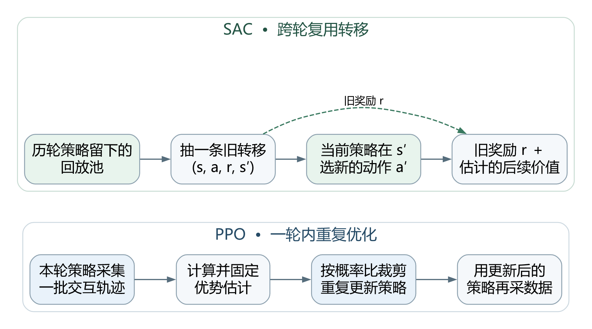

# 经验回放与数据利用

把剪刀捏稳以后，策略在几乎每个控制步都能采到一条「维持夹持」的经验。真正难学的，可能是剪刀刚滑动时应该加一点拇指力，还是先转手腕。即使再收集一百万条数据，如果新增的仍然主要是稳定夹持，最想解决的问题也可能没有变得更容易。

这篇笔记围绕一个判断展开。**经验有多大用，取决于它对下一次策略决策提供了什么证据。** 我们依次问三件事：经验里什么可以沿用，算法怎样把它变成更新信号，下一批预算又应该花在哪里。

## 1. 一条经验里，有哪两种信息？

设 $s$ 为执行动作前的环境状态，$a$ 为实际执行的动作，$r$ 为即时奖励，$s'$ 为下一状态。经验回放保存的是一条实际发生的转移 $(s,a,r,s')$。用 $\beta$ 表示当时采数据的行为策略，用 $\pi$ 表示现在想评价或改善的目标策略。

- **转移告诉你实际发生了什么。** 如果动力学和奖励定义一致，且 $s$ 足以描述影响后续的因素，固定 $s$ 和 $a$ 后，环境规律就不依赖是谁选了这个动作。这条旧记录仍是该转移规律的一次采样。环境有随机性时，需要多次采样才能分清偶然和规律。
- **行为策略决定哪些问题有数据可答。** 旧策略如果只会在将要打滑时加大拇指力，回放中即使有很多这样的状态，仍缺少转动手腕的后果。若旧摩擦参数和新摩擦参数不同，或者观测把不同接触状态混在一起，旧转移的适用范围也会缩小。

这里还要区分**一步转移**和**整条回报**。从同一个动作出发，旧策略往后可能继续夹紧，新策略往后可能松开再抓。第一步记录仍可沿用，后面累计得分的含义已经随策略改变。经验回放的核心工作就是决定怎样在利用旧的第一步时，评价新的后续行为。

## 2. PPO 和 SAC 复用数据时，在哪一步作了不同选择？

### 2.1 PPO 保留一批轨迹及其优势，局部更新策略

PPO 先用本轮策略采出一批轨迹，再计算每一步的优势估计。优势表达的是这个动作在当时状态下比参照水平好多少。同一批轨迹可以拆成多个小批次，重复训练多轮。每次策略改变后，会重新计算当前策略对记录动作的概率，并与采样时的概率做比。优势估计在这一轮的策略优化中保持固定。

想象一条经验表明「开始滑动时加一点力」在当时的策略下不错。PPO 会适度提高这类动作的概率；当比值越过正确方向上的裁剪阈值，目标就不再奖励这条样本继续拉大比值。若新策略已经开始主动重新抓取，它会到达旧轨迹几乎没有的状态，下一轮就需要采集能反映新行为的轨迹。[PPO 手记](PPO_handnote.md) · [PPO 原论文](https://arxiv.org/abs/1707.06347)

### 2.2 SAC 保留发生过的第一步，重新估计后续

SAC 的 critic 按状态与动作来估计长期得分。考虑一条从回放池抽出的未终止转移。令 $a'$ 是当前策略 $\pi$ 在 $s'$ 处新采的动作，$\gamma$ 是折扣因子，$\alpha$ 是熵温度，$\bar Q_1$ 和 $\bar Q_2$ 是慢更新的两个目标 critic。给在线 critic 的训练目标记为 $y$：

$$
y=r+\gamma\left[
  \min_{i=1,2}\bar Q_i(s',a')-\alpha\log\pi(a'\mid s')
\right].
$$

左边是要拟合给 $Q(s,a)$ 的监督值。右边的 $r$ 和 $s'$ 来自旧记录；$a'$ 和它的对数概率来自当前策略。目标 critic 给出新动作的长期估计，熵项也按当前策略计算。用一个已有估计来构造另一个状态的学习目标，叫**自举**。

所以一条旧数据可以服务许多版本的策略，但同一个目标里也会混合两种证据强度：真实测到的第一步，以及由网络估计的后续。如果当前策略经常选某类在回放里几乎没出现的动作，后者更多依赖外推。actor 又会提高被 critic 评为好动作的概率。只要某个缺乏数据支撑的动作被估得太高，估计与选择就可能互相强化。双 Q 取较小值可以缓解高估；真正缺少的动作结果仍得靠数据覆盖或可信的先验来补。[SAC 手记](SAC_handnote.md) · [SAC 原论文](https://arxiv.org/abs/1812.05905)

## 3. 从「多用几遍」变成「找出缺失的经验」

看剪刀任务时，先给恢复阶段一个可记录的入口。例如把「物体相对手指的速度连续几步超过阈值」定义为滑动起点。然后追踪该事件之后的动作和结果。诊断顺序取决于最早缺失的环节。

| 回放中观察到的情况 | 当前最缺的证据 | 可以比较的改动 |
| --- | --- | --- |
| 滑动起点很罕见 | 接近失败边界时的状态 | 保持动作规则，增加从这些状态出发的交互 |
| 滑动常见，但后续动作高度相似 | 同类状态下不同动作的后果 | 给恢复动作增加有控制的变化 |
| 多种恢复动作和结果都已有记录，训练却很少抽到 | 优化时实际见到这些片段的频率 | 改变回放抽样比例，对照普通回放 |

这三种改动影响的范围不同。前两种会改变下一批采到的经验，第三种只改变已有经验进入训练的频率。若补采恢复状态后，恢复率提高而整条任务的完成率没变，可以查看滑动事件在完整任务里发生得是否足够频繁。反过来，完整任务完成率提高时，也可以检查是恢复变好了，还是策略更少把剪刀推到滑动边缘。

比较 PPO、SAC 或回放方案时，同时画「评估完成率随环境交互数变化」和「随训练时间变化」两条曲线。前者测样本效率，后者包含 critic 更新、数据搬运和仿真吞吐。想检验「补什么数据」时，先固定初始策略和交互预算；想知道实际多久训练好，再比较到达同一指标的墙钟时间。[FlashSAC 原论文](https://arxiv.org/html/2604.04539v2)

## Appendix A. 动作概率比换算了什么？

固定状态 $s$，令 $f(s,a)$ 是想对动作求平均的量。$\pi(a\mid s)$ 和 $\beta(a\mid s)$ 是目标策略与行为策略的离散动作概率。若所有在 $\pi$ 下有正概率的动作，在 $\beta$ 下也有正概率，可把求和里的每项写成乘除 $\beta(a\mid s)$ 的形式：

$$
\mathbb E_{a\sim\pi}[f(s,a)]
=\mathbb E_{a\sim\beta}\left[
  \frac{\pi(a\mid s)}{\beta(a\mid s)} f(s,a)
\right].
$$

连续动作时，求和换成积分，概率换成密度。旧策略若给某个离散动作 1% 概率，新策略给 20%，这类观测在求平均时乘 20。小批次里可能碰巧完全没有这类动作，也可能偶然抽到一个、对结果影响很大。即使分布在数学上有重叠，实际样本也可能不足。上式只改变固定 $s$ 后的平均方式。若要连状态也换成新策略的访问分布，还需要处理状态访问频率的差异。[TRPO 手记附录](TRPO_handnote.md)

## Appendix B. 截断轨迹与真正结束有什么区别？

如果任务真结束，比如剪刀掉出工作区且环境把这次尝试判定为失败，那么对应的后续回报在任务定义中结束。若只是采样器每隔若干步切一段、环境仍可继续，这个切点之后还存在回报。计算目标时要用自动重置前的最后观测来延续估计，否则会把下一回合的起点错接成这条经验的后续。是否继续估计取决于任务定义：若固定时限本身规定了任务的终点，则时限到达就应该结束。

## Appendix C. UTD 的分母是什么？

设一次并行推进得到 $N$ 条新转移，做 $U$ 次 critic 更新，每次从回放池抽 $B$ 条记录。更新次数与新转移的比值是 $U/N$，总回放抽取量与新转移的比值是 $UB/N$。例如 $N=1024$、$U=2$、$B=4096$ 时，每轮做 2 次优化器更新，却抽出 8192 条记录，抽取量与新增量之比为 8。8 描述各轮抽取的规模，同一个旧样本可能被反复抽中，刚进入池的样本也可能尚未被用到。[FlashSAC 手记](flash_sac_handnote.md)
