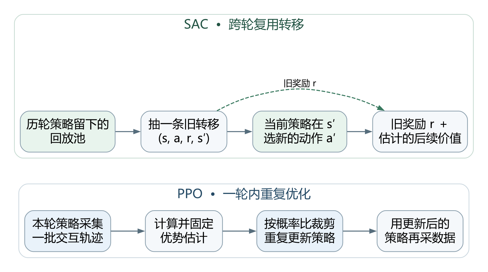
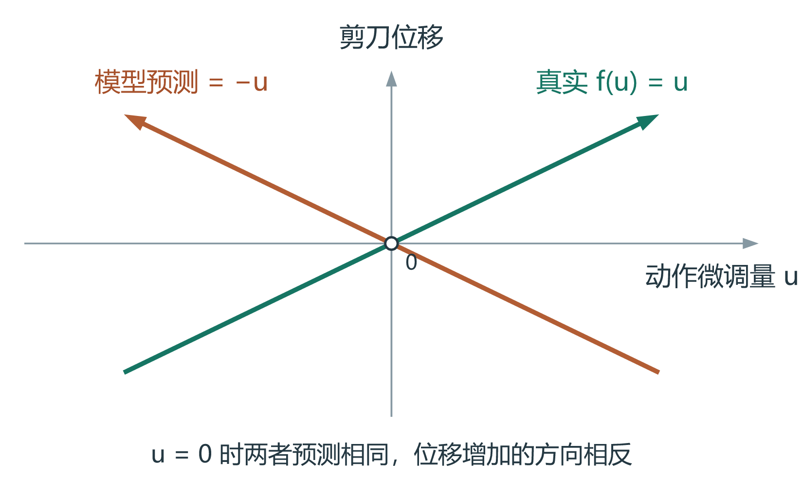

# 灵巧手强化学习调优

## 第一章：经验回放与数据利用

把剪刀捏稳以后，策略在几乎每个控制步都能采到一条「维持夹持」的经验。真正难学的，可能是剪刀刚滑动时应该加一点拇指力，还是先转手腕。即使再收集一百万条数据，如果新增的仍然主要是稳定夹持，最想解决的问题也可能没有变得更容易。

这篇笔记围绕一个判断展开。**经验有多大用，取决于它对下一次策略决策提供了什么证据。** 我们依次问三件事：经验里什么可以沿用，算法怎样把它变成更新信号，下一批预算又应该花在哪里。

### 1. 一条经验里，有哪两种信息？

设 $s$ 为执行动作前的环境状态，$a$ 为实际执行的动作，$r$ 为即时奖励，$s'$ 为下一状态。经验回放保存的是一条实际发生的转移 $(s,a,r,s')$。用 $\beta$ 表示当时采数据的行为策略，用 $\pi$ 表示现在想评价或改善的目标策略。

- **转移告诉你实际发生了什么。** 如果动力学和奖励定义一致，且 $s$ 足以描述影响后续的因素，固定 $s$ 和 $a$ 后，环境规律就不依赖是谁选了这个动作。这条旧记录仍是该转移规律的一次采样。环境有随机性时，需要多次采样才能分清偶然和规律。
- **行为策略决定哪些问题有数据可答。** 旧策略如果只会在将要打滑时加大拇指力，回放中即使有很多这样的状态，仍缺少转动手腕的后果。若旧摩擦参数和新摩擦参数不同，或者观测把不同接触状态混在一起，旧转移的适用范围也会缩小。

这里还要区分**一步转移**和**整条回报**。从同一个动作出发，旧策略往后可能继续夹紧，新策略往后可能松开再抓。第一步记录仍可沿用，后面累计得分的含义已经随策略改变。经验回放的核心工作就是决定怎样在利用旧的第一步时，评价新的后续行为。

### 2. PPO 和 SAC 复用数据时，在哪一步作了不同选择？

#### 2.1 PPO 保留一批轨迹及其优势，局部更新策略

PPO 先用本轮策略采出一批轨迹，再计算每一步的优势估计。优势表达的是这个动作在当时状态下比参照水平好多少。同一批轨迹可以拆成多个小批次，重复训练多轮。每次策略改变后，会重新计算当前策略对记录动作的概率，并与采样时的概率做比。优势估计在这一轮的策略优化中保持固定。

想象一条经验表明「开始滑动时加一点力」在当时的策略下不错。PPO 会适度提高这类动作的概率；当比值越过正确方向上的裁剪阈值，目标就不再奖励这条样本继续拉大比值。若新策略已经开始主动重新抓取，它会到达旧轨迹几乎没有的状态，下一轮就需要采集能反映新行为的轨迹。[PPO 手记](PPO_handnote.md) · [PPO 原论文](https://arxiv.org/abs/1707.06347)

#### 2.2 SAC 保留发生过的第一步，重新估计后续

SAC 的 critic 按状态与动作来估计长期得分。考虑一条从回放池抽出的未终止转移。令 $a'$ 是当前策略 $\pi$ 在 $s'$ 处新采的动作，$\gamma$ 是折扣因子，$\alpha$ 是熵温度，$\bar Q_1$ 和 $\bar Q_2$ 是慢更新的两个目标 critic。给在线 critic 的训练目标记为 $y$：

$$
y=r+\gamma\left[
  \min_{i=1,2}\bar Q_i(s',a')-\alpha\log\pi(a'\mid s')
\right].
$$

左边是要拟合给 $Q(s,a)$ 的监督值。右边的 $r$ 和 $s'$ 来自旧记录；$a'$ 和它的对数概率来自当前策略。目标 critic 给出新动作的长期估计，熵项也按当前策略计算。用一个已有估计来构造另一个状态的学习目标，叫**自举**。

所以一条旧数据可以服务许多版本的策略，但同一个目标里也会混合两种证据强度：真实测到的第一步，以及由网络估计的后续。如果当前策略经常选某类在回放里几乎没出现的动作，后者更多依赖外推。actor 又会提高被 critic 评为好动作的概率。只要某个缺乏数据支撑的动作被估得太高，估计与选择就可能互相强化。双 Q 取较小值可以缓解高估；真正缺少的动作结果仍得靠数据覆盖或可信的先验来补。[SAC 手记](SAC_handnote.md) · [SAC 原论文](https://arxiv.org/abs/1812.05905)

### 3. 从「多用几遍」变成「找出缺失的经验」

看剪刀任务时，先给恢复阶段一个可记录的入口。例如把「物体相对手指的速度连续几步超过阈值」定义为滑动起点。然后追踪该事件之后的动作和结果。诊断顺序取决于最早缺失的环节。

| 回放中观察到的情况 | 当前最缺的证据 | 可以比较的改动 |
| --- | --- | --- |
| 滑动起点很罕见 | 接近失败边界时的状态 | 保持动作规则，增加从这些状态出发的交互 |
| 滑动常见，但后续动作高度相似 | 同类状态下不同动作的后果 | 给恢复动作增加有控制的变化 |
| 多种恢复动作和结果都已有记录，训练却很少抽到 | 优化时实际见到这些片段的频率 | 改变回放抽样比例，对照普通回放 |

这三种改动影响的范围不同。前两种会改变下一批采到的经验，第三种只改变已有经验进入训练的频率。若补采恢复状态后，恢复率提高而整条任务的完成率没变，可以查看滑动事件在完整任务里发生得是否足够频繁。反过来，完整任务完成率提高时，也可以检查是恢复变好了，还是策略更少把剪刀推到滑动边缘。

比较 PPO、SAC 或回放方案时，同时画「评估完成率随环境交互数变化」和「随训练时间变化」两条曲线。前者测样本效率，后者包含 critic 更新、数据搬运和仿真吞吐。想检验「补什么数据」时，先固定初始策略和交互预算；想知道实际多久训练好，再比较到达同一指标的墙钟时间。[FlashSAC 原论文](https://arxiv.org/html/2604.04539v2)

### Appendix A. 动作概率比换算了什么？

固定状态 $s$，令 $f(s,a)$ 是想对动作求平均的量。$\pi(a\mid s)$ 和 $\beta(a\mid s)$ 是目标策略与行为策略的离散动作概率。若所有在 $\pi$ 下有正概率的动作，在 $\beta$ 下也有正概率，可把求和里的每项写成乘除 $\beta(a\mid s)$ 的形式：

$$
\mathbb E_{a\sim\pi}[f(s,a)]
=\mathbb E_{a\sim\beta}\left[
  \frac{\pi(a\mid s)}{\beta(a\mid s)} f(s,a)
\right].
$$

连续动作时，求和换成积分，概率换成密度。旧策略若给某个离散动作 1% 概率，新策略给 20%，这类观测在求平均时乘 20。小批次里可能碰巧完全没有这类动作，也可能偶然抽到一个、对结果影响很大。即使分布在数学上有重叠，实际样本也可能不足。上式只改变固定 $s$ 后的平均方式。若要连状态也换成新策略的访问分布，还需要处理状态访问频率的差异。[TRPO 手记附录](TRPO_handnote.md)

### Appendix B. 截断轨迹与真正结束有什么区别？

如果任务真结束，比如剪刀掉出工作区且环境把这次尝试判定为失败，那么对应的后续回报在任务定义中结束。若只是采样器每隔若干步切一段、环境仍可继续，这个切点之后还存在回报。计算目标时要用自动重置前的最后观测来延续估计，否则会把下一回合的起点错接成这条经验的后续。是否继续估计取决于任务定义：若固定时限本身规定了任务的终点，则时限到达就应该结束。

### Appendix C. UTD 的分母是什么？

设一次并行推进得到 $N$ 条新转移，做 $U$ 次 critic 更新，每次从回放池抽 $B$ 条记录。更新次数与新转移的比值是 $U/N$，总回放抽取量与新转移的比值是 $UB/N$。例如 $N=1024$、$U=2$、$B=4096$ 时，每轮做 2 次优化器更新，却抽出 8192 条记录，抽取量与新增量之比为 8。8 描述各轮抽取的规模，同一个旧样本可能被反复抽中，刚进入池的样本也可能尚未被用到。[FlashSAC 手记](flash_sac_handnote.md)

## 第二章：预测准确与动作改进

训练一个动力学模型时，我们经常先看预测误差。小误差说明模型在测过的样本上能复现系统的输出。可是，只要下一步打算把模型接进策略优化，就多了一个要求：**策略改一点动作时，模型能不能指出实际收益会往哪边变？**

这篇笔记从策略真正用到的信号出发，再回过头看数据应怎样采，模型应怎样验。

### 1. 策略要选的是增一点，还是减一点

设 $u$ 是相对当前控制指令的微调量，正值表示手指向右多推一点。$f(u)$ 是真实系统下一时刻的水平位移，$\hat f(u)$ 是模型预测。为便于看清符号，把两者都归一化。考虑真实关系 $f(u)=u$，模型关系 $\hat f(u)=-u$。

如果只在 $[-0.01,0.01]$ 内测试，模型的最大绝对误差是 $0.02$。当前指令 $u=0$ 处，模型还完全正确。可是，为了把剪刀向右移，真实系统应增大 $u$，模型却建议减小 $u$。若把测试范围缩得更窄，最大误差继续下降，两条曲线的斜率仍为 $+1$ 和 $-1$。

从控制的角度看，这是**工作点本身**和**工作点附近的局部响应**两种信息。稳定夹持时大量重复执行近似同一个指令，能帮模型逼近该工作点的输出。要学出附近的动作方向，还需要在相关状态下采到不同动作，观察响应是否随动作改变。对剪刀来说，最有价值的扰动不一定发生在稳态，它可能发生在即将失去接触的几步里。

### 2. 学习信号沿哪条路径到达 actor？

#### 2.1 可微世界模型沿状态轨迹传递梯度

世界模型拟合当前状态和动作到下一状态的映射。SuperMimic 用普通仿真器记录状态转移来拟合模型，再让策略在模型中运行短轨迹，通过反向传播求多个控制步对回报的影响，并用 critic 估计短轨迹之后的回报。[SuperMimic 原论文](https://arxiv.org/abs/2610.28480) · [作者项目页](https://supermimic.github.io/)

以防止剪刀滑动为例，第一步拇指移动会改变下一步的剪刀速度。这个状态变化又会改变策略后续输出，也会改变手指能否保持压紧。梯度沿这些依赖向回传，最终告诉策略第一步指令往哪里改。若世界模型把拇指动作对剪刀速度的响应方向学反，后续奖励设计得再合理，反传到第一步的建议仍可能指向错误的方向。

#### 2.2 SAC 直接用长期回报对动作的响应

SAC 的 critic 估计 $Q(s,a)$，即在状态 $s$ 做动作 $a$，之后依照策略运行的预期软回报。actor 的动作由网络参数决定，critic 对动作的梯度可以沿这条依赖传给 actor。完整的 actor 目标还包含熵项，所以用这个方式检验的是其中的价值信号。[SAC 原论文](https://arxiv.org/abs/1812.05905)

设真实的两个软回报分别为 40.1 与 40.0，而网络对它们的估计分别为 40.0 与 40.1。两次绝对误差都是 0.1，但动作排序完全翻转。对 actor 来说，可能需要看的指标是**同一状态下相邻动作的回报差**。误差大但对所有相邻动作都加上了类似的常数，局部方向仍可能好用。误差小但沿动作变化的方式错了，策略就可能连续选错。

可以把两条路径看成两种信息压缩方式。世界模型先预测多步状态，再从奖励和后续价值获得梯度。critic 直接学习长期得分，省去在 actor 更新中显式展开状态。它们都需要动作改动及其后果的证据，失败可以分别发生在动力学响应或价值响应上。

### 3. 把「方向准不准」作为单独的验证任务

1. **定义在哪些状态、沿哪些动作方向比较。** 从稳定夹持、初次滑动和即将换接触点分别挑快照。每个快照先指定名义动作，可以是当前 actor 的均值。再选拇指法向力、手腕角度等有物理解释的方向。按正负同幅度扰动，后续恢复使用同一冻结策略。
2. **明确两边比较的是同一个得分。** 若检验世界模型，用同样的有限步奖励和终止规则，分别从模型和仿真得到成对的回报差。若检查 SAC critic，则用相同后续策略、多次仿真轨迹估计软回报差。两个第一步动作的得分可以用普通回报作另一项指标，但那回答的是任务收益，和包含熵的价值目标要分别报告。
3. **把预测误差、方向一致率和动作收益差一起看。** 可按接触阶段汇总。若两次尝试的真实收益差小到无法从随机波动中识别，把这一对记为方向未判定。再试几档扰动大小，检查结论是只在很小的邻域成立，还是对策略实际会尝试的改动也成立。

该检查能区分三类后续工作。模型预测和方向都差时，先检查观测是否包含接触信息。预测误差很小但方向经常相反时，优先在对应状态补采多种动作的结果。方向对了但策略表现没有提升时，再检查这些状态的出现频率、actor 的更新幅度，以及正确方向能够带来的收益大小。

### Appendix A. 用两次试验估计方向导数

设 $J(u)$ 是固定起点执行第一步指令 $u$ 后、用固定策略继续运行的期望得分。$u_0$ 是当前指令，$h>0$ 是扰动大小。沿这个方向的中心差分为：

$$
D_h J(u_0)=\frac{J(u_0+h)-J(u_0-h)}{2h}.
$$

两侧的泰勒式都有同一个常数项和同一个二阶项，相减时它们抵消。两个一阶项符号相反，相减后得到两倍的一阶变化。若 $J$ 在附近有有界的三阶导数，剩余截断误差随 $h^2$ 缩小。多维动作时，选单位方向 $v$，把两个动作改写成 $u_0+hv$ 与 $u_0-hv$。这个试验只测沿 $v$ 的局部响应，依次选择几个方向就能检查不同动作维度。

小扰动让比较更局部，也会放大仿真噪声在差分中的影响。跨过接触切换时，导数可能不存在或不稳定，这时直接报告所选幅度的收益差，能说明控制器实际可做的改动。环境带随机性时，可以配对起点和外部随机条件，再重复多组试验估计差值的波动。

### Appendix B. 一步反传里的两项从哪里来？

令 $x_0$ 为固定状态，$a_0$ 为第一步动作，$\hat f$ 为世界模型，$x_1=\hat f(x_0,a_0)$ 为预测的下一状态。$V(x_1)$ 是从 $x_1$ 开始的后续价值，$r(x_0,a_0)$ 是示例中的即时奖励，$\gamma$ 为折扣因子。用列向量表示梯度，$J_a\hat f$ 表示模型输出对动作的雅可比矩阵。

$$
\begin{aligned}
\hat J(a_0) &= r(x_0,a_0)+\gamma V(x_1),\\
\nabla_{a_0}\hat J &=
\nabla_{a_0}r+\gamma(J_a\hat f)^\top \nabla_{x_1}V.
\end{aligned}
$$

第一项评价动作对当前奖励的直接影响。第二项先经模型的局部响应，再由价值评价这个状态变化是否有利。把轨迹展开为多步，还会经过后续策略与模型的雅可比。若只希望定位问题，可先验一步动力学在关键动作方向上的响应，再验整段回报的方向。前者对而后者错时，问题可能出在后续模型滚动、奖励或价值截断上。

## 第三章：灵巧手的重定向与直接强化学习

**演示最值钱的地方，是它能把「最后成功了没有」拆成一串中途可比较的状态。** 剪刀快掉的时候，直接给一个失败分数，只告诉策略这次没拿稳。若有参考轨迹，可以在剪刀真正掉下去之前，就发现手和物体的相对关系已经偏离。这能让学习信号来得更早。另一面是，人手演示也可能把某种特定抓法、速度和换指顺序一起带进奖励。先判断**哪些细节值得学，哪些应该让机器手自己决定**，再决定怎样用演示。

### 3.1 重定向、跟踪和直接强化学习分别做什么？

**动作重定向（retargeting）** 把人手演示映射成目标机器手的参考。人和机器人指节长度、关节自由度、运动范围不同，直接照搬人手的关节角，指尖可能够不到同一个位置。实际要先选值得保留的关系，例如拇指相对于剪刀柄的位置、另外几根手指的接触位置、剪刀的开合轨迹，再求机器手能做出的姿态。这里的**逆运动学**就是给定指尖等点的目标位置，反求关节角。

**参考跟踪** 让机器手在执行过程中根据观测纠偏。最简单的是将重定向关节轨迹交给已有位置控制器。也可以用 RL 训练一个反馈策略，输出完整指令，或者只输出对名义指令的修正。后者称为**残差强化学习**。REGRIND 用手与物体的空间关系构造参考，训练时用关键点比较实际运动与参考运动，并把修正后的关节位置目标交给底层比例微分控制器。它还从参考轨迹的不同位置初始化，给策略机会练习那些从头探索很难到达的阶段。[REGRIND 原论文 §3.3](https://arxiv.org/html/2607.11874v1#S3.SS3) · [作者项目页](https://www.yunhaifeng.com/REGRIND/)

**直接强化学习** 在本章指不要求逐帧跟随示范，主要依照任务结果学习策略。给它的目标可以是「不用桌面撑住剪刀，稳定夹持的同时完成指定次数的开合」，由策略选择怎么抓、什么时候换指。它同样可以使用底层位置控制、任务阶段奖励，或者从预抓取状态开始。PPO、SAC 都可以用于参考跟踪，也都可以用于直接任务优化。这里讨论的是**目标怎么表达、策略输出什么、训练从哪里开始**，这些选择可以分别改变。

### 3.2 为什么跟踪奖励通常更容易写？

假设我们已经把剪刀的关键点和手指的接触位置重定向好了。每个控制步都可以问：剪刀的位置和开合角离目标多少？指尖相对剪刀柄的位置离接触参考多少？这些误差有连续大小。即使两次尝试最后都失败，贴近目标、让滑动减缓的那次通常也能得到更好的中间分数。

用一个示意奖励说明。设 $t$ 是当前控制步，$x_t$ 是当前物体关键点，$x_t^{\mathrm{ref}}$ 是参考关键点。$c_t$ 与 $c_t^{\mathrm{ref}}$ 分别是当前和参考的手指相对物体位置。$\sigma_x$ 与 $\sigma_c$ 是允许误差的尺度，$w_x$ 与 $w_c$ 代表两项的权重。一个逐步跟踪奖励可以写成：

$$
\begin{aligned}
r_t^{\mathrm{track}}={}&w_x
  \exp\!\left(-\frac{\|x_t-x_t^{\mathrm{ref}}\|^2}{\sigma_x^2}\right)\\
 &+w_c
  \exp\!\left(-\frac{\|c_t-c_t^{\mathrm{ref}}\|^2}{\sigma_c^2}\right).
\end{aligned}
$$

误差为零时，该项拿满分。误差等于所设尺度时，该项剩下约 37%。这样写的好处是，换成另一条演示，通常仍能用同一套误差计算。难点被移到了**参考量的选择**。如果恢复时需要暂时放弃某根手指的接触、用另一根手指支撑，过高的手指跟踪权重就可能持续惩罚正确的恢复动作。把接触位置定义在物体坐标系，可以自然比较不同摆放姿态下的同一种抓法；如果任务允许多种抓法，还要决定在什么阶段才需要匹配这些位置。

直接 RL 的奖励有时反而更容易**定义成功**。例如手内旋转，可以量当前姿态到目标姿态的角度误差。OpenAI 的手内旋转工作用「上一步角度误差减去这一步误差」奖励进展，达到目标时额外加分，掉落时扣分。它没有用人类演示，策略仍学会了换指和多指协调。这个例子说明，只要能找到与任务紧密相关的进度量，直接任务奖励也能逐步给出信号。对于夹稳、对准、开合、恢复连续发生的任务，难点是怎样给不同阶段提供这种信号，又给多种有效动作留下空间。[Learning Dexterous In-Hand Manipulation 原论文 §4.2](https://arxiv.org/html/1808.00177#S4.SS2)

以剪刀为例，如果只奖励铰链角度改变，策略可能靠桌面顶开。若只奖励指尖靠近剪刀柄，策略可能把手停在柄旁。一个可检验的任务表达可以先定义**成功事件**：物体保持在规定区域，按顺序达到目标开合角，之后仍保持受控。然后用夹持稳定性、向当前阶段目标推进等信号辅助学习，最后用独立的任务成功判据评估。阶段化奖励要知道现在应当「开」还是「合」。若策略看不到阶段或开合目标，同一个观测就可能要求它向两个相反方向动作。

### 3.3 重定向最容易漏掉的是动力学可行性

一个姿态看起来像示范，还要问**机器人能不能靠自己的力维持这些接触**。人手视频通常能给出位姿和运动顺序，接触力大小、力矩和局部摩擦信息往往需要另外估计。即使重定向后的指尖每帧都够得到，快速开合时也可能因为夹力不足、执行延迟、剪刀负载变化而打滑。逐帧做逆运动学还容易遇到关节分支跳变，因而通常需要考虑关节限位、碰撞和时间连续性。

可以按失败出现的位置判断先改哪里：

- **静止时就够不到或穿模。** 检查人体与机器人坐标对齐、物体尺寸、指定的接触位置和关节限位。优先改参考。
- **慢放能做，正常速度下失败。** 重点查速度、力矩余量、控制延迟和接触参数。时间重标定可以检验名义速度是不是问题的一部分。
- **正常轨迹能走完，稍有偏差就滑落。** 重点测策略在异常状态上的反馈。例如提前或延后轻微推扰，再看它能否在接触还可恢复时调整夹持。
- **残差长期打满。** 名义动作可能存在持续偏差，修正范围可能太小，也可能是底层执行器已经饱和。分开记录名义指令、残差和执行后的实际控制量，可以区分这些情况。

本仓库的剪刀实验给了一个具体例子：在该测试协议下，零残差参考控制完成了 0/256 次，某个训练后的残差模型完成了 254/256 次。前者已经保留参考和底层控制，因此这里比较的是**同一套参考是否需要学得的反馈修正**。这组数字还没有比较从任务奖励直接训练的策略。[剪刀实验报告](report.md)

### 3.4 两条路线各自把成本放在哪里？

| 维度 | 重定向引导的 RL | 直接任务 RL |
| --- | --- | --- |
| 输入信息 | 演示提供接触、时序和物体运动 | 任务目标、状态观测和结果判据 |
| 奖励难点 | 选择该跟什么、误差容差与各项权重 | 设计中间信号，确保高分行为直接服务任务 |
| 探索 | 容易先到达示范接触附近，恢复动作仍需专门练 | 更容易容纳不同抓法，随机探索也可能长期碰不到成功 |
| 可执行性 | 穿模、超速、错误接触会从参考传入 | 在仿真中直接试执行，效果取决于仿真和实机动力学是否一致 |
| 泛化 | 可泛化到扰动或新参考，分别取决于训练覆盖 | 可泛化到见过的目标分布附近，仍需分开测新物体、新抓法和新扰动 |
| 迁移成本 | 换手要重新考虑形态、可达性和接触映射 | 换手可复用部分任务目标，通常仍需适配动作、观测和训练分布 |

**示范通常最适合提供「怎么进入难找的接触」，任务目标最适合说明「最终要实现什么」。** 因此这两条路线可以组合。若目标是复现一个特定的人手动作，可以保留较强的过程跟踪。若目标是稳定完成开合，可以多跟踪物体关键点和铰链角，对手指的位置留出更多余地。若示范主要解决初始抓取探索，可以仅用它做训练初期的参考或起点，再用任务结果继续优化。DexTrack 也把「能跟随新的参考」作为独立的泛化问题，并利用覆盖更多参考的训练数据来学习跟踪控制。[DexTrack 原论文](https://arxiv.org/abs/2502.09614)

### 3.5 用剪刀任务回答哪条路线更适合

如果研究问题是**示范本身能提供多少收益**，可以设计三个对照。它们使用相同的手、物体、物理设置和底层控制，评估时用同一任务成功标准。

1. **参考控制基线。** 执行重定向轨迹，记录首次失稳时刻、失败接触和控制饱和。这能看出参考本身能执行到哪一步。
2. **同一个跟踪目标，比较完整指令与残差指令。** 两者观察同一参考并使用相同跟踪奖励。此对照主要看名义指令是否让学习更快，以及它是否会限制大的恢复动作。
3. **同一个动作接口，比较跟踪引导与纯任务反馈。** 例如都使用同一个完整指令接口，一组使用任务奖励加跟踪奖励，另一组只用任务奖励。如果前者还拿到了参考帧或参考起点，需把这些当成额外信息，分别报告。只想测奖励的作用时，可以用同一观测和重置分布，在训练目标里开关跟踪项。

评估可依次用原始起点、扰动后的起点、未见的摩擦或物体设置。记录完整开合成功率、恢复率、打滑时间和首次达标所需交互步数。若跟踪误差很小但任务成功率不高，先查参考是否满足物理和任务约束。若跟踪引导更快学会、直接 RL 最终更稳，可再检查后者有没有找到不同的接触策略，前者是否被固定时序或动作余量卡住。这样才能知道瓶颈在**目标表达、探索还是控制可行性**。

### Appendix A. 三个容易混用的量

- **名义关节轨迹** $q_t^{\mathrm{ref}}$ 描述期望的关节构型，量纲通常是弧度。若控制器接受位置目标，可以将它转成名义控制指令 $a_t^{\mathrm{ref}}$。如果策略动作是关节力矩，就需要相应的底层映射，不能把参考角度直接加到力矩上。
- **残差动作** $\Delta a_t$ 是策略输出的修正，和 $a_t^{\mathrm{ref}}$ 必须处在相同动作空间。简单形式是 $a_t=a_t^{\mathrm{ref}}+\Delta a_t$，执行前再按控制范围限幅。修正范围越大，越有机会换一种动作；范围较小则更容易保持名义运动。
- **跟踪误差** 比较实际关节、物体位姿或接触量和各自的参考。即使残差很大，最终误差也可能很小，因为残差正在补偿名义控制的偏差。分析结果时应分别看残差大小、跟踪误差与最终任务成功。

### Appendix B. 怎样给直接 RL 加一个进度信号？

一种办法是把「当前离目标有多远」写成势函数 $\Phi(s)$。$s$ 是当前状态，可以包含剪刀开合阶段。$\Phi(s)$ 是一个标量，越接近本阶段目标越大。用 $s_t,s_{t+1}$ 表示转移前后的状态，$\gamma$ 表示与任务回报相同的折扣因子。每一步额外奖励设为：

$$
F_t=\gamma\Phi(s_{t+1})-\Phi(s_t).
$$

把每个 $F_t$ 按折扣加起来，相邻两步中同一个状态的势函数会抵消。若轨迹有 $T$ 步，累计的额外奖励只剩 $-\Phi(s_0)+\gamma^T\Phi(s_T)$。把所有真正终止状态的势设为零后，从同一起点出发的轨迹都加上同一个常数。这样就能在中途提供进度信号，同时保留原任务对完整轨迹的偏好。常用的距离差也有相同的进度直觉；上式中的折扣和终止处理让抵消条件明确。

这个技巧仍然要求势函数有意义。如果只用铰链角度作为势，剪刀已经快滑落时，策略得到的中间信号可能依旧只反映开合进度。设计时要把「能不能从这个信号看出进展」和「最终评估认定什么是成功」分开检查。[势函数奖励塑形原论文](https://people.eecs.berkeley.edu/~russell/papers/icml99-shaping.pdf)
