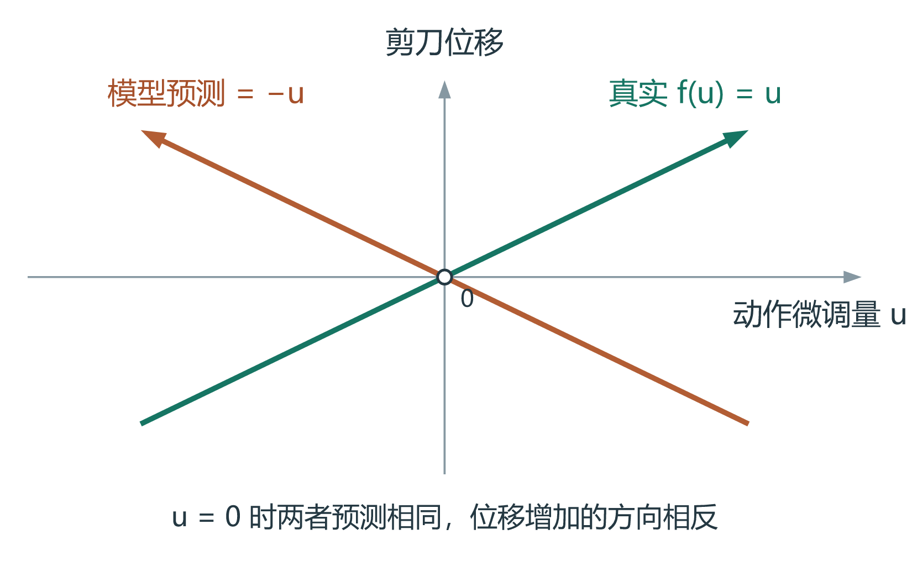

# 预测准确与动作改进

训练一个动力学模型时，我们经常先看预测误差。小误差说明模型在测过的样本上能复现系统的输出。可是，只要下一步打算把模型接进策略优化，就多了一个要求：**策略改一点动作时，模型能不能指出实际收益会往哪边变？**

这篇笔记从策略真正用到的信号出发，再回过头看数据应怎样采，模型应怎样验。

## 1. 策略要选的是增一点，还是减一点

设 $u$ 是相对当前控制指令的微调量，正值表示手指向右多推一点。$f(u)$ 是真实系统下一时刻的水平位移，$\hat f(u)$ 是模型预测。为便于看清符号，把两者都归一化。考虑真实关系 $f(u)=u$，模型关系 $\hat f(u)=-u$。

如果只在 $[-0.01,0.01]$ 内测试，模型的最大绝对误差是 $0.02$。当前指令 $u=0$ 处，模型还完全正确。可是，为了把剪刀向右移，真实系统应增大 $u$，模型却建议减小 $u$。若把测试范围缩得更窄，最大误差继续下降，两条曲线的斜率仍为 $+1$ 和 $-1$。

从控制的角度看，这是**工作点本身**和**工作点附近的局部响应**两种信息。稳定夹持时大量重复执行近似同一个指令，能帮模型逼近该工作点的输出。要学出附近的动作方向，还需要在相关状态下采到不同动作，观察响应是否随动作改变。对剪刀来说，最有价值的扰动不一定发生在稳态，它可能发生在即将失去接触的几步里。

## 2. 学习信号沿哪条路径到达 actor？

### 2.1 可微世界模型沿状态轨迹传递梯度

世界模型拟合当前状态和动作到下一状态的映射。SuperMimic 用普通仿真器记录状态转移来拟合模型，再让策略在模型中运行短轨迹，通过反向传播求多个控制步对回报的影响，并用 critic 估计短轨迹之后的回报。[SuperMimic 原论文](https://arxiv.org/abs/2610.28480) · [作者项目页](https://supermimic.github.io/)

以防止剪刀滑动为例，第一步拇指移动会改变下一步的剪刀速度。这个状态变化又会改变策略后续输出，也会改变手指能否保持压紧。梯度沿这些依赖向回传，最终告诉策略第一步指令往哪里改。若世界模型把拇指动作对剪刀速度的响应方向学反，后续奖励设计得再合理，反传到第一步的建议仍可能指向错误的方向。

### 2.2 SAC 直接用长期回报对动作的响应

SAC 的 critic 估计 $Q(s,a)$，即在状态 $s$ 做动作 $a$，之后依照策略运行的预期软回报。actor 的动作由网络参数决定，critic 对动作的梯度可以沿这条依赖传给 actor。完整的 actor 目标还包含熵项，所以用这个方式检验的是其中的价值信号。[SAC 原论文](https://arxiv.org/abs/1812.05905)

设真实的两个软回报分别为 40.1 与 40.0，而网络对它们的估计分别为 40.0 与 40.1。两次绝对误差都是 0.1，但动作排序完全翻转。对 actor 来说，可能需要看的指标是**同一状态下相邻动作的回报差**。误差大但对所有相邻动作都加上了类似的常数，局部方向仍可能好用。误差小但沿动作变化的方式错了，策略就可能连续选错。

可以把两条路径看成两种信息压缩方式。世界模型先预测多步状态，再从奖励和后续价值获得梯度。critic 直接学习长期得分，省去在 actor 更新中显式展开状态。它们都需要动作改动及其后果的证据，失败可以分别发生在动力学响应或价值响应上。

## 3. 把「方向准不准」作为单独的验证任务

1. **定义在哪些状态、沿哪些动作方向比较。** 从稳定夹持、初次滑动和即将换接触点分别挑快照。每个快照先指定名义动作，可以是当前 actor 的均值。再选拇指法向力、手腕角度等有物理解释的方向。按正负同幅度扰动，后续恢复使用同一冻结策略。
2. **明确两边比较的是同一个得分。** 若检验世界模型，用同样的有限步奖励和终止规则，分别从模型和仿真得到成对的回报差。若检查 SAC critic，则用相同后续策略、多次仿真轨迹估计软回报差。两个第一步动作的得分可以用普通回报作另一项指标，但那回答的是任务收益，和包含熵的价值目标要分别报告。
3. **把预测误差、方向一致率和动作收益差一起看。** 可按接触阶段汇总。若两次尝试的真实收益差小到无法从随机波动中识别，把这一对记为方向未判定。再试几档扰动大小，检查结论是只在很小的邻域成立，还是对策略实际会尝试的改动也成立。

该检查能区分三类后续工作。模型预测和方向都差时，先检查观测是否包含接触信息。预测误差很小但方向经常相反时，优先在对应状态补采多种动作的结果。方向对了但策略表现没有提升时，再检查这些状态的出现频率、actor 的更新幅度，以及正确方向能够带来的收益大小。

## Appendix A. 用两次试验估计方向导数

设 $J(u)$ 是固定起点执行第一步指令 $u$ 后、用固定策略继续运行的期望得分。$u_0$ 是当前指令，$h>0$ 是扰动大小。沿这个方向的中心差分为：

$$
D_h J(u_0)=\frac{J(u_0+h)-J(u_0-h)}{2h}.
$$

两侧的泰勒式都有同一个常数项和同一个二阶项，相减时它们抵消。两个一阶项符号相反，相减后得到两倍的一阶变化。若 $J$ 在附近有有界的三阶导数，剩余截断误差随 $h^2$ 缩小。多维动作时，选单位方向 $v$，把两个动作改写成 $u_0+hv$ 与 $u_0-hv$。这个试验只测沿 $v$ 的局部响应，依次选择几个方向就能检查不同动作维度。

小扰动让比较更局部，也会放大仿真噪声在差分中的影响。跨过接触切换时，导数可能不存在或不稳定，这时直接报告所选幅度的收益差，能说明控制器实际可做的改动。环境带随机性时，可以配对起点和外部随机条件，再重复多组试验估计差值的波动。

## Appendix B. 一步反传里的两项从哪里来？

令 $x_0$ 为固定状态，$a_0$ 为第一步动作，$\hat f$ 为世界模型，$x_1=\hat f(x_0,a_0)$ 为预测的下一状态。$V(x_1)$ 是从 $x_1$ 开始的后续价值，$r(x_0,a_0)$ 是示例中的即时奖励，$\gamma$ 为折扣因子。用列向量表示梯度，$J_a\hat f$ 表示模型输出对动作的雅可比矩阵。

$$
\begin{aligned}
\hat J(a_0) &= r(x_0,a_0)+\gamma V(x_1),\\
\nabla_{a_0}\hat J &=
\nabla_{a_0}r+\gamma(J_a\hat f)^\top \nabla_{x_1}V.
\end{aligned}
$$

第一项评价动作对当前奖励的直接影响。第二项先经模型的局部响应，再由价值评价这个状态变化是否有利。把轨迹展开为多步，还会经过后续策略与模型的雅可比。若只希望定位问题，可先验一步动力学在关键动作方向上的响应，再验整段回报的方向。前者对而后者错时，问题可能出在后续模型滚动、奖励或价值截断上。
