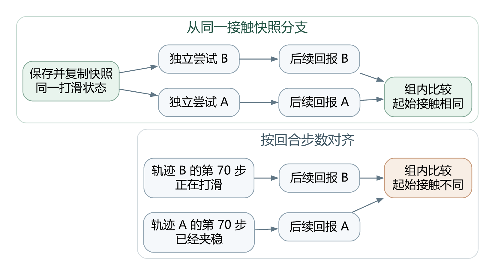

# GRPO 与可比较轨迹

两次抓剪刀的尝试，一次成功，一次失败。如果第一次开始时剪刀已经夹稳，第二次开始时拇指正在失去接触，我们很难说这两次结果到底反映了多少动作差异。若能把同一个要滑落的状态复制成几份，再观察策略如何补救，比较就能回答一个更具体的问题。

**GRPO 留给灵巧手最值得研究的想法，是怎么构造这种参照。** 这篇先解释为什么大模型容易找到参照，再看机器人里该固定哪些条件，以及为此要付出多少采样预算。

## 1. 同一道题的多个答案，可以互相作参照

假设模型对一道容易的题得了 80 分，同题其他答案平均得 95 分。它对一道难题得了 50 分，同题其他答案平均得 20 分。绝对分数依次是 80 和 50。减去同题参照后，分别得到 $-15$ 和 $+30$。后一个回答在绝对分数上较低，却提供了更值得保留的尝试。

DeepSeekMath 的 **GRPO**（Group Relative Policy Optimization，组相对策略优化）从同一个题目出发，用同一版本的策略采多个答案。以最终答案评分的版本为例，先在组内对回报减均值、除标准差，再把相对分数作为优势估计参与裁剪后的策略更新。这里的**基线**是同一道题的平均分，替代了专门学习这个参照的价值网络。相对分数怎么计算，可看附录 A。[DeepSeekMath 原论文 §4.1](https://arxiv.org/html/2402.03300#S4.SS1)

这个机制有个前提：题目本身是很自然的分组条件。从同一题出发，得到多个可能答案，分数差才有明确的参照。机器人的「题目」还需要定义。任务名称、参考轨迹进度和真实接触状态都可以拿来分组，它们提供的比较不同。

## 2. 灵巧手里的「同一道题」怎么定义？

**按回合经过的步数分组。** 例如把第 70 步对齐，每条轨迹从第 70 步计算后续回报。组内比较的对象是「推进到相同时间位置后，各轨迹的后续结果」。这样较容易用现有的并行采样数据。即使两条轨迹共享参考帧，一条可能已夹稳，另一条已经打滑，所得参照仍包含当时接触状态的差异。若训练还会从随机参考帧起步，相同回合步数甚至可以对应不同的参考进度。

**按接触快照分组。** 从「剪刀刚开始滑动」的一个完整仿真快照复制出多个环境，然后用同一个策略和相互独立的动作采样，得到不同尝试。快照要保存手指与物体的位姿、速度、参考帧和控制器内部状态。如果环境已经抽过摩擦参数，同组沿用那次取值，跨组再随机化。组内回报差因此更直接地反映从同一个起点出发的行为差异。

不过，相同起点的轨迹会很快走散。用整段回报，能够比较各次恢复尝试的总体成败。想定位到第几步、哪个动作有用，可以在关键时刻重新保存状态并分支，或对每步计算从该步起的后续回报。只要轨迹已经走散，即使使用同一步的后续回报，也应该记得各条轨迹当时面对的接触情况可能不同。

DexPolicy 已在灵巧操作中使用过无 critic 的 GRPO 续训。作者按回合经过步数对齐，对该步的折扣后续回报做组内归一化，重点比较的是探索噪声调度。下面的接触分组是可以在剪刀任务中测试的另一个问题。[DexPolicy §IV-B、§V-C](https://arxiv.org/html/2610.00360#S4.SS2)

## 3. 组应该有多大？先弄清预算换来了什么

假设可以完整运行 64 条同样长度的短轨迹。给每个起点 2 次尝试，可以覆盖 32 个起点。给每个起点 8 次，只能覆盖 8 个。当差异主要来自摩擦、姿态或滑动方向时，覆盖更多起点很重要。当起点已经比较明确、要找的是一种罕见的恢复动作时，集中多试几次更有机会看到正反例。

组内必须有可区分的结果。用二值成功奖励，如果一组全失败，组内标准化后的信号就是零。可以先记录「全失败组」「全成功组」「组内有成有败」分别有多少，再决定是否增加组大小，或者在恢复过程中使用滑动减缓、重新建立接触这样的中间信号。中间信号和最终完成率要一起看。暂时减慢滑动的动作之后也可能丢掉剪刀。

## 4. 把采样收益和分组收益拆开测

1. **主对照。** 固定起始模型、快照池、奖励、更新规则和新增仿真步数。让一组独立抽取起点后按回合步数分组，另一组每次复制同一个起点再做组内比较。如果恢复段提前结束，以真实交互步数结算预算。
2. **定位收益来源。** 在复制采样的条件下，再比较两种分组规则。可以从同样分布生成训练批次，一种只按步数分组，另一种保留快照编号，在同一快照的尝试内分组。这样更容易判断收益来自重复采样本身，还是来自计算参照的方式。
3. **验证任务能力。** 一套测试从训练没见过的滑动起点开始，测夹稳恢复率；另一套从完整任务起点开始，测最终完成率。同时记录见过多少起点、多少组有回报差。如果恢复率提高但完成率下降，要进一步检查组太大是否压缩了起点覆盖，或恢复评分是否鼓励了只在短段里有利的动作。

最值得先问的是：**轻微打滑时，在同一个接触起点多试几次，能不能比扩大起点覆盖更快学会恢复？** 这个结论取决于任务和奖励，可以用上述对照检验。

## Appendix A. GRPO 怎样计算相对得分？

设同一题采了 $K$ 条回答或轨迹。$R_i$ 为第 $i$ 条的回报，$\bar R$ 为组内均值，$\sigma_R$ 为组内标准差，$\varepsilon>0$ 是避免除零的小量。相对分数记为 $A_i$：

$$
A_i=\frac{R_i-\bar R}{\sigma_R+\varepsilon}.
$$

若四条轨迹里三条得 0，一条得 1，组均值为 0.25。减均值后失败各得 $-0.25$，成功得 $0.75$。组内标准差为正，只会改变这一组的更新尺度。不同组的标准差不同，所以相同的原始分差在不同组里的权重也可能不同。全组得分相同时，分子全为零。

把它放回算法理解：GRPO 和 PPO-Clip 都用当前策略与采样策略的概率比构造裁剪目标。GRPO 的一个关键选择是用同组采样形成优势信号。原论文还有相对于参考策略的 KL 项。参考策略用于约束整体漂移，采样策略用于计算概率比，二者在实现中可以是不同的策略版本。[DeepSeekMath 原论文 §4.1](https://arxiv.org/html/2402.03300#S4.SS1)

## Appendix B. RLOO 为什么把本条轨迹留出去？

RLOO（REINFORCE Leave-One-Out）提供一个更直接的基线。仍用 $R_i$ 表示第 $i$ 条轨迹的回报。组大小 $K\geq2$ 时，用其余 $K-1$ 条的平均值构造它的参照 $b_i$：

$$
b_i=\frac{1}{K-1}\sum_{j\ne i} R_j,\qquad A_i=R_i-b_i.
$$

在给定快照后，如果不同轨迹独立采样，其余轨迹形成的 $b_i$ 和本条轨迹的动作采样独立。因此在未裁剪的 REINFORCE 策略梯度里，减去这个基线不会改变期望梯度。直觉是：给定起点，所有可能轨迹的概率加起来是 1，对参数求导为 0，独立于本条轨迹的参照乘上这个和也为 0。这个结论给出了一个干净对照：可以先测「同起点的相对参照」是否有用，再额外加入组内尺度归一化或裁剪。[RLOO 原论文 §2.3](https://arxiv.org/html/2402.14740#S2.SS3)
