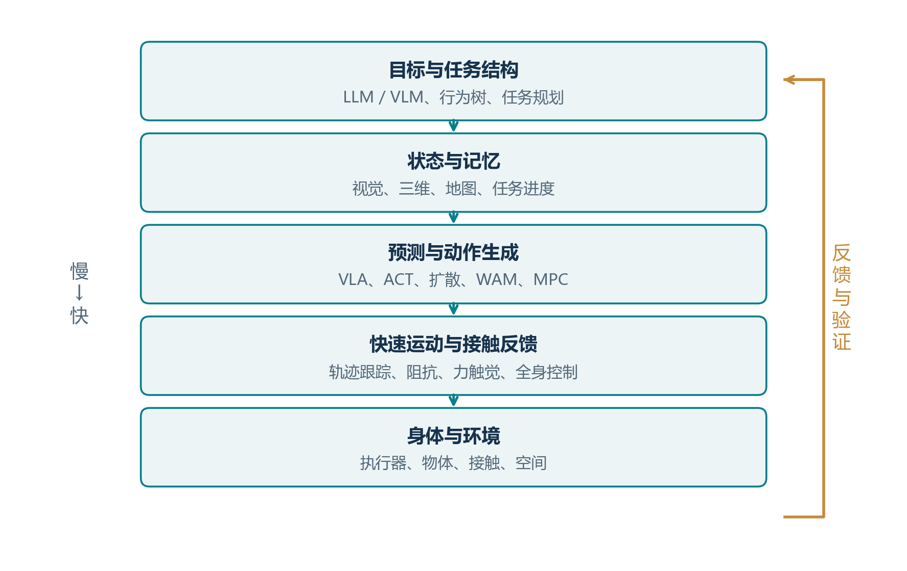
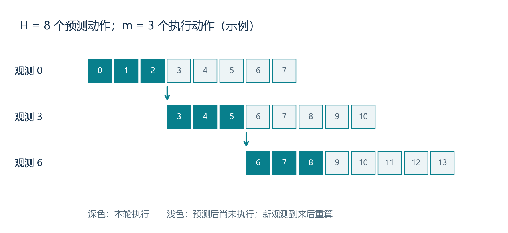
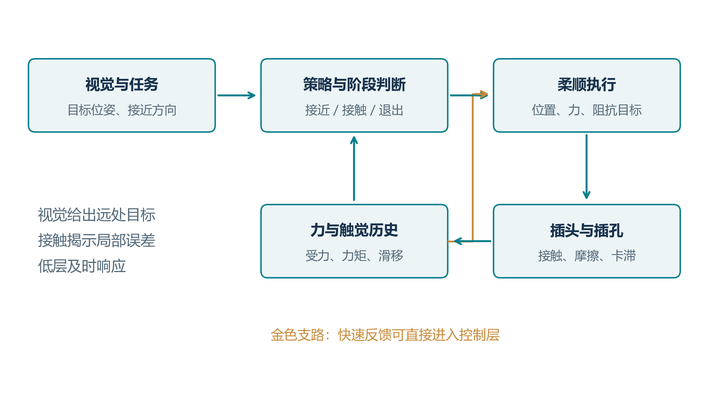
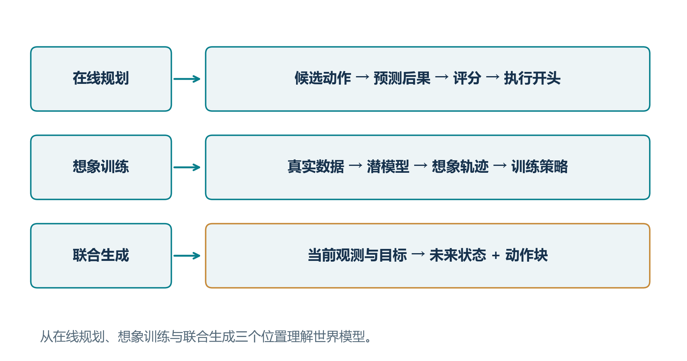
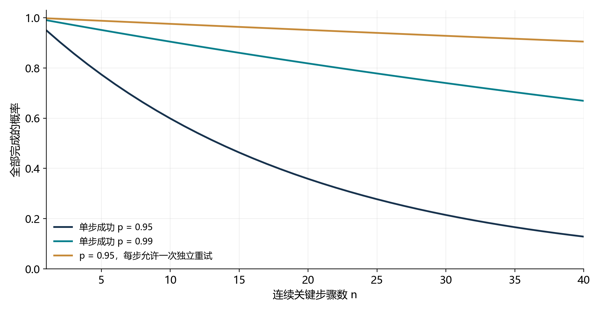
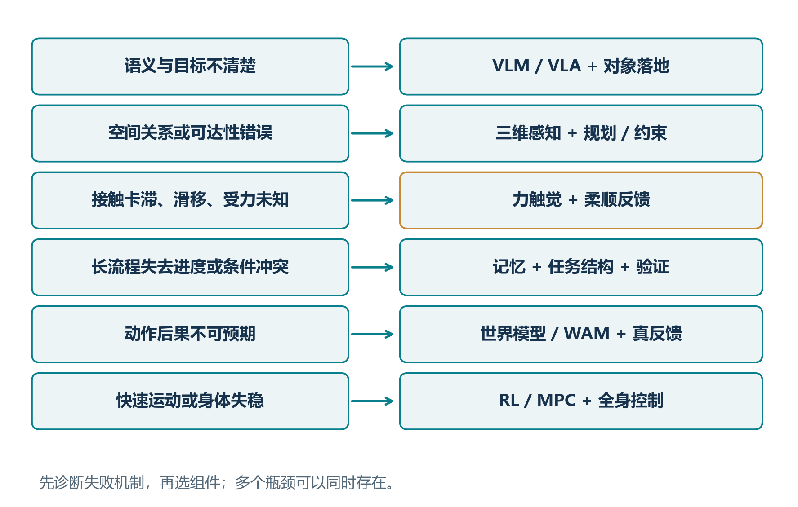

# 具身智能技术路线小书

从感知、接触与决策，到能够持续完成任务的机器人

技术资料核验截至 2026 年 10 月 27 日 · 讲义修订版

> 阅读定位：本书以高等数学、线性代数、系统建模、自动控制、深度学习与强化学习为基础，逐步引入机器人几何、接触机制、任务规划和基础模型。

## 导读：从问题出发理解技术路线

机器人完成一项任务，需要形成一条连续的因果链：传感器获得信息，系统估计当前状态，决策模块选择目标，控制器驱动身体，新的观测再反馈到下一轮决策。理解 embodied tasks 的各种方法，可以从这条链上的四个问题入手：**机器人需要知道什么，应该决定什么，怎样产生动作，以及怎样利用行动后的反馈。**

本书围绕一个任务展开：**找到桌上的杯子，装入饮品，再送给指定的人。** 找杯子需要识别对象并搜索空间；抓杯子需要理解几何与可达性；装饮品需要跟踪连续变化；放置与交接需要处理接触；送达需要导航、记忆和任务进度管理。任务逐步展开时，几何规划、模仿学习、VLA、力触觉、LLM 驱动和 WAM 的动机也随之显现。

全书按“任务建模—方法原理—系统组合—研究实践”组织。前两章给出共同的问题框架；第 3 至 10 章解释主要技术路线；第 11 至 17 章讨论导航、全身运动、长期行为、数据和部署；最后三章把这些知识组织成选型与研究方法。专有名词保留领域通行写法，并在首次出现时解释概念。

**建议阅读顺序。** 建立全局认识可先读第 1、2、18、20 章；研究基础模型可重点读第 6 至 10 章；关注接触操作可连读第 3、8、16 章。每个公式先定义符号，再解释数学关系和控制意义。正文以原始论文与项目资料为依据，六幅教学图帮助读者把抽象结构对应到实际机器人。

# 第 1 章　任务建模：状态、信息与行动

## 1.1 具身任务中的信息闭环

具身任务的一个基本特点是：**动作既改变世界，也改变机器人能够获得的信息。** 机械手绕到杯子侧面，会改变自身位置，同时看清杯柄；轻触物体，会产生位移与受力，同时揭示接触位置和材料性质。感知与控制由此相互耦合。

先定义时间步 t；真实状态 s_t，包含机器人、物体与环境；动作 a_t，为执行接口接收的指令；观测 o_t，为传感器读数；过程扰动 w_t 和观测噪声 v_t；动力学函数 f 和观测函数 h。状态描述系统的物理情况，观测描述机器人获得的信息。动作的具体形式可以是位置、速度或力矩参考。

$$
s_{t+1}=f(s_t,a_t,w_t),\qquad o_t=h(s_t,v_t)
$$

第一个式子描述动作如何推动状态演化，第二个式子描述状态如何形成观测。杯中液体质量、孔内接触位置和桌面摩擦系数，都会影响动作结果。机器人通过视觉、接触传感、历史信息与主动试探，逐步获得这些量的估计。

把任务指令记为 l，观测与动作历史记为 H_t=(o_0,a_0,...,o_t)。belief b_t 表示给定历史后对当前状态的概率分布；连续状态可用概率密度表示。策略 π 根据 belief 与任务选择动作：

$$
b_t(s_t)=p(s_t\mid H_t),\qquad a_t\sim\pi(\cdot\mid b_t,l)
$$

这构成部分可观测决策问题的基本形式。历史用于推断当前状态，belief 用于组织不确定性，策略负责把当前认识转成行动。工程中常用状态估计器、图像窗口、循环网络或记忆模块近似这一过程。后文的主动感知、触觉融合和世界模型，都可以沿着这个框架理解。

## 1.2 用五个维度组织任务难度

| 维度 | 较简单的情形 | 较复杂的情形 | 需要发展的能力 |
|---|---|---|---|
| 语义开放程度 | 固定对象与固定工艺 | 新指令、新对象、新工具 | 指令理解、grounding |
| 几何与动力学变化 | 固定工位、刚性物体 | 遮挡、柔性、液体、未知摩擦 | 状态估计、接触与动态建模 |
| 时间跨度 | 一次抓取 | 搜索、取物、运输、整理 | 任务分解、记忆、恢复 |
| 身体复杂程度 | 固定单臂 | 双臂、灵巧手、移动人形 | 冗余协调、平衡、动作映射 |
| 运行要求 | 仿真中重复试验 | 与人协作、持续完成任务 | 结果检测、反馈与维护 |

这些维度分别对应不同的信息与控制需求。新指令要求系统表达目标，精密插入要求系统感知接触，长流程要求系统管理进度。把任务放到这些维度上，就能看出应该优先补充哪一种能力。

## 1.3 把任务目标写成可判断的条件

以杯子任务为例，“拿起”可以用杯子离开支撑面且相对夹爪稳定来判断；“装入饮品”可以用液位或质量达到目标来判断；“送达”可以用到达指定对象并完成交接来判断。这些完成条件同时服务于控制切换、训练奖励和评测。

任务定义因而包含初始状态分布、传感器、动作接口、完成条件、时间要求和终止条件。明确这些内容后，技术选择就有了依据：观测不足时补感知与记忆，动作精度不足时补几何与反馈，长流程中断时补任务结构与恢复。任务建模把一个宽泛的智能目标转成一组可求解的问题。

# 第 2 章　技术路线的共同结构

## 2.1 从功能位置建立技术地图

图 1 按功能组织具身系统。高层把请求转成任务，中层处理状态、预测和动作，低层把动作变为身体运动。反馈贯穿整个过程。一个神经网络可以覆盖相邻的若干层，层级系统也可以把这些功能交给不同组件。

| 分类坐标 | 主要选项 | 回答的问题 |
|---|---|---|
| 决策组织 | 单一策略、层级技能、TAMP、智能体编排 | 下一步做什么？ |
| 动作生成 | 回归、离散 token、ACT、扩散、flow matching、优化 | 怎样得到动作？ |
| 学习信号 | 模仿、自监督、强化学习、混合训练 | 依据什么经验学习？ |
| 输入与表征 | RGB、深度、点云、语言、力、触觉、记忆 | 决策使用什么信息？ |
| 预测机制 | 动力学规划、想象训练、未来与动作联合生成 | 怎样利用动作后果？ |

沿着这五个坐标，可以给每一种方法找到位置。VLA 组织视觉、语言与动作之间的映射；VFA（Vision-Force-Action）强调视觉和接触受力对动作的共同作用；LLM 驱动组织高层计划与技能调用；WAM（World Action Model）连接未来演化与动作生成。理解这些位置，有助于把不同方法组合成完整系统。

## 2.2 主要方法家族

| 方法家族 | 主要输出或中间量 | 核心动机 | 实现重点 |
|---|---|---|---|
| 几何规划与反馈控制 | 状态、轨迹、约束 | 精确到达并跟踪目标 | 几何、标定、模型与反馈 |
| Behavior Tree 与 TAMP | 技能序列、前提条件、运动解 | 组织多步骤任务 | 离散次序与连续运动的连接 |
| 模仿学习策略 | 动作或 action chunk | 从示范获得操作技能 | 数据覆盖、动作分布与时间结构 |
| 强化学习策略 | 动作、价值或残差 | 根据执行结果优化行为 | 奖励、探索、经验循环 |
| 三维与 affordance 方法 | 抓点、关键点、作用区域 | 将语义目标落到空间交互 | 三维表征与几何结构 |
| VLA 与通用策略 | 条件动作分布 | 共享语义和跨任务经验 | 预训练、条件与动作接口 |
| 力触觉与 VFA | 接触状态、位置或力参考 | 利用接触信息调整动作 | 传感融合与柔顺执行 |
| LLM / VLM 智能体 | 子目标、程序、技能调用 | 组合技能并管理长任务 | grounding、记忆与结果反馈 |
| 世界模型与 WAM | 未来状态、视频、动作 | 用预测帮助选择与学习动作 | 动力学表示、目标与执行闭环 |
| 混合层级系统 | 多种结构化输出 | 协调不同能力与时间尺度 | 接口、状态同步与调度 |

affordance 描述对象、环境和机器人共同决定的交互机会。例如，杯柄为夹爪提供抓取区域，桌面为杯子提供支撑位置。判断 affordance 时，系统同时考虑物体几何、夹爪尺寸、当前姿态与后续任务。

## 2.3 模型、训练与执行怎样组合

**模型规定表示与映射。** VLA 指明了视觉、语言和动作的关系，三维网络规定空间信息如何编码，世界模型规定未来如何表示。

**训练规定知识来源。** 同一个 VLA 可以先通过 behavior cloning 学习示范，再通过强化学习 post-training 优化执行结果。扩散与 flow matching 则为动作分布提供不同的学习与采样机制。

**执行规定闭环组织。** 模型生成的动作可以交给轨迹跟踪器、阻抗控制器或全身控制器；高层任务可以通过技能库连接到这些执行组件。把这三层分别看清，便能理解为什么一套系统同时使用 VLA、世界模型与传统控制，也能判断某项论文贡献具体改善了哪里。

# 第 3 章　几何、动力学与规划控制

## 3.1 从目标位姿到关节运动

机器人抓取杯子，需要把“杯柄所在的位置和方向”转成“每个关节应该如何运动”。机器人学用 pose 表示位置与朝向。三维刚体 pose 属于 SE(3)，其结构由平移和旋转共同构成；旋转可用旋转矩阵、四元数或局部角度参数表示。

先定义关节位置向量 q；末端相对基座的 pose T；旋转矩阵 R；位置向量 p；正运动学映射 FK。T 在本节表示空间变换。

$$
T=\mathrm{FK}(q)=\begin{bmatrix}R&p\\0&1\end{bmatrix}
$$

FK 从关节位置计算末端 pose；inverse kinematics 根据目标 pose 求关节位置。求解时把关节范围、末端朝向和碰撞条件一起纳入。对于有多个逆解的机械臂，还可以选择更便于避障、保持视野或执行后续动作的姿态。

得到起点与终点后，运动规划寻找连接二者的可行轨迹。采样搜索擅长寻找障碍环境中的通路，轨迹优化擅长组织平滑、避障和能耗目标。常见流程是先找到通路，再优化形状并分配运动时间。

## 3.2 MPC：通过预测组织反馈

环境和状态估计会随执行发生变化，因此轨迹需要持续更新。MPC（Model Predictive Control）的做法是：预测一段未来，求解当前最合适的控制序列，执行开头部分，再用新观测重算。

定义预测步数 N；预测状态 x_k；控制输入 u_k；目标状态 x_g；终端代价 V_f；状态权重 Q 和控制权重 R_u；约束集合 C。加权平方范数为 ‖x‖²_Q=xᵀQx，通常 Q 半正定、R_u 正定。x 表示控制器选择的状态变量，R_u 表示控制代价权重。

$$
\min_{u_{0:N-1}}\sum_{k=0}^{N-1}\left(\|x_k-x_g\|_Q^2+\|u_k\|_{R_u}^2\right)+V_f(x_N)
$$

优化同时满足预测动力学 x_{k+1}=f(x_k,u_k) 和约束 (x_k,u_k)∈C。状态代价推动机器人接近目标，输入代价控制动作强度，终端代价评价预测末端的状态。关节极限、碰撞距离和允许接触力都可以通过约束表达。

MPC 把目标与执行条件统一到一个优化问题中。其实现围绕三个环节展开：用模型预测后果，用状态估计修正预测起点，用在线求解及时调整控制。后文的学习动力学和世界模型，可以直接进入这一结构。

## 3.3 接触如何改变动力学

机械手接近桌面时，主要控制自身运动；与桌面接触后，环境开始施加约束与反作用力；推动物体时，摩擦又影响物体的运动。不同接触模式对应不同的有效动力学，因此接触状态需要参与控制决策。

定义关节位置 q、速度 dq/dt、加速度 d²q/dt²；惯性矩阵 M；速度相关项 C；重力项 g；关节力矩 τ；接触雅可比 J_c；环境作用在机器人上的接触力 F_c。机器人动力学可写为：

$$
M(q)\ddot q+C(q,\dot q)\dot q+g(q)=\tau+J_c(q)^T F_c
$$

J_c 把关节速度映射到接触点速度，J_c 的转置把接触力映射到关节广义力。这个关系解释了为什么末端接触会改变关节负载，也说明了力觉反馈进入控制的物理位置。第 8 章将进一步用阻抗关系描述机器人如何顺应接触。

## 3.4 TAMP 与任务执行结构

“先打开柜门，再取杯子”规定任务次序；“抓哪个位置、手臂从哪里经过”规定几何运动。TAMP（Task and Motion Planning）把这两类决策联系起来：任务规划提出技能及前提条件，运动求解检查并实现具体几何过程。PDDLStream 通过符号规划与连续采样的连接实现这一思想。[R01]

Behavior Tree 用条件、动作、顺序和备选分支组织执行。例如，抓取节点完成后检查杯体稳定性，检查失败则进入重新定位分支；通路阻塞时触发重规划。它使任务推进和恢复逻辑形成清晰的控制结构。

由此，传统方法提供了一组可复用的系统接口：目标 pose、状态、轨迹、约束和反馈误差。学习方法可以预测这些中间量，也可以直接生成动作。两者通过明确的接口共同完成任务。

# 第 4 章　模仿学习：从示范到动作分布

## 4.1 behavior cloning：直接学习专家动作

很多精细操作容易由人演示，例如对准杯柄、双臂折叠和插入电池。模仿学习利用这些示范，把人的操作经验转成条件策略，省去逐项编写技能规则的工作。

定义示范数据集 D；策略参数 θ；专家动作 a；条件信息 c，包含视觉、语言、proprioceptive state 和历史；条件动作分布 π_θ。behavior cloning 用专家动作的负对数似然作为学习目标：

$$
\mathcal L_{BC}(\theta)=\mathbb E_{(c,a)\sim D}\left[-\log\pi_\theta(a\mid c)\right]
$$

降低这个损失，会使策略在相似条件下为专家动作分配更高概率。于是数据中的抓取、移动和双臂协调逐步进入策略。训练设计的重点是让条件信息足够表达任务状态，并让动作表示保留专家行为的空间和时间结构。

## 4.2 多解行为为什么需要动作分布

机器人可以从障碍物左侧绕行，也可以从右侧绕行。如果两种示范同时出现，直接最小化均方误差会倾向于输出两者的平均值，而这个平均动作可能正对障碍物。这个例子说明：操作学习需要表达多个可行解，并在执行中选择一条一致的路径。

这里的 multimodal 指动作分布具有多个峰。混合密度模型、latent variable、离散动作、能量模型、扩散和 flow matching 都可以表达这种结构。生成动作分布的动机，是把“存在多个合理做法”保留到策略输出中，再通过任务条件与采样选择具体行为。

## 4.3 ACT：一次预测连续动作

单步预测需要在每个控制时刻重新组织局部动作，细小误差容易逐步改变运动方向。action chunking 把未来一段动作一起生成，让策略直接学习一段具有时间一致性的行为。

ACT（Action Chunking with Transformers）把这一思路用于低成本双臂操作，并结合 conditional VAE 和时间聚合。[R02] conditional VAE 用隐变量表达示范中的行为变化，动作解码器根据观测和隐变量生成动作序列；时间聚合则综合不同预测时刻对当前动作的估计。

定义预测长度 H；action chunk A_t=(a_t,...,a_{t+H-1})；实际执行长度 m，满足 1≤m≤H。H_t 表示截至当前的观测动作历史，H 表示块长。

$$
A_t\sim\pi_\theta(\cdot\mid H_t,l),\qquad\text{execute }a_t,\ldots,a_{t+m-1}
$$

H 决定模型一次规划多长的局部行为，m 决定多久接收一次新反馈。较大的 m 减少推理调用，较小的 m 提高扰动响应速度。将这两个量分别设计，就能协调动作一致性、计算开销和闭环反应。

## 4.4 Diffusion Policy：逐步生成有结构的动作

Diffusion Policy 从条件生成的角度学习动作分布。训练时给示范动作加噪声，让网络根据当前观测恢复动作结构；执行时从随机噪声出发，通过多步去噪得到一段动作，再滚动执行。[R03]

先定义干净动作块 A_0；噪声等级 k 下的动作 A_k；标准高斯噪声 ε；预设噪声系数 ᾱ_k；噪声预测网络 ε_θ。k 索引生成过程，t 索引机器人的实际执行时刻。

$$
A_k=\sqrt{\bar\alpha_k}A_0+\sqrt{1-\bar\alpha_k}\epsilon
$$

训练让 ε_θ(A_k,k,c) 拟合真实噪声 ε。给定观测 c，网络逐渐学会哪些动作序列符合任务。采样过程可以选择“从左绕行”这一分布峰，并在整个动作块中保持方向一致。

这种方法把高维动作、多解行为和时间平滑统一到一个生成问题中。多步去噪带来的计算开销，使采样步数、网络规模与执行流水线成为重要设计变量；这些变量将在部署章节中与闭环延迟一起讨论。

## 4.5 从成功示范到恢复技能

模仿学习的数据可以围绕任务阶段组织：正常接近、首次接触、动作完成、偏离后的修正。这样，同一个策略既学习标准技能，也学习如何回到能够继续执行的状态。

以抓杯子为例，常规示范教会策略闭合夹爪并提起；边缘状态示范教会它调整抓点；滑移后的示范教会它重新支撑和抓取。数据采集从完整成功轨迹扩展到关键转移状态后，策略的闭环行为也会更加完整。

## 4.6 DAgger 与运行分布

策略执行会决定自己接下来遇到什么状态。一次轻微抓偏，可能让下一帧中的杯子位于夹爪外侧，此时需要重新对准。这个新状态来自学习策略的实际行为，因此有必要把运行过程纳入数据采集。

DAgger 类方法让当前策略执行，再由专家为实际访问的状态提供纠正，逐轮合并数据并更新策略。[R43] 专家可以是人、规划器或已有的可靠策略。这一过程使训练数据逐步覆盖机器人真正到达的状态。

Implicit Behavioral Cloning 还提供了另一种动作表示：网络给“观测—动作”组合分配能量，通过优化或采样寻找低能量动作。[R44] 多个低能量区域对应多个行为解。综合这些方法，可以把动作学习理解为三个相互配合的问题：数据覆盖哪些状态，策略表达哪些行为解，以及执行时怎样利用新观测更新动作。

# 第 5 章　强化学习：从执行结果改进行为

## 5.1 用回报表达行为质量

有了可执行技能后，机器人还可以进一步学习怎样更快、更稳、更省力地完成任务。强化学习把这些要求写成奖励，让策略通过动作后果改进行为。

定义策略 π；每步奖励 r_t；折扣因子 γ∈[0,1)；累计回报 J(π)。初始状态、策略与动力学共同决定轨迹分布。J(π) 衡量策略的长期结果，J_c 则是前章动力学中的接触雅可比。

$$
J(\pi)=\mathbb E_\pi\left[\sum_{t=0}^{\infty}\gamma^t r_t\right]
$$

例如插入任务可以奖励有效连接、惩罚过大接触力，并评价完成时间。策略通过试验发现动作和这些后果之间的关系。训练系统因此需要把任务目标、奖励测量、经验采集和复位过程组织在一起。

## 5.2 四种学习组织方式

| 用法 | 经验来源 | 核心动机 | 主要设计问题 |
|---|---|---|---|
| 仿真中从头学习 | 大规模并行交互 | 学习动态运动和复杂协调 | 奖励、场景与现实迁移 |
| Offline RL | 固定交互数据 | 利用已有成功与失败评价动作 | 数据覆盖与价值估计 |
| 模仿后强化学习 | 示范加策略交互 | 从已有技能继续优化 | 探索范围、复位与更新 |
| Residual RL | 基础控制与交互经验 | 学习结构化控制中的修正量 | 残差接口、幅度与带宽 |

## 5.3 Residual RL：把学习集中在修正量

很多任务已经有一个能工作的控制器，例如把插头送到插孔附近。此时可以让学习模块专门处理摩擦、偏差和接触扰动，把已有模型知识与数据驱动修正结合起来。[R04]

定义基础控制指令 u_base、策略修正 Δu_θ 和总输入 u，三者采用相同坐标、单位和接口：

$$
u=u_{base}+\Delta u_\theta
$$

基础控制器承担主要运动结构，残差承担环境变化带来的局部调整。设计时围绕基础闭环、修正幅度、采样频率和执行器饱和进行协调，就能把学习问题收缩到最需要适应的部分。

## 5.4 Sim-to-real：让训练覆盖真实闭环

仿真允许大量并行试验，现实部署则带来质量、摩擦、电机带宽、背隙、相机噪声和通信延迟等变化。Sim-to-real 的目标是把仿真中形成的行为迁移到真实身体。

domain randomization 在训练时改变动力学和感知参数，使策略适应一组环境；system identification 利用真实数据校准模型，使训练分布更接近硬件。二者可以先后或同时使用：先校准主要特性，再随机化仍会变化的参数。

privileged information 指仿真中容易获得的精确状态，如地面摩擦或完整接触信息。教师策略利用这些状态学习行为，学生再从真实可用的观测与历史中学习相应能力。RMA 通过运动历史估计环境相关信息，展示了快速适应的实现思路。[R05]

## 5.5 基础模型的强化学习 post-training

对已有 VLA 进行强化学习，动机是利用真实执行结果调整动作质量。动作采用离散 token 时，可以沿序列概率计算更新；动作采用连续生成时，需要结合其采样与概率表示设计策略优化。奖励、优势估计和更新幅度因此与 action head 紧密关联。

完整的 post-training 循环包括执行、评价、复位、保存经验和更新策略。通过示范提供起点，再围绕当前失败收集经验，训练能够逐步向速度、稳定性和任务完成率推进。这个循环把机器人运行过程变成持续学习的数据来源。

# 第 6 章　VLA：把语义知识接到动作接口

## 6.1 从语义理解到条件动作生成

面对“把有把手的杯子拿来”，机器人需要同时理解类别、属性、对象关系和当前身体状态。VLA 的动机是让大规模视觉语言预训练中的知识直接参与动作选择，形成跨对象、指令与任务共享的策略。

VLM（Vision-Language Model）以图像和语言为条件理解或生成语义内容。VLA 在这一表征基础上学习机器人动作：视觉描述现场，语言指定目标，proprioceptive state 描述身体，action head 输出下一段运动。

定义图像 I_t、机器人状态 q_t、指令 l、动作块 A_t，以及策略参数 θ。条件策略为：

$$
p_\theta(A_t\mid I_t,q_t,l)
$$

训练把语义概念和动作经验关联起来。例如预训练提供“杯柄适合抓握”的概念，机器人示范提供接近、闭合与提起的连续动作。共享表征使这些知识能够在多个任务之间复用，而动作数据把语义具体连接到机器人接口。

## 6.2 action head 的三种组织方式

| 动作表示 | 生成机制 | 适合表达的结构 | 主要计算特点 |
|---|---|---|---|
| 离散 token | 量化或编码连续量，再预测符号 | 动作序列与语义条件 | 关注编码精度与序列长度 |
| 连续回归 | 直接输出数值或 action chunk | 较集中的条件动作分布 | 解码简单，便于并行 |
| 连续生成 | 扩散或 flow matching | 多解、高维连续动作 | 关注采样步数和网络调用 |

RT-2 把动作写成 token，并与视觉语言任务共同训练，建立了语义知识向机器人控制迁移的代表性路径。[R06] OpenVLA 提供了开源模型与适配流程，使这一结构更便于研究与复现。[R07]

OpenVLA-OFT 进一步把连续动作、并行解码、action chunk 和回归损失组织成高效微调方案。[R08] 从这条发展线可以看到，动作表示决定了训练目标、推理形式与执行效率，因而是 VLA 设计中的核心环节。

## 6.3 flow matching：把噪声分布运输到动作分布

π0 把 vision-language backbone 与连续 action expert 结合，利用 flow matching 生成动作。[R09] 这个方法的直觉是学习一组连续的移动方向，让随机噪声逐步形成符合当前任务的动作块。

定义示范动作块 A、噪声 Z、生成时间 σ∈[0,1]、插值 X_σ、条件 c 和速度场 v_θ。这里 σ 索引生成过程；机器人执行时间使用 t。本节约定 σ=0 为噪声端，σ=1 为数据端。

$$
X_\sigma=(1-\sigma)Z+\sigma A,\qquad \frac{dX_\sigma}{d\sigma}=A-Z
$$

直线路径的速度为 A-Z。训练时采样示范、噪声和路径位置，让速度场拟合该方向：

$$
\mathcal L_{FM}=\mathbb E\left[\|v_\theta(X_\sigma,\sigma,c)-(A-Z)\|^2\right]
$$

推理时从噪声出发，数值积分 dX/dσ=v_θ(X,σ,c)，得到动作块。条件 c 使同一套生成机制能够随对象、语言和身体状态改变输出。噪声路径、时间采样和数值积分步数共同影响训练与推理效率。

Diffusion Policy 从去噪目标学习动作结构，flow matching 从路径速度学习分布运输。两种方法都把复杂动作分布交给条件生成器，再通过滚动执行接入机器人闭环。

## 6.4 通用策略怎样共享跨任务经验

通用策略需要把不同任务、观察方式与动作接口放进可共享的表示。Octo 以 Transformer 和扩散解码构建通用策略，强调任务条件、观测结构与动作空间的适配。[R10] 它展示了机器人数据组织与灵活接口在跨任务学习中的作用。

π0.5 进一步研究开放环境与异构数据训练。[R11] π0.7 通过语言、执行属性和 visual subgoal 等条件组织多来源经验，并研究技能组合。[R12] 这些设计试图解决同一个问题：当示范来自不同身体、策略与完成质量时，如何让条件把行为差异表达清楚，使共享网络学到可复用的结构。

## 6.5 快慢时间尺度下的系统设计

语义任务变化相对缓慢，机械运动与接触反馈变化较快，因此 VLA 系统常把高层理解、动作生成和低层跟踪安排在不同时间尺度。高层更新目标，action expert 生成短期动作，执行层持续跟踪与处理接触。

GR00T N1.7 的架构说明采用视觉语言基础模型与连续动作去噪头。[R13] Gemini Robotics 2 的系统组织包含具身推理、动作与端侧执行模型，并面向全身操作扩展。[R14] 这些实现把通用理解与快速运动连接起来，具体接口和运行频率决定了二者怎样协同。

## 6.6 围绕任务需求扩展 VLA

三维信息让目标与动作共享空间坐标；力触觉让策略感知接触变化；记忆保存遮挡对象与任务进度；层级规划组织多步骤；世界模型预测动作后果；强化学习利用执行经验优化行为。这些扩展分别作用于状态表达、决策组织和动作改进。

因此，发展 VLA 可以从具体任务出发：桌面抓放先关心对象与几何变化，精密装配先关心接触，移动整理先关心记忆与进度。沿着任务的因果链补充信息与结构，能够把通用策略逐步接成完整的闭环系统。

# 第 7 章　三维、affordance 与结构化动作

## 7.1 为什么动作需要空间表征

抓取杯柄，需要知道夹爪从哪个方向进入、抓点相对身体有多远、经过哪些空间。视觉识别提供对象语义，三维表征进一步组织动作所需的距离、朝向与支撑关系。

深度图为像素提供距离；点云把可见表面表示为三维采样点；体素把空间划分为小格子。它们使感知结果可以与末端 pose、碰撞距离和目标方向直接关联。深度质量、相机标定和可见区域决定了这些空间量的精度。

引入三维信息的动机是共享几何结构。相机改变视角后，世界中的杯柄仍然处在同一个位置；整个场景平移时，杯柄与杯身的相对关系仍然保留。用适合这些变换的表示，可以减少模型重复学习空间关系所需的数据。

## 7.2 从空间作用点到连续动作

PerAct 将语言与体素化观测结合，通过空间动作定位学习多任务操作。[R15] DP3 将稀疏三维表征与 Diffusion Policy 结合，把空间信息作为连续动作生成的条件。[R16] 这两类设计分别强调空间动作位置与动作轨迹分布。

另一条路径先预测抓取 pose、接触点、物体关键点或 affordance 图，再让规划器生成运动。关键点可以表示杯柄中心、杯口、容器边缘等任务相关位置。这样，模型把大规模视觉信息压缩成直接参与任务求解的几何量。

表征的精细程度随任务而定：刚体抓放可以使用 pose 与少量关键点，布料操作需要描述更多局部形变，液体操作需要跟踪液面和流动。选择表征，就是选择哪些环境变化应该进入决策。

## 7.3 用几何结构提高迁移效率

等变性描述输入与输出对空间变换的协调关系。例如桌面场景旋转后，抓取方向也按相应规则旋转。网络结构和数据增强可以利用这种关系，让学习集中在任务本身，而较少重复学习坐标变化。

三维方法与 VLA 可以通过两种方式结合。一种方式由语言确定目标，三维网络定位抓点，优化器求可行运动，再交给策略和控制器执行；另一种方式把点云直接输入 VLA，共同学习空间与动作表示。前者显式组织几何约束，后者通过数据学习跨模块联系。两种方式都围绕“将语义目标转成身体可执行的空间关系”展开。

# 第 8 章　VFA、力觉与触觉：用接触信息指导动作

## 8.1 接触丰富任务为何需要新的观测

视觉适合观察远处目标与整体几何。进入抓握、插入、拧紧和擦拭阶段后，任务成败还取决于遮挡处的受力、摩擦和滑移。接触传感让这些局部物理变化进入反馈，形成视觉与交互信息的互补。

VFA（Vision-Force-Action）突出视觉、受力与动作之间的联系，Eka Robotics 也使用这一名称介绍其方向。[R17] 本章从机器人系统中的信息流出发，解释力触觉如何进入感知、策略与执行；具体方法结合 ForceVLA、Tactile-VLA 和 TaF-VLA 等论文展开。[R18][R19][R20]

## 8.2 传感器分别测到了什么

| 信号 | 测量内容 | 提供的信息 | 典型任务 |
|---|---|---|---|
| 相机 | 外观、几何与运动 | 目标、相对位置、可见形变 | 搜索、接近、观察液位 |
| 腕部六维力/力矩 | 三维合力与三维合力矩 | 接触建立、方向和整体负载 | 插入、打磨、装配 |
| 触觉阵列或视触觉 | 局部压力、形变、剪切等 | 接触位置、局部形状、滑移 | 抓握、换指、材质适应 |
| 编码器和电机电流 | 关节运动、负载相关量 | 身体状态和扰动线索 | 运动跟踪、负载估计 |

六维力传感器的六个分量由三个力和三个力矩构成。视触觉通过相机观察软材料表面的形变，标定模型再把图像变化关联到接触位置、剪切或受力。电机电流与驱动力矩相关，结合传动、摩擦和惯性模型，可以估计外部负载。

这些观测在空间与时间上各有所长。视觉描述整体目标，触觉描述局部接触，腕力描述末端合力，proprioception 描述身体运动。融合的目标是让它们共同解释当前交互阶段。

## 8.3 从位置跟踪到柔顺交互

考虑连接器插入。插头略微偏向一侧时，孔壁会阻碍继续运动；位置控制器仍要求到达原定目标，于是位置误差转化为持续施力。任务此时需要的是利用受力调整方向，并允许末端随接触发生小范围偏移。

在接触附近采用局部任务坐标 x。定义参考 x_ref、位置偏差 e=x-x_ref、等效惯性 M_d、阻尼 D_d、刚度 K_d，以及环境施加在末端的外力 F_ext。目标阻抗关系为：

$$
M_d\ddot e+D_d\dot e+K_d e=F_{ext}
$$

这个式子把末端塑造成可调的质量—弹簧—阻尼系统。K_d 决定受力后的位移程度，D_d 调节响应中的振荡，M_d 调节加速特性。较柔顺的方向便于顺应孔壁，较刚性的方向便于保持必要姿态，因此这些参数可以按任务方向分别设计。

Impedance control 通过控制输入实现期望的力—运动关系。Admittance control 根据测量力生成运动参考，便于接入已有的位置控制设备。实际调节围绕接触刚度、传感延迟、采样频率和执行器带宽展开，使期望的交互关系能够在硬件闭环中实现。

## 8.4 力触觉进入系统的三个位置

**感知层融合。** 将视觉、力与触觉历史对齐，编码对象几何、接触方向和局部变化。时间戳、坐标变换、偏置校准和采样率转换，是建立跨传感器对应关系的基础。

**动作层融合。** 策略根据接触状态输出位置参考、力参考、刚度或阶段切换。例如接近时给出末端轨迹，触碰后给出小范围搜索动作，对准后给出插入方向与目标受力。

**控制层融合。** 高层模型更新任务与运动目标，快速接触控制器利用力反馈连续调整。通过这种时间尺度分工，语义决策与局部物理反应可以共同工作。

## 8.5 代表工作怎样组织物理信息

ForceVLA 用力感知的 Mixture-of-Experts 结构融合视觉语言特征与受力反馈。[R18] 其中 expert 是具有不同处理能力的子网络，路由机制根据当前条件选择或加权它们，从而适应交互阶段的变化。

Tactile-VLA 将触觉与视觉、语言、动作联系起来，并通过交互控制把模型意图转成物理行为。[R19] TaF-VLA 进一步关注触觉与力的对齐，用受力关系组织触觉表征。[R20] 三者分别从特征融合、任务推理与物理对齐切入，说明接触信息可以在多个位置参与学习。

## 8.6 围绕接触阶段组织数据与控制

力觉任务可以采用不同学习接口：以受力历史为条件预测位置；预测接触力作为辅助目标；直接生成目标力或阻抗参数。接口决定了数据中的标签、网络的学习目标与底层控制器的职责。

为了辨认摩擦、刚度和滑移，采集动作还需要提供足够的激励。受控按压、微小侧向移动和逐步增加夹持力，会揭示物体对动作的响应。这些试探同时推进操作和 system identification，使机器人能够根据当前材料与接触条件调整策略。

# 第 9 章　LLM 驱动：组织计划、技能与反馈

## 9.1 从人类请求到机器人技能

“打开柜子，取出杯子，再倒入饮品”包含对象、顺序、前提和完成条件。LLM 擅长处理这种离散结构，可以把自然语言请求转成子任务、程序或技能调用；VLM 进一步把图像中的对象与这些结构对应起来。

让计划落到现场，需要确定柜门与杯子的位置，判断当前可执行的交互，生成运动并检查结果。这个把语言、对象和操作联系起来的过程称为 grounding。grounding 提供了高层语义与低层执行之间的接口。

## 9.2 四种中间表示

| 组织方式 | 模型输出 | 如何进入执行 | 代表 |
|---|---|---|---|
| 技能选择 | 技能与参数 | 调用已有策略或控制器 | SayCan |
| 程序生成 | 条件、循环、工具调用 | 通过感知和控制 API 执行 | Code as Policies |
| 空间目标生成 | 价值图、作用区域 | 供三维运动规划使用 | VoxPoser |
| 约束生成 | 关键点关系与阶段条件 | 通过跟踪和约束优化求动作 | ReKep |

中间表示越贴近任务结构，越便于组织顺序和恢复；越贴近几何结构，越便于求解运动。技能库可以包含 VLA、Diffusion Policy、传统控制和接触技能，因而高层编排能够复用多种动作来源。

## 9.3 SayCan：把任务相关性与技能可行性结合

当杯子仍在柜子里时，首先应该执行开门与取杯；倒饮品则在后续状态中才适合调用。SayCan 用两个评分共同选择技能：语言模型评价技能与请求的相关性，技能价值函数评价它在当前状态下的执行前景。[R21]

定义候选技能 k、状态估计 s、指令 l、已执行上下文 h、语言相关性分数 P_LM，以及技能成功估计 V_k(s)。候选技能评分写为：

$$
k^*=\arg\max_k P_{LM}(k\mid l,h)\,V_k(s)
$$

两个因子分别把任务目标与当前身体能力引入决策。执行一个技能后，状态和上下文随结果更新，再为下一步评分。于是长任务被组织成一个由语言目标引导、由执行可行性约束的循环。

## 9.4 程序、价值图与关键点约束

Code as Policies 让模型生成包含条件和循环的程序，并调用感知与控制 API。[R22] 对“把三个杯子依次放入托盘”，程序可以表达对象遍历、数量判断和重复动作，感知负责绑定对象，动作接口负责实际抓放。

VoxPoser 把语言意图转成可组合的三维价值图，再求取运动。[R23] 例如“靠近杯柄并避开杯口”可以对应多个空间偏好。ReKep 则用关键点间的关系表达阶段约束，如杯口保持朝上、杯底对准托盘中心，并通过优化生成动作。[R24]

显式中间量使系统能够逐层检查任务含义：程序表达了什么次序，价值图偏好哪些位置，约束要求哪些几何关系。感知、语义生成和运动求解因此有了共同的调试对象。

## 9.5 用执行结果推进任务

一个任务智能体反复执行：查看现场、更新任务状态、生成局部计划、调用技能、检查结果、选择下一步。完成检测可以使用物体位置、夹爪状态、载荷变化或外部确认。例如抓取完成后，杯体与夹爪保持稳定关系，就可以切换到运输。

快循环处理运动与接触，慢循环处理任务解释与重规划。对象被人移动时，状态更新触发目标修正；抓取失败时，任务保持在取杯阶段，并调用重新定位或换抓点技能。这样，反馈会直接改变接下来的决策。

# 第 10 章　世界模型与 WAM：通过预测组织行动

## 10.1 为什么需要预测动作后果

直接策略根据当前条件产生动作。面对新的物理变化时，机器人还希望回答：“这段运动之后，杯子会到哪里？继续施力会滑动还是卡住？”世界模型通过学习动作与环境演化的关系，为这些问题提供可计算的预测。

定义 latent state z_t=E(o_≤t)，其中 E 编码观测历史；动作 a_t；世界模型参数 φ。latent state 把决策相关的场景与历史压缩到共同表示中。动作条件预测为：

$$
p_\phi(z_{t+1}\mid z_t,a_t)
$$

预测以当前状态和候选动作为条件，因此可以比较不同动作的后果。模型还可以预测奖励、终止或接触变化，让“未来会怎样”进一步关联到“是否有利于完成任务”。

## 10.2 世界模型的三种用法

**用于在线规划。** 生成候选动作序列，在模型中预测后果，根据目标与约束评分，再执行开头一段。这延续了 MPC 的滚动规划思想，学习模型负责提供更复杂的动力学表示。

**用于策略训练。** 在 latent space 中想象轨迹，通过预测奖励与价值训练策略。执行时由学到的策略快速输出动作。DreamerV3 是这一组织方式的重要代表。[R25]

**与动作联合生成。** 网络同时生成未来观测与动作，让环境演化的学习任务与控制任务共享表示。这种组织方式为视频预训练中的运动知识进入机器人策略提供了一条路径。

## 10.3 WAM 如何连接视频与动作

WAM（World Action Model）强调世界演化与动作之间的耦合。[R26] 在近期机器人研究中，一条重要路线是利用视频模型预训练，再联合学习未来视频与机器人动作。视频提供密集的运动与对象变化信息，动作数据把这些变化连接到执行接口。

定义未来观测序列 O⁺=(o_{t+1},...,o_{t+H})、动作块 A_t 和上下文 c_t，后者包含当前观测与指令。联合分布可写为：

$$
p_\theta(O^+,A_t\mid c_t)
$$

实现时可以按时间交错预测视频和动作，使用共享 latent variable，或对两者联合去噪。这些结构使动作生成能够利用未来表征。需要进行在线规划时，再对候选动作或目标未来进行搜索与评分。

## 10.4 三种代表性的实现路径

DreamZero 以预训练视频扩散骨干联合学习未来世界状态与动作，研究新任务、环境和身体上的迁移。[R27] 它的动机是利用视频中丰富的运动经验，帮助策略学习机器人数据中较少出现的行为变化，并通过推理与执行优化形成闭环。

Cosmos Policy 把预训练视频模型 post-training 为机器人策略，并结合未来状态与价值预测进行规划。[R28] 视频预测、动作生成和结果评价因而能够在同一个控制框架中协同。

LingBot-VA 联合学习未来帧与动作，采用闭环观测和异步推理组织执行。[R29] LingBot-VA 2.0 进一步探索面向机器人控制的原生视频动作预训练。[R30] 从这些工作可以看到，研究正在同时推进预训练表征、动作耦合方式和运行效率。

## 10.5 从目标未来求动作

另一种组织方式先生成期望的未来状态，再用 inverse dynamics 根据当前与未来状态求动作。在这里，inverse dynamics 表示从状态转移推断产生它的动作；第 3 章的 inverse kinematics 则从目标 pose 求关节位置。

这个分解把“希望达到什么结果”与“当前身体怎样达到”连接起来。为了让目标未来贴近执行能力，系统可以把机器人动作、可达空间、物体几何和接触条件作为预测条件，也可以用价值函数筛选候选未来。

预测表示的选择由任务决定。抓放关心物体位置与支撑关系，插入关心接触与相对姿态，搬运关心杯子倾斜与稳定性。把这些变量保留到未来表示中，会使预测直接服务于控制目标。

## 10.6 预测长度与反馈频率

预测越远，局部模型误差会经过更多次状态传播。考虑固定候选动作序列，设单步误差上界为 ε，状态误差的局部放大系数为 L，第 h 步累计误差为 e_h，并从 e_0=0 的初始估计出发，则：

$$
e_{h+1}\le L e_h+\epsilon,\qquad e_H\le\epsilon\sum_{i=0}^{H-1}L^i
$$

这个递推把两类误差来源联系起来：已有误差被动力学传播，新预测又加入单步误差。当 L>1 时，较远预测可能迅速偏离。滚动执行通过新观测重置起点，缩短连续依赖模型预测的长度；不确定性估计则帮助选择更可信的预测范围。

## 10.7 WAM、VLA 与技能组合

世界模型可以为 VLA 提供 visual subgoal，使策略围绕局部目标生成动作；π0.7 的条件设计包含这类目标形式。[R12] AW-0 将代码、未来视频与动作组织为耦合生成流，研究可复用技能程序与预测控制的结合。[R31]

这类融合把长任务分成三个相连的层次：程序表达技能与次序，未来预测表达执行后的状态，动作模型实现局部变化。真实观测再把三者接回同一个反馈循环。

## 10.8 联合目标如何分配学习重点

为说明多任务训练，定义动作损失 L_action、未来预测损失 L_future、可选的价值损失 L_value，以及非负权重 λ_a、λ_o、λ_v。一个通用的组织形式为：

$$
\mathcal L_{joint}=\lambda_a\mathcal L_{action}+\lambda_o\mathcal L_{future}+\lambda_v\mathcal L_{value}
$$

动作损失使表示保留控制所需的信息，未来损失使表示保留环境变化，价值损失使表示关联任务结果。采用动作与未来双目标时，令 λ_v=0。权重与采样共同决定模型容量如何分配，例如增加接触阶段的训练权重，可以使细小却关键的状态变化获得更多学习机会。

为了比较“换一个动作会怎样”，训练还需要覆盖足够多的动作与结果。受力变化、抓点变化和主动试探，为模型提供了可辨认的交互经验。预测学习与数据采集因此相互联系：任务需要区分哪些后果，就应提供能够揭示这些后果的动作变化。

# 第 11 章　导航与具身问答：在空间中寻找信息

## 11.1 定位、地图与路径

“去厨房找一个杯子”首先需要把当前身体位置、房间结构与对象位置联系起来。SLAM（Simultaneous Localization and Mapping）在移动中同时估计自身位置并建立地图，为后续搜索和运动提供空间参照。

几何地图组织通路与障碍，语义地图关联对象类别与位置，拓扑地图用房间、通道和关键地点组成连接图。它们分别适合局部避障、目标搜索与较远距离的路线决策，也可以在同一系统中共同使用。

典型导航系统由定位、全局路径、局部避障与运动反馈构成。学习方法可以进入目标选择、探索或局部动作环节，让系统从经验中获得搜索偏好与运动策略。

## 11.2 把语言目标映射到空间

VLMaps 把视觉语言特征与三维重建结合，使开放词汇目标能够在地图中定位。[R32] GOAT 研究类别、目标图像和语言等多种目标，以及长期经验在搜索中的使用。[R33] “桌子旁边的杯子”于是可以由对象语义、空间关系和地图位置共同表示。

端到端视觉语言导航学习从观察与指令到移动动作的映射，历史窗口或记忆模块保存沿途信息。混合方法则让学习系统决定去哪里搜索，再由几何导航实现运动。地图与策略分别承担空间积累和即时决策，组合方式随环境规模与计算条件选择。

## 11.3 通过移动改善观察

目标位置未知时，机器人需要决定下一步观察哪个区域。可以先探索更可能出现杯子的桌面与柜子，再根据新观测更新搜索分布。历史信息记录已经查看过的位置，减少重复搜索。

具身问答也遵循这一过程。要回答“杯子里有没有水”，机器人可以靠近、改变视角，或利用重量与接触信息。一个问题由此转成一串信息采集动作，每次观测都帮助收缩可能答案。

## 11.4 移动操作中的联合决策

底盘位置决定手臂的工作空间、相机视角、身体稳定性和后续撤离通路。因此，取杯任务中的导航目标可以定义为“便于观察并完成抓取的身体位置”。搬运时，底盘速度与手臂姿态还需要共同维持杯体稳定。

分阶段方案先选底盘位姿，再求机械臂动作，便于模块复用；联合方案同时优化底盘与手臂，能够利用二者的协调空间。任务对通路、可达性和稳定性的耦合越强，联合建模的价值越大。

# 第 12 章　腿足、人形与全身控制

## 12.1 从固定基座到动态身体

固定机械臂由基座支撑，人形机器人的基座随运动改变位置，脚与环境的接触也不断切换。手去够远处的杯子时，腿、躯干和其他接触点需要共同管理身体动量，因此任务自然扩展为全身协调。

Whole-Body Control 把末端跟踪、身体动量、足端接触与关节力矩放进同一个求解框架。任务可按权重折中，也可按优先级安排。准静态站立可以借助支撑区域理解平衡，动态行为则进一步使用动量与接触力的演化关系。

## 12.2 用接触力表达支撑与滑动

定义法向接触力 f_n≥0、切向力向量 f_T 和摩擦系数 μ。下标 T 在此表示切向，上标 T 在矩阵公式中表示转置。简化库仑摩擦条件为：

$$
\|f_T\|\le\mu f_n,\qquad f_n\ge0
$$

它给出了接触面能够提供的切向支撑范围。机器人可以通过增加合适的法向载荷、改变身体姿态或选择新的接触点，重新分配支撑需求。地面摩擦和柔性变化则需要进入估计与适应过程。

## 12.3 模型优化、强化学习与层级组合

模型优化路线利用刚体动力学、接触估计、MPC 与全身控制，把任务目标和接触约束显式组织起来。在线求解持续调整身体运动与接触力，适合利用清楚的动力学结构。

强化学习路线在仿真中通过大量交互获得站立、行走、恢复和动态动作。参考动作可以来自人工设计或人体运动；motion retargeting 根据机器人比例、关节范围与运动能力，把参考行为映射到目标身体。

层级路线让高层产生运动目标或参考轨迹，低层运动策略与控制器负责实现。Deep Whole-body Parkour 结合外部感知与全身运动跟踪，研究复杂地形中的多接触运动，是这一方向的近期例子。[R34]

## 12.4 灵巧手中的多接触协调

多指操作需要管理接触点的建立、滚动、滑动和换指。物体 pose 随多指受力共同变化，触觉反馈则揭示局部接触。自由度、接触模式与状态估计因此紧密耦合。

常用方法把抓取规划、示范、仿真强化学习和触觉反馈结合。动作协同用少量变量协调多个手指，可以降低学习维数；更精细的指间操作则使用更丰富的局部状态和动作表示。表征分辨率与任务精细程度相互匹配，是灵巧操作的重要设计原则。

## 12.5 从单体控制到协作

多机器人任务需要分配角色、共享环境状态、协调资源与同步关键动作。例如搬运长物体时，两个机器人需要同时维护物体 pose 与各自受力；交接杯子时，双方需要共享接收准备和释放时机。

LLM 可以组织角色与任务，地图和状态估计提供公共环境信息，规划与反馈控制协调实际运动。协作能力由这些共享变量和同步机制形成，并沿任务执行不断更新。

# 第 13 章　记忆、主动感知与长任务

## 13.1 为什么任务需要跨时间状态

杯子离开视野后，运输任务仍需要保留它的位置；搜索过的柜子需要被记录；用户改变目标后，后续计划需要跟着更新。长任务因此要求系统积累并维护跨时间信息。

短期记忆保存近期观察与动作，空间记忆保存地图和物体轨迹，任务记忆保存子目标与资源状态，长期记忆保存跨任务经验。不同记忆按各自时间尺度更新，使当前决策同时利用现场信息和过去经验。

## 13.2 给信息采集赋予任务价值

机器人有时需要先做一个便于观察的动作，再继续操作。提起杯子一点，可以从载荷判断是否拿稳；绕到另一侧，可以确认杯柄方向。这些动作把眼前的执行成本转成后续决策的信息收益。

定义候选动作 a、任务效用 U_task(a)、当前 belief b、期望信息增益 IG(a) 和权重 β。信息增益描述动作后预计减少的不确定性。可以用下列目标说明任务推进与信息采集的协调：

$$
a^*=\arg\max_a\left[U_{task}(a)+\beta\,IG(a)\right]
$$

β 控制系统对信息收益的重视程度；任务效用中可以纳入耗时和动作成本。这个结构与 dual control 的思想相通：同一个动作同时改变系统，并改善对系统的认识。信息的价值最终通过更好的后续动作体现出来。

## 13.3 长任务为何需要局部恢复

一项任务由许多关键步骤串联时，整体结果取决于每个转移。设共有 n 步，每一步在之前各步成功的条件下，成功概率均为 p，并暂时采用一次尝试，则：

$$
P_{all}=p^n
$$

例如 p=0.95、n=20 时，全部完成的概率约为 0.358。这个计算说明，长流程会放大单步失误的影响。提高局部可靠性与增加恢复机会，因而对整体完成率有直接价值。

恢复机制需要知道当前停在哪里，以及怎样回到能够继续执行的状态。抓空后重新定位，滑移后重新支撑，通路被挡后重新规划，分别对应不同的修正过程。完成检测为阶段切换提供依据，恢复技能则连接被扰动的状态与后续任务。

图 5 使用等成功概率模型比较连续任务。加入一次独立重试后，单步成功概率变成 1-(1-p)²，再按步骤串联。实际设计中，可以通过换抓点、改变视角或重新对准，使重试获得新的状态与信息，降低重复同一失败的机会。

# 第 14 章　数据路线：让经验覆盖任务变化

## 14.1 把一次交互组织成可学习的数据

Episode 是从某个初始条件开始，到成功或终止的一段交互。为了学习状态与动作的关系，数据通常记录时间戳、观察、动作、proprioceptive state、任务描述与结束标记。接触任务还要记录受力、控制模式与交互阶段。

数据设计的核心是覆盖任务会发生的变化。例如抓杯子需要变化位置、朝向、杯柄尺寸和抓点；插入需要变化偏差、接触方向与摩擦。轨迹数量说明经验规模，对象、环境和阶段分布则说明经验的内容。

## 14.2 五类数据源及其作用

| 数据来源 | 主要信息 | 采集优势 | 适合补充的内容 |
|---|---|---|---|
| 真机遥操作 | 观察、机器人动作与结果 | 直接对应真实接口 | 操作技能和真实接触 |
| 人类视频 | 外观、运动、任务次序 | 场景与行为丰富 | 语义、运动结构与视觉目标 |
| 手持采集装置 | 自然操作中的工具轨迹 | 携带与部署方便 | 多场景示范、相对运动 |
| 仿真与自动生成 | 状态、接触、奖励和动作 | 并行、可复现、易改变条件 | 大范围探索与系统性变化 |
| 机器人自主经验 | 当前策略的执行轨迹 | 直接暴露运行中的问题 | 恢复行为与经验改进 |

Open X-Embodiment 汇集跨机构、跨机器人的操作经验，用联合训练共享技能。[R35] DROID 通过多样真实场景扩大环境覆盖。[R36] UMI 使用便携采集与策略接口，把自然环境中的人类操作连接到机器人。[R37] MimicGen 从示范出发生成更多任务轨迹。[R38]

这些路线分别改善身体多样性、环境多样性、采集便利性和生成规模。选择数据来源时，可以先确定任务最缺少哪一种变化，再组织相应的采集或生成过程。

## 14.3 跨身体学习中的接口对齐

不同机器人用不同方式表达动作：关节增量、末端速度、目标 pose 或全身关节位置。单位、坐标、控制周期和夹爪编码共同决定向量的物理含义，因此共享数据前需要把这些信息写入接口。

对齐过程包含相机与机器人坐标变换、动作归一化、控制模式标注、传感器同步，以及目标状态和实际状态的记录。模型由此能够识别“采取了什么动作”和“身体实际怎样响应”。

末端坐标适合共享任务中的相对运动，身体条件与动作适配器负责实现不同机器人的具体运动。再用目标平台上的经验微调动力学和接触行为，就能把共享知识落实到新的身体。

## 14.4 怎样从人类视频获得动作知识

人类视频提供对象、任务次序、工具运动和交互结果。机器人学习要进一步把这些观察映射到自己的动作空间，因此常结合姿态估计、motion retargeting、inverse dynamics 或带动作标签的数据。

latent action 提供一种压缩接口：从前后观察的变化中学习一个表示“发生了什么动作”的隐变量，再通过机器人数据把它解码到具体控制量。它把视频中丰富的运动结构与机器人有限的动作标签联系起来。

这类方法的设计重点是保持任务相关变化。抓取关注对象与手的相对运动，擦拭关注工具与表面的接触路径，双臂任务关注两侧动作的协调。围绕这些关系组织表征，会使视频经验更容易迁移到执行。

## 14.5 用运行经验形成数据循环

数据循环从部署开始：记录策略遇到的场景，分类执行问题，采集纠正或生成新的示范，更新模型，再在保留的测试条件下评价。每一轮都把当前系统暴露的问题转成下一轮学习内容。

例如抓空需要重新定位与抓点数据，滑移需要受力与重抓数据，任务误解需要指令与对象关系数据，规划死锁需要新的技能次序。按机制组织失败记录，可以让采集预算集中到最有价值的状态与转移。

# 第 15 章　评测：把方法改进转成可解释的结果

## 15.1 用试验协议定义成功率

成功率来自一组具体试验。初始分布规定机器人从哪里开始，完成条件规定什么算成功，时间和重试规则规定一次试验包含多少执行机会。先固定这些内容，才能把统计结果对应到清楚的任务能力。

定义试验数 n、成功数 k、估计成功率 p_hat=k/n。对足够多的独立试验，标准误差可近似为：

$$
SE\approx\sqrt{\frac{\hat p(1-\hat p)}{n}}
$$

这个量描述有限样本带来的统计波动。增加 n 会缩小波动，便于辨认方法间的差异。样本较少或结果接近全成功、全失败时，可以基于二项分布计算区间，并同时报告试验数与失败类型。

## 15.2 把泛化组织成实验变量

| 泛化维度 | 改变的条件 | 需要观察的能力 |
|---|---|---|
| 物体 | 实例、形状、材质、类别 | 对象表征与交互迁移 |
| 场景 | 布局、光照、背景、相机 | 空间与感知适应 |
| 指令 | 改写、关系、技能组合 | 语义理解与组合执行 |
| 物理动作 | 新运动、工具与接触方式 | 动作结构与动力学迁移 |
| 身体 | 关节结构、执行器、负载 | 跨身体适配 |
| 时间与扰动 | 更长流程、意外变化 | 记忆、检测与恢复 |

zero-shot 说明目标条件下使用了哪些已有知识；few-shot 则进一步记录适配轨迹、训练时间和参数更新方式。把适配过程写清楚，能够判断性能提升来自预训练共享、目标数据还是执行系统的调整。

## 15.3 用任务基准覆盖不同问题

| 基准或环境 | 主要研究内容 | 需要记录的实验信息 |
|---|---|---|
| LIBERO | 操作中的知识迁移与任务变化 | 任务套件、训练和评测协议 |
| RoboCasa | 日常场景中的多样操作 | 场景、任务版本、训练数据 |
| BEHAVIOR-1K | 日常活动与较长任务 | 活动定义、任务子集、仿真设置 |
| 导航基准 | 搜索、语言跟随、路径效率 | 地图条件、目标形式、停止规则 |
| 真机接触任务 | 插入、摩擦、柔顺与触觉 | 夹具、容差、传感器、控制频率 |

LIBERO、RoboCasa 和 BEHAVIOR-1K 分别提供了操作迁移、日常场景和活动组织的任务空间。[R39][R40][R41] 研究可以根据机制假设选择基准，再通过真机任务检验传感、延迟和接触条件下的表现。

## 15.4 用对照和消融解释改进来源

比较 action head 时，尽量保持机器人、训练数据、相机和执行接口一致；比较完整系统时，则同时记录数据、计算与人工投入。这样可以分别回答“这个组件改善了什么”和“整套方案带来了什么收益”。

消融实验把机制逐项拆开。研究力觉融合时，可以移除力输入、改变时间对齐或保持相同控制器；研究世界模型时，可以匹配计算预算并比较不同预测目标。实验由此帮助解释信息、结构和训练方式各自的贡献。

运行指标也应沿因果链记录：模型吞吐说明生成效率，观测到动作的延迟说明反应速度，任务耗时说明整体效率，干预与恢复说明持续执行能力。这些指标共同形成对系统的描述。

# 第 16 章　系统设计实例：把方法接成任务闭环

## 16.1 找杯子、装饮品并送达

本章用三个设计实例说明前述方法怎样配合。第一个任务的完成条件是：选对杯子、达到目标饮品量、运输中保持稳定，并向指定对象完成交接。

| 阶段 | 需要估计的量 | 主要方法 | 阶段完成依据 |
|---|---|---|---|
| 搜索杯子 | 位置、身份、遮挡 | 语义地图、主动导航、VLM | 多视角定位与对象匹配 |
| 拿起杯子 | 抓点、可达性、滑移 | 三维抓取、VLA、触觉 | 杯体与夹爪关系稳定 |
| 装入饮品 | 液位、质量、流量 | 视觉、称重、学习技能 | 达到目标液位或质量 |
| 放到托盘 | 接触、支撑与稳定性 | 视觉动作、柔顺控制 | 释放后物体保持稳定 |
| 运送交接 | 人的位置、通路、接收准备 | 导航、智能体、交接技能 | 到达与接收确认 |

LLM 或 VLM 把请求组织成子目标，VLA 生成具体操作，世界模型提供候选动作的后果预测，接触控制完成夹持和放置，导航系统管理空间移动。不同组件通过对象状态、子目标和完成条件连接起来。

这一设计最重要的接口是阶段切换。杯子放稳后进入运输，接收者准备好后进入释放；托盘被移动时，目标 pose 与任务状态共同更新。每个阶段都向下一个阶段提供一个可继续执行的初始条件。

## 16.2 遮挡下插入连接器

连接器任务围绕目标深度、允许受力与完成时间定义结果。系统先用视觉估计插头和插口 pose，规划接近路径；建立接触后，利用受力、力矩和微小位移估计偏差方向。

随后采用柔顺搜索：允许横向小范围调整，保持适当轴向推进，对准后继续插入。高层决定接近、搜索和插入阶段，低层快速调节位置与力。卡滞检测触发退出与重新对准，把接触异常接回恢复过程。

实验可以依次改变孔位、容差、遮挡、材质和摩擦，观察视觉定位、力觉融合与柔顺控制分别在什么阶段改善结果。任务设计与实验设计由此共享同一套交互变量。

## 16.3 未知房间中的整理

“把散落的杯子放回柜子”要求系统持续维护对象清单、已搜索区域和可用存储位置。每拿走一个杯子，环境状态与剩余任务都会改变；遇到柜门受阻或空间不足时，任务次序也要更新。

任务智能体维护目标与进度，语义地图支持搜索，操作策略执行抓放，TAMP 协调柜门、底盘与机械臂的几何条件。世界模型可以预测局部操作后果，全身控制负责移动与操作时的身体协调。

对象记忆在这里起到连接作用：把“看到一个杯子”“已经取走这个杯子”“这个杯子现在在托盘上”组织成连续记录。系统根据这份状态选择下一步搜索、搬运或存放动作。

## 16.4 从任务变量映射到技术组件

| 主要任务变量 | 优先引入的能力 | 对系统的作用 |
|---|---|---|
| 新指令与对象关系 | VLM/VLA 与 grounding | 把请求绑定到目标与技能 |
| 遮挡、接触、滑移 | 力触觉与柔顺控制 | 感知局部物理状态并调整动作 |
| 长流程与条件切换 | 任务结构、记忆、结果检测 | 保存进度并选择后续阶段 |
| 动态平衡与快速运动 | 动力学、RL、全身反馈 | 协调身体与接触支撑 |
| 动作后果与目标未来 | 世界模型与规划 | 比较候选行为并生成子目标 |

# 第 17 章　执行效率、动作接口与运行成本

## 17.1 把延迟放回控制问题

一次观测影响身体运动，要经过采集、同步、传输、视觉编码、决策、解码、控制器接收和执行器响应。把这些阶段的延迟相加，才能得到机器人使用新信息的实际时间。

设总延迟为 T_lat，局部速度为 v。在短时近似恒速的情况下，延迟期间运动距离约为 Δx≈vT_lat。若 v=0.2 米/秒、T_lat=0.15 秒，对应约 3 厘米。这使计算设计直接关联到抓取和避障所需的空间精度。

可从视觉压缩、生成步数、轻量 action expert、缓存和异步推理等环节降低延迟。FAST 通过更有效的动作 token 化压缩序列，改善动作表示与推理效率。[R42] 高频局部反馈则把部分反应任务放到更接近执行器的控制层。

## 17.2 异步推理怎样与运动衔接

异步执行在当前动作运行时预测下一块动作，使计算和运动重叠。新动作块的起点需要对应它实际接管控制的时刻，因此系统要估计执行进度、处理延迟，并对齐重叠动作。

自由空间运动可以通过重叠融合获得平滑衔接；建立接触后，新的受力信息应及时修正后续动作。设计时根据运动阶段调整预测范围与接管规则，使动作连续性和扰动响应能够共同满足任务要求。

## 17.3 用明确接口连接策略与执行器

动作接口需要给出坐标系、单位、控制模式、更新频率、参考保持方式，以及夹爪与接触量定义。例如同一个数值 0.1，可以表示位置增量、角度或速度，接口信息决定它最终产生的物理运动。

执行层把策略输出与关节范围、速度、碰撞和接触约束协调，再反馈实际执行的状态与动作。上层据此更新下一次预测。这个闭环使模型的动作意图、控制器的实际处理和环境响应保持对应关系。

## 17.4 从单次执行转向长期运行

长期运行成本包含计算、硬件和数据，也包含干预、复位、标定、传感器维护、任务切换与模型更新后的检查。这些成本决定系统能够以多大投入持续完成工作。

因此系统改进可以同时追求三类结果：减少完成一项任务的时间，减少需要人处理的中断，以及降低换任务和维护的工作量。稳定的完成检测、清晰的状态管理和成熟的恢复技能，会直接改善这些指标。

# 第 18 章　路线选择：从任务需求到系统组合

## 18.1 建立基线，定位主要瓶颈

基线提供一个可以分析的起点。固定工位先建立感知、规划与反馈控制；有高质量示范的操作先建立 behavior cloning、ACT 或 Diffusion Policy；动态运动可以从仿真强化学习与模型控制开始。

接着按照执行过程分类问题：目标识别错误对应语义与感知，抓点和可达性错误对应三维与规划，卡滞对应接触信息与控制，长流程中断对应记忆与任务组织。这样，方法选择就能对应到明确的状态变量和决策环节。

## 18.2 根据条件组织技术起点

| 场景条件 | 技术起点 | 后续发展方向 |
|---|---|---|
| 固定结构与高精度 | 几何感知、轨迹规划、反馈控制 | 学习感知与残差适应 |
| 单任务与高质量示范 | ACT、扩散或连续回归 | 失败状态、触觉、在线纠正 |
| 开放语义与多任务 | 通用策略或 VLA 微调 | 三维、记忆、接触与 post-training |
| 长流程与多条件 | 技能库、Behavior Tree 或智能体 | 可行性、结果检测、TAMP |
| 快速运动与复杂平衡 | RL 与模型控制 | 环境适应、外感知、全身规划 |
| 后果预测与视频迁移 | 世界模型或 WAM | 动作耦合、目标生成、滚动反馈 |

数据量、硬件接口、实时性和传感条件会进一步收缩选择范围。对一个具体项目，先找出能最快建立完整闭环的起点，再沿主要瓶颈增加模型能力，往往更容易解释每一步投入带来的收益。

## 18.3 三种可组合的系统组织方式

**规划器与学习技能结合。** 高层用 Behavior Tree、TAMP 或 LLM 组织任务，底层调用经过模仿或强化学习得到的技能。适合技能边界较清楚、长流程逻辑较丰富的任务。

**VLA 与快速物理反馈结合。** VLA 根据图像、语言和历史生成局部动作，三维与接触信息进入策略或执行层，低层控制处理连续跟踪与柔顺。适合对象和指令变化较多的操作。

**世界模型与条件策略结合。** 世界模型预测候选后果或生成 visual subgoal，策略把目标转成动作，真实观测更新下一轮预测。适合需要利用视频经验、比较未来或执行多阶段运动的任务。

这三种组织方式可以共享同一个技能、状态估计或控制器。系统设计的关键是确定每个组件接收什么信息、输出什么量，以及多久更新一次。

# 第 19 章　把方法理解转成研究问题

## 19.1 从执行现象提出机制假设

一个研究问题可以从具体失败现象出发。例如：连接器接触后，视觉受遮挡，策略难以判断偏差方向。由此提出假设：“时间对齐的腕力历史，能够帮助策略在未见摩擦条件下选择修正动作。”

这个表述包含观测条件、信息来源、作用机制与目标分布，因而能够直接指导数据和实验。类似地，研究三维表征可以围绕新视角，研究记忆可以围绕重复搜索，研究世界模型可以围绕候选动作的后果比较。

## 19.2 沿因果链安排研究流程

1. 定义任务、初始分布、动作接口与完成条件。
2. 建立基线并记录执行中的主要现象。
3. 提出关于信息、表示或控制结构的机制假设。
4. 采集能够区分这些机制的数据，并保留测试条件。
5. 比较成功率、耗时、反应延迟、干预与恢复。
6. 通过对照与消融分析各组件的贡献。
7. 根据新的执行现象，确定下一轮研究问题。

每一轮实验都围绕一个清晰判断组织。结果既可以说明方法在哪些条件下有效，也可以揭示下一步需要补充的观测、数据或模型结构。

## 19.3 几组值得继续研究的关系

**数据与交互。** 视频、示范和自主经验分别提供哪些状态变化？怎样分配采集预算，才能更快获得目标任务所需的信息？

**语义与组合执行。** 已有技能如何在新的对象、顺序和接触条件下重新组合？任务表示需要向动作层传递哪些条件？

**预测与控制。** 哪些未来变量最有利于选择动作？训练损失怎样同时重视对象运动、接触变化和任务结果？

**经验与持续改进。** 怎样自动评价、复位与保存纠正，使每轮运行都能产生有价值的学习数据？

**共享知识与身体特性。** 哪些表示适合跨机器人共享，哪些参数需要根据关节、执行器与传感器单独适配？

# 第 20 章　技术融合与后续方向

## 20.1 从多条路线走向共同闭环

语义、几何、接触和预测正在围绕同一个执行过程结合。VLA 提供条件策略，三维表征提供空间关系，力触觉提供交互观测，世界模型提供动作后果。它们通过目标、状态和动作接口共享信息。

模仿预训练与经验 post-training 也形成连续过程：示范提供技能起点，运行暴露需要适应的状态，纠正与奖励推动下一轮更新。数据循环把离线训练和现实执行联系起来。

系统组织上，联合学习让多个任务共享表示，层级结构让不同功能适应各自时间尺度。两种思路共同关注如何组织知识、动作与反馈，使学习效率和执行效率能够相互促进。

## 20.2 从技能演示发展到持续任务

持续运行把研究重点扩展到状态积累、异常检测、恢复和维护。机器人需要知道任务完成到哪一步、当前对象发生了什么变化，以及下一次动作还需要哪些信息。

由此产生一组具体发展方向：用跨时间记忆保持对象和任务一致性，用局部恢复衔接被扰动的状态，用动作条件预测比较未来，用自主经验完善数据覆盖。这些能力共同支撑更长、更开放的 embodied tasks。

## 20.3 用系统观点理解技术路线

从控制与建模的角度看，VLA 是带语义先验的条件策略；VFA 把接触观测接入交互反馈；LLM 驱动组织离散目标、程序与技能；WAM 组织动力学预测与行动。

完整机器人是一个部分可观测、接触模式会切换、具有多个时间尺度的闭环系统。状态估计让系统知道当前情况，任务表示给出目标，策略与规划产生动作，控制器实现运动，反馈把结果接回下一次决策。沿着这条因果链理解方法，就能把不断出现的模型和算法放进一张持续扩展的技术地图。

# 附录 A　符号与概念索引

| 符号或术语 | 本书定义 | 使用位置 |
|---|---|---|
| s_t / o_t | 真实状态 / 传感观测 | 动力学与观测模型 |
| H_t / H | 观测动作历史 / action chunk 长度 | 条件输入 / 预测范围 |
| a_t / A_t / u | 一步动作 / 动作序列 / 控制输入 | 策略输出与执行接口 |
| q / x / z | 关节变量 / 控制状态 / latent state | 运动学 / 控制 / 学习表征 |
| θ / φ | 策略参数 / 世界模型参数 | 本书对两类网络的记号约定 |
| t / k / σ | 机器人时间 / 扩散步 / flow 生成时间 | 物理执行与生成过程 |
| J_c / J(π) | 接触雅可比 / 强化学习回报 | 力与运动映射 / 策略评价 |
| R / R_u | 旋转矩阵 / 控制惩罚矩阵 | pose / MPC 代价 |
| f / F_ext | 动力学函数 / 环境作用外力 | 状态演化 / 接触控制 |
| inverse kinematics | 从目标 pose 求关节位置 | 几何可达与运动求解 |
| inverse dynamics | 根据动力学求输入，或由状态转移推断动作 | 模型控制与视频动作学习 |
| multimodal | 多种输入模态，或多个分布峰 | 传感融合 / 动作分布 |
| token | 序列模型中的离散编码单元 | 语言、视觉或动作编码 |
| 闭环 | 执行结果参与后续决策 | 状态更新与动作修正 |
| 世界模型 / WAM | 环境演化模型 / 世界与动作耦合路线 | 规划、策略训练与联合生成 |

# 附录 B　进一步阅读顺序

**第一轮：建立动作学习直觉。** 读 ACT [R02]、Diffusion Policy [R03]、RT-2 [R06] 和 OpenVLA [R07]。围绕输入输出、动作时间结构与闭环执行，建立动作学习的共同框架。

**第二轮：理解可组合系统。** 读 SayCan [R21]、Code as Policies [R22]、VoxPoser [R23] 与 ReKep [R24]，比较技能、程序、价值图和约束四种中间表示。

**第三轮：理解连续生成与物理反馈。** 读 π0 [R09]、DP3 [R16]、ForceVLA [R18] 和 Tactile-VLA [R19]，检查动作接口、传感时序和底层控制。

**第四轮：理解预测与迁移。** 读 DreamerV3 [R25]、DreamZero [R27]、Cosmos Policy [R28]、LingBot-VA [R29]，区分想象训练、在线规划和联合生成。

**第五轮：理解系统融合。** 结合 π0.7 [R12]、Gemini Robotics 2 [R14] 和 AW-0 [R31]，观察多模态条件、全身动作与技能程序怎样组织在同一个任务闭环中。

# 参考资料

资料核验截至 2026-10-27。条目列出作者、年份、题名和论文或项目直达链接；跨年份条目对应预印本与后续发表。模型介绍与预印本在条目中按来源标注。

- [R01] Garrett 等，2020。PDDLStream: Integrating Symbolic Planners and Blackbox Samplers via Optimistic Adaptive Planning。任务与运动规划。[论文与官方实现](https://github.com/caelan/pddlstream)
- [R02] Zhao 等，2023。Learning Fine-Grained Bimanual Manipulation with Low-Cost Hardware。ACT 与 ALOHA。[项目与论文](https://tonyzhaozh.github.io/aloha/)
- [R03] Chi 等，2023。Diffusion Policy: Visuomotor Policy Learning via Action Diffusion。[论文](https://arxiv.org/abs/2303.04137)；[项目](https://diffusion-policy.cs.columbia.edu/)
- [R04] Johannink 等，2018/2019。Residual Reinforcement Learning for Robot Control。[论文](https://arxiv.org/abs/1812.03201)
- [R05] Kumar 等，2021。RMA: Rapid Motor Adaptation for Legged Robots。[论文](https://arxiv.org/abs/2107.04034)
- [R06] Brohan 等，2023。RT-2: Vision-Language-Action Models Transfer Web Knowledge to Robotic Control。[项目与论文](https://robotics-transformer2.github.io/)
- [R07] Kim 等，2024。OpenVLA: An Open-Source Vision-Language-Action Model。[项目与论文](https://openvla.github.io/)
- [R08] Kim 等，2025。Fine-Tuning Vision-Language-Action Models: Optimizing Speed and Success。OpenVLA-OFT。[论文](https://arxiv.org/abs/2502.19645)
- [R09] Physical Intelligence，2024。π0: A Vision-Language-Action Flow Model for General Robot Control。[官方技术介绍与论文](https://www.pi.website/blog/pi0)
- [R10] Octo Model Team，2024。Octo: An Open-Source Generalist Robot Policy。[项目与论文](https://octo-models.github.io/)
- [R11] Physical Intelligence，2025。π0.5: A Vision-Language-Action Model with Open-World Generalization。[官方技术介绍与论文](https://www.pi.website/blog/pi05)
- [R12] Physical Intelligence，2026-04-16。π0.7: A Steerable Model with Emergent Capabilities。多模态条件与技能组合研究。[官方说明与论文入口](https://www.pi.website/blog/pi07)
- [R13] NVIDIA，2026。Isaac GR00T N1.7。模型架构与实现。[官方仓库](https://github.com/NVIDIA/Isaac-GR00T)；[官方模型介绍](https://huggingface.co/blog/nvidia/gr00t-n1-7)
- [R14] Google DeepMind，2026-07-30。Gemini Robotics 2 brings whole body intelligence to robots。系统介绍与模型卡。[官方说明](https://deepmind.google/blog/gemini-robotics-2-brings-whole-body-intelligence-to-robots/)；[ER 2 模型卡](https://deepmind.google/models/model-cards/gemini-robotics-er-2/)
- [R15] Shridhar 等，2022。Perceiver-Actor: A Multi-Task Transformer for Robotic Manipulation。[项目与论文](https://peract.github.io/)
- [R16] Ze 等，2024。3D Diffusion Policy: Generalizable Visuomotor Policy Learning via Simple 3D Representations。[论文](https://arxiv.org/abs/2403.03954)
- [R17] Eka Robotics，2026。Vision-Force-Action 技术方向介绍。[官方主页](https://ekarobotics.com/)
- [R18] Yu 等，2025。ForceVLA: Enhancing VLA Models with a Force-aware MoE for Contact-rich Manipulation。[论文](https://arxiv.org/abs/2505.22159)
- [R19] Huang 等，2025。Tactile-VLA: Unlocking Vision-Language-Action Model's Physical Knowledge for Tactile Generalization。[论文](https://arxiv.org/abs/2507.09160)
- [R20] Huang 等，2026。TaF-VLA: Tactile-Force Alignment in Vision-Language-Action Models for Force-aware Manipulation。[论文](https://arxiv.org/abs/2601.20321)
- [R21] Ahn 等，2022。Do As I Can, Not As I Say: Grounding Language in Robotic Affordances。SayCan。[项目与论文](https://say-can.github.io/)
- [R22] Liang 等，2022/2023。Code as Policies: Language Model Programs for Embodied Control。[项目与论文](https://code-as-policies.github.io/)
- [R23] Huang 等，2023。VoxPoser: Composable 3D Value Maps for Robotic Manipulation with Language Models。[项目与论文](https://voxposer.github.io/)
- [R24] Huang 等，2024。ReKep: Spatio-Temporal Reasoning of Relational Keypoint Constraints for Robotic Manipulation。[项目与论文](https://rekep-robot.github.io/)
- [R25] Hafner 等，2025。Mastering diverse control tasks through world models。DreamerV3，Nature 640，647-653。[论文](https://www.nature.com/articles/s41586-025-08744-2)
- [R26] NVIDIA，2026 年访问。What Is a World Action Model?。WAM 术语说明。[官方术语页](https://www.nvidia.com/en-us/glossary/world-action-model/)
- [R27] Ye 等，2026-02。World Action Models are Zero-shot Policies。DreamZero。[论文](https://arxiv.org/abs/2602.15922)
- [R28] Kim 等，2026-01。Cosmos Policy: Fine-Tuning Video Models for Visuomotor Control and Planning。[论文](https://arxiv.org/abs/2601.16163)
- [R29] LingBot-VA 团队，2026-01。Causal World Modeling for Robot Control。[论文](https://arxiv.org/abs/2601.21998)；[官方项目](https://technology.robbyant.com/lingbot-va)
- [R30] LingBot-VA 2.0 团队，2026-07。Native Video-Action Pretraining for Generalizable Robot Control。[论文](https://arxiv.org/abs/2607.08639)
- [R31] Liu 等，2026-10-21。Agentic World Action Models。AW-0，近期预印本。[论文](https://arxiv.org/abs/2610.30136)
- [R32] Huang 等，2022/2023。Visual Language Maps for Robot Navigation。VLMaps。[论文](https://arxiv.org/abs/2210.05714)
- [R33] GOAT 团队，2023/2024。GOAT: GO to Any Thing。[论文](https://arxiv.org/abs/2311.06430)
- [R34] Deep Whole-body Parkour 团队，2026-01。Deep Whole-body Parkour。[论文](https://arxiv.org/abs/2601.07701)
- [R35] Open X-Embodiment Collaboration，2023/2024。Open X-Embodiment: Robotic Learning Datasets and RT-X Models。[项目与论文](https://robotics-transformer-x.github.io/)
- [R36] DROID Dataset Team，2024。DROID: A Large-Scale In-The-Wild Robot Manipulation Dataset。[项目与论文](https://droid-dataset.github.io/)
- [R37] Chi 等，2024。Universal Manipulation Interface: In-The-Wild Robot Teaching Without In-The-Wild Robots。[论文](https://arxiv.org/abs/2402.10329)
- [R38] Mandlekar 等，2023。MimicGen: A Data Generation System for Scalable Robot Learning using Human Demonstrations。[官方文档与论文入口](https://mimicgen.github.io/docs/introduction/overview.html)
- [R39] Liu 等，2023。LIBERO: Benchmarking Knowledge Transfer for Lifelong Robot Learning。[论文](https://arxiv.org/abs/2306.03310)
- [R40] Nasiriany 等，2024。RoboCasa: Large-Scale Simulation of Everyday Tasks for Generalist Robots。[论文](https://arxiv.org/abs/2406.02523)；[官方项目及后续更新](https://robocasa.ai/)
- [R41] Li 等，2024。BEHAVIOR-1K: A Human-Centered, Embodied AI Benchmark with 1,000 Everyday Activities and Realistic Simulation。[论文](https://arxiv.org/abs/2403.09227)；[官方项目](https://behavior.stanford.edu/)
- [R42] Pertsch 等，2025。FAST: Efficient Action Tokenization for Vision-Language-Action Models。[论文](https://arxiv.org/abs/2501.09747)
- [R43] Ross 等，2010/2011。A Reduction of Imitation Learning and Structured Prediction to No-Regret Online Learning。DAgger 与数据聚合的理论来源，对应第 4 章。[论文](https://arxiv.org/abs/1011.0686)
- [R44] Florence 等，2021/2022。Implicit Behavioral Cloning。能量模型与隐式动作策略。[项目与论文](https://implicitbc.github.io/)

# 附录 C　修改、转换与配图说明

本书以同目录的 Markdown 为内容源，采用黑白学术讲义排印。中文正文使用宋体，英文使用衬线字体，公式以 Computer Modern 矢量字形绘制。正文、表格、公式和参考条目均可直接修改；`assets` 中保存六幅原创教学图。公式源使用 `$$` 包围的 LaTeX 形式。配套 `build_pdf.py` 从 Markdown 生成带目录、书签、页码与引用链接的 PDF。

重建需要 Python 3、ReportLab、Matplotlib、Pillow、pypdf，以及可显示中文的字体。脚本优先使用宋体，也可通过环境变量 `BOOK_FONT` 与 `BOOK_FONT_BOLD` 指定字体文件。脚本直接读取 Markdown 公式并绘制矢量字形；六幅教学图保持原样，缺失时可由脚本重建。运行示例：`python build_pdf.py`。

六幅原创教学图分别解释系统分层、action chunk、接触闭环、世界模型用法、长任务可靠性和路线选型。图 5 根据第 13 章的概率模型绘制，其余配图用概念框图组织信息流。

更新时，先记录对应论文版本与实验设定，再修改方法介绍和系统比较，并同步更新资料截止日。
